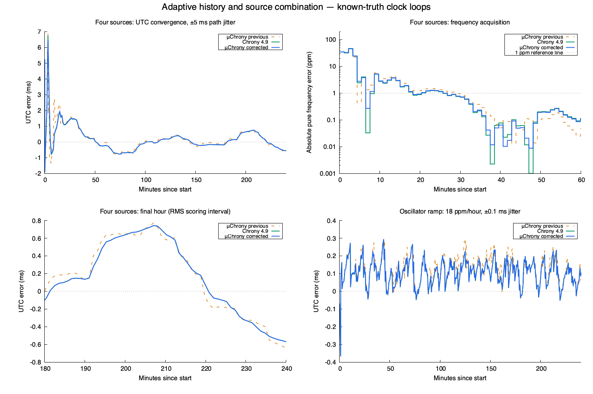
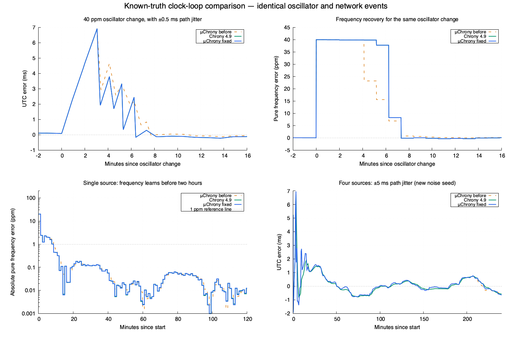

# μChrony clock-control comparison

Current disposition: [NTP work is closed](ntp-work-closeout.md). μChrony is
retained for UTC discipline and future GPS/PPS input; NTP-derived RF calibration
is rejected. The Pico-to-Pi GPIO pulse path is retired. Results below describe
their recorded images and evidence, not current operating instructions.

The complete supported source-to-clock control paths are compared against
unmodified Chrony 4.9 using identical deterministic oscillator ticks, server
timestamps, network delays and loss. Twenty-five four-hour traces have independent
UTC and oscillator truth. The [machine-readable record](microchrony-clock-loop.json)
binds source, reference objects, executables, inputs and generated results.
This is hardware-free validation; no board was loaded, reset, queried or owned.

## Control paths and scoring

The external reference executes SST regression, SRC selection/combination, REF
frequency/phase discipline, LCL clock transformations and the actual SYS_Generic
frequency/slew driver. An original oscillator plant implements the driver's
frequency requests. Its clock feeds later sample timestamps. Scheduler timeouts
execute at their own deadlines between supplied physical events. The reference
never changes an OS clock or opens a network socket. GPL reference objects and
executables remain in ignored private build storage, separate from MIT code and
firmware; no Chrony algorithm source was copied or translated.

The production `microchrony::Engine` receives basic NTP replies through its
request/receive path, fits/combines sources, blends frequency, slews phase and
projects virtual UTC. Its current frequency corrects round-trip measurement and
its current clock participates in the next phase correction. No alternate
estimator or oracle-derived correction is inserted. Neither controller receives
the injected oscillator error. Truth is used only to generate physical events
and score the resulting clock.

Both use the Pico profile: 64-second normal observations, four initial burst
observations, six minimum active fit samples, 64 maximum originals per source,
±100 ppm drift, 50 ppm stability allowance, 1000 ppm maximum update skew,
83333.333 ppm maximum slew and correction-time ratio 3. Server timestamp wire
quantization, timestamp precision and peer dispersion match. Chrony's bounded
reach-loss setting is `maxunreach 0`. μChrony accepts every supplied reply under
its production admission checks. Poll times are externally fixed, permitting
the same physical events in both loops.

The six-sample setting governs retention after pruning; an initial fit can
establish synchronization from three admitted observations.

Chrony's adapter enters at the NTP sample API. Its UDP parsing, authentication,
packet-admission policy, automatic polling and DNS are outside this test.
μChrony assigns its first UTC epoch from a usable fit; the reference plant starts
with the correct epoch and unknown frequency. The shared scenarios test clock
frequency acquisition, subsequent phase control and holdover, rather than RTC
boot acquisition or physical cold-start persistence. No complete Unix daemon,
leap execution, GPS/PPS, hardware timestamp or absolute RF equivalence is claimed.

Reported UTC error is the actual gradually corrected clock minus known UTC.
Pure frequency error includes the injected oscillator rate and excludes phase
slew. Settling means **every later available probe** stays within the stated
threshold through the finite trace; it is not a first favorable crossing or
an indefinite guarantee. Holdover probes remain in accuracy scoring after
synchronization is withdrawn. RMS values below use the final simulated hour.

## Corrections in the portable engine

The adaptive-history and combination rules are independently implemented from
public API observations and the documented [residual-runs behavior](https://chrony-project.org/doc/4.9/chronyc.html#_sourcestats).
Unmodified reference objects provide separate SST, SRC and complete-loop
comparisons; their algorithm source is not copied or translated.

- Residual runs use the balanced-sign null model. Conditioning the threshold
  on an observed sign imbalance had excused persistent drift. Predecessors
  extend a fit's test up to twice its active sample count. Their horizon is
  trimmed before admitting a new observation, using twice the preceding active
  count and an overall 127-point bound. A growing fit cannot resurrect an
  already retired regime. The reported runs count describes the active fit.
- Quantization-limited residuals remain ties. When variance resolves network
  noise above timestamp precision, every residual sign participates in the
  test. A variable-delay predecessor requires an identifiable asymmetry model;
  regression covariance still includes the full fitted asymmetry uncertainty.
- Phase combines sources using inverse synchronization distance. Frequency uses
  inverse frequency variance; controller skew combines the source skew
  variances separately. Phase-controller error includes disagreement about the
  chosen reference and each estimate's signed age at that reference epoch.
  These rules match 274 combinations of exactly identical source estimates
  supplied to the external SRC output boundary and the production combiner.
- Source ranking and the unchanged combination-distance ratio use the measured
  best path plus aging by the source fit's skew. The system's separate 50 ppm
  holdover allowance had excluded a good short-delay peer every time its
  selected neighbor updated. Conservative candidate-distance and agreement
  checks still run before combination; the ratio remains 3.
- The controller's statistical error remains separate from the public frequency
  bound. Max-update-skew still checks the conservative envelope of every
  admitted source around the combined frequency. Public skew also covers the
  displacement of the actual applied rate. Combining statistical errors never
  grants RF authority or reduces those conservative bounds.
- Frequency discipline retains the independently checked three-to-one new/old
  weighting for equally precise fits, with innovation expanding tracking error.
  Repeating an overlapping fit does not manufacture independent evidence.
  Reset and reconfiguration now clear the active and predecessor indices.

Manual PPM, persistence formats, automatic RF authority, the UI, USB installer,
packet admission, distance/jitter limits, timing age/uncertainty, drift, update
skew and RF thresholds are unchanged. The normal application remains heap-free.

The existing 32,768-byte engine limit remains enforced. The host engine occupies
32,552 bytes, versus 30,440 before this fix. Each source still exports 64 complete
original timestamp/wire records. Up to 64 compact predecessor records retain an
exact raw timestamp and signed nanosecond phase relative to an exact anchor;
only their delay uses a float, with rounding uncertainty included in the sign
check. An out-of-range compact phase rebases the predecessor horizon instead of
wrapping. The derived precision field rounds outward to float; original wire
precision and timestamps remain exact. These changes fit the existing resource
limit without changing it.

## Convergence

“Previous” is the pre-fix engine preserved under ignored
`build/microchrony-loop-20261018/adaptive-combination/before/`, with source and
binary hashes in the evidence record. It includes the earlier frequency-loop
corrections. The original primary `devel` engine at
`ed24b31e9c40321c65807a6a35ce49ec09d4c984` remains a separate baseline in the
machine-readable record. Every controller receives the same physical events;
all output rows and input hashes remain in private build storage.

| Scenario | Chrony UTC RMS | μChrony previous | μChrony corrected |
| --- | ---: | ---: | ---: |
| ±0.5 ms path jitter, fixed +20 ppm oscillator | 95.815 µs | 95.816 µs | 95.816 µs |
| Oscillator ramps at 18 ppm/hour, ±0.1 ms jitter | 115.191 µs | 122.938 µs | 115.186 µs |
| Four sources, ±5 ms path jitter | 438.839 µs | 451.189 µs | 438.871 µs |
| Three sources including a 100 ms falseticker | 17.780 µs | 19.625 µs | 17.779 µs |

The four-source RMS gap falls from 12.350 µs to 0.032 µs, or about 0.0074% of
the reference RMS. Its pure frequency settles within 1 ppm at **1544 seconds**
for both controllers, versus 1736 seconds previously. UTC settles within 1 ms
at 2020 seconds for μChrony and 2016 seconds for Chrony. Source consistency is
conditional on the supplied network; this is not independent UTC or RF
qualification.

Nine further four-hour checks use three fresh noise seeds across pool, ramp and
majority cases. Their final-hour RMS differences are all below 0.021 µs, and
pure-frequency settling matches on each trace. Across the original and fresh
pool/ramp/majority cases, RMS agrees within the added 1 µs comparison bound.
Six separate 256-point stationary/ramp histories match every active sample-count
decision against SST. They exercise both pruning and retention beyond 64 points.

For a −20 to +20 ppm oscillator change with ±0.5 ms jitter, both controllers
settle within 1 ms after 380 seconds and within 1 ppm after 440 seconds.
The fixed +20 ppm case with ±0.5 ms jitter settles within 1 ms at 78 seconds
and within 1 ppm at 520 seconds. Frequency correction participates throughout
acquisition. A −80 ppm case with another noise seed takes 4616 seconds to stay
below 1 ppm. Neither controller stays below 1 ppm during the continuing ramp.

The blue corrected and green reference UTC curves nearly overlap. The frequency
panel uses a 0.001 ppm display floor; scoring uses unfloored values. Pure
frequency is separate from phase slew.

## Remaining limits

The deterministic noisy-history and combination discrepancies above are fixed
within the recorded bounds. Bitwise or complete daemon equivalence is not
claimed. Quantization-limited treatment still differs: the noiseless 40 ppm
oscillator change settles within 1 ppm in 376 seconds for μChrony versus
440 seconds for Chrony. A variable-delay queue case retains 21.043 µs RMS
versus 19.656 µs, reflecting the conditional delay model and full joint
covariance. Those conservative rules are retained. Startup selection can also
differ, as the separate selection receipt records.

Both controllers follow a server-only +50 ms phase error and retain about +2 ms
error on a fixed 5 ms forward / 1 ms reverse path. Filtering cannot identify an
unknown common source or path bias. The profile's clock admission and launch
gates, independent RF qualification, physical cold boots and GPS/PPS are outside
this simulated comparison.

The earlier convergence figure requested for engineering documentation is
retained byte-for-byte below. Its “before” baseline is the original `devel`
engine, and its corrected series precedes the adaptive/combination fixes above.

## Validation and reproduction

- Current portable host build and all **117 CTest checks pass**, including
  ten complete Engine loops scored against known truth. The initially missing
  JSON Schema dependency is installed only under this ignored build directory;
  no shared Python installation is changed.
- All 25 four-hour comparative traces complete. Six additional 256-point
  adaptive histories and 274 same-estimate combinations pass their comparisons.
  An eight-case source-statistics
  comparison, 160 existing phase-steering cases and five existing source traces
  still pass their original checks; their retained limits remain explicit.
- Comparing one-second and quarter-second probes over four adverse scenarios
  gives at most 4 ns UTC and 0.000007472 ppm reference frequency difference;
  μChrony's common observations are identical. Simulator probe cadence does
  not control when the reference driver ends a slew. Truncating future input
  preserves all 7317 preceding rows exactly for each controller.
- AddressSanitizer and UndefinedBehaviorSanitizer pass the μChrony unit, ten
  complete-loop and NTP integration tests, including pruned-history reset,
  compact-phase rebase, rate saturation and public-bound checks.
- The normal `WsprryPico` target cross-builds with the pinned existing SDK and
  toolchain. Its image checks pass; no new firmware is loaded. Callback latency,
  physical UTC accuracy, cold boots and RF behavior require separate hardware
  evidence. The older deployed image's receipts do not qualify these changes.

The drivers, comparisons and plotting command are documented in
[the reference harness](../../tests/reference/README.md#complete-clock-control-loops).
Generated reports, binaries and plot data are under ignored
`build/microchrony-loop-20261018/adaptive-combination/`; both engineering figures
above are retained in
`docs/development/figures/`. The tracked record contains artifact hashes and
summaries. Scientific plotting uses installed gnuplot, with a 0.001 ppm display
floor only on the logarithmic panel; scores use unfloored values.
