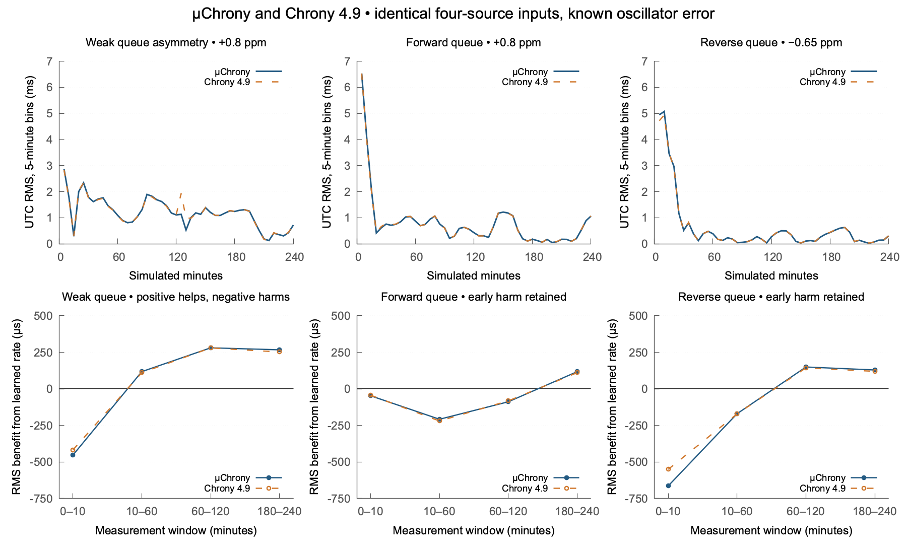

# μChrony packet admission and complete clock-control comparison

Current disposition: [NTP work is closed](ntp-work-closeout.md). μChrony is
retained for UTC discipline and future GPS/PPS input; NTP-derived RF calibration
is rejected. The Pico-to-Pi GPIO pulse path is retired. Results below describe
their recorded images and evidence, not current operating instructions.

The original MIT implementation corrects packet-delay admission, conditional
variance normalization, repeated-server-timestamp handling and a runs-test
rounding boundary. Local-path weighting and sustained asymmetry evidence remain
separate from upstream uncertainty. Public covariance, clock-error, source,
launch and RF bounds remain conservative. Manual PPM remains separate.

The deterministic comparisons pass. The earlier October 19 physical rerun stopped
at 07:02:02 CDT after recurring unexpected GPIO events; its measurement fault
remains unresolved. Retained pulse forecasts and initial RF checkpoints show
mixed phase/frequency effects, not a robust actual-UTC improvement on both boards.
The subsequent [lead-layout comparison](microchrony-lead-layout-results.md)
completed with 319 main pulses per board and no unexpected edges. It retains
mixed correction results and does not establish the electrical root cause.

The comparison has three boundaries: actual offered packets at Chrony 4.9's
NCR admission path; normalized source histories at its SST statistics API; and
complete source-selection/frequency/phase loops driven by known physical clock
error. Agreement at one boundary does not establish complete daemon equivalence.
The [sanitized numerical results](microchrony-conformance-results.json) retain
input, executable, script and private-artifact hashes. The [closeout](ntp-work-closeout.md) records the final scope and disposition.

## Packet admission and adaptive history

The private reference links unmodified external Chrony 4.9 objects. It runs
wire parsing, correlation, validity and delay admission before SST. Original
adapters replace IO, request scheduling, entropy and output sinks. They open no
network sockets and never adjust the host clock. The reference is GPLv2-only;
no upstream code, table, translation or object is included in MIT firmware.

Thirty deterministic offered-input cases cover queues, changing jitter, phase
innovation, startup, processing, era rollover, loss, duplicate responses and
malformed lengths including 47 and 49 bytes. Repeated reference runs reproduce
the same offered transcript. Both implementations receive identical actual
wire bytes and raw send/receive coordinates. Five deliberate stricter Pico
profile differences remain: NTPv2, future reference time, reversed server
processing timestamps, excessive root distance and a zero reference timestamp.
Other acceptance decisions agree in these fixtures. Autonomous polling, receive
expiration policy, extensions and the complete daemon environment are outside
this oracle's scope; loss is an omitted reply between supplied requests.

The delay classifier now compares half the excess round-trip delay with a
phase allowance. That allowance contains normalized conditional residual jitter,
conditional slope skew and the existing 50 ppm oscillator-stability allowance.
A larger phase innovation than the queue can explain reaches the fit and its
unchanged error bounds. Queue classification needs six retained observations;
three can still initialize a source fit. Existing delay/deviation ratios,
distance limits and application/RF thresholds are unchanged. This fixes the
quantities and classifier availability; packet admission behavior does change.
A low-jitter excess-queue negative fixture still rejects the bad response.

A fresh nonce cannot make a repeated server transmit timestamp a new time
observation. Such responses no longer refresh the source. Malformed or
uncorrelated input also cannot overwrite the preceding measurement's verdict.

A 54-observation residual horizon exposed a rounding difference: a 1.645 normal
quantile wrongly pruned a 22-run line. The independently computed two-decimal
1.65 quantile gives a critical count of 21. It matches all 120 reference counts
for horizons 8–127 without copying the upstream table. This is an arithmetic
conformance repair, not a change to the selected significance criterion.

All 898 retained October 18 originals across eight source cohorts now produce
matching active-history counts and asymmetry decisions at the normalized SST
boundary. Maximum slope disagreement is below 0.001 ppb. A's disputed selected
source has 48 active samples and approximately −1.643 ppm in both implementations
at this boundary. The earlier 48-versus-52 comparison mixed statistics with
coupled cooked-clock/control histories; it did not isolate an SST mismatch.

## Known-error convergence and interim corrections



The upper panels show non-overlapping five-minute RMS bins after common first
synchronization. Lower panels compare full control with an offline phase-only
controller: both start with zero learned frequency and receive the same physical
packet events; the latter retains phase damping but cannot learn frequency.
Positive values mean learned frequency reduced UTC RMS; negative values mean it
made RMS worse. These counterfactual settings are never deployed to the Picos.
The unequal labeled windows are categorical comparisons, not a continuous time
axis. The first ten minutes and every adverse window remain in the results.

| Four-source known-error trace | Baseline UTC RMS | Weighting only | Asymmetry/history only | Current μChrony | Chrony 4.9 |
| --- | ---: | ---: | ---: | ---: | ---: |
| Weak queue asymmetry | 1.184851 ms | 1.206144 ms | 0.994917 ms | 0.767711 ms | 0.765845 ms |
| Forward queue | 0.518698 ms | 0.514693 ms | 0.442833 ms | 0.442854 ms | 0.447142 ms |
| Reverse queue | 0.425034 ms | 0.451857 ms | 0.307862 ms | 0.340424 ms | 0.342605 ms |

These are final-hour RMS errors in four-hour simulations. The baseline is
`0a7c05d1c41b7fd261db50a6fa267c4004e0c6e8`. Weighting and asymmetry interact;
neither isolated change improves every trace. The constant-RTT four-source case
remains 0.438871 ms versus Chrony's 0.438839 ms. All 28 complete-loop traces,
held-out seeds, original CI limits, causal prefixes and seven finer-grid traces
retain their checks. The loop reference exercises SST/SRC/REF/LCL/SYS_Generic;
its entry point is after packet admission. The separate packet oracle above
covers that earlier boundary rather than silently claiming the loop does so.

For the three Internet-delay traces, pure frequency remains within 1 ppm after
1,288, 1,096 and 1,224 seconds, respectively, through the finite trace. Final
pure errors are +0.121, +0.432 and +0.237 ppm. These exclude intentional phase
slew. The forward-queue trajectory still exceeds 1 ms near its endpoint; RMS
is not an all-time accuracy guarantee.

| Trace | μChrony RMS gain, 0–10 min | 10–60 min | 60–120 min | 180–240 min |
| --- | ---: | ---: | ---: | ---: |
| +20 ppm, 0.5 ms jitter | +189.6 µs | +744.8 µs | +717.1 µs | +748.9 µs |
| Weak queue | −453.4 µs | +117.7 µs | +280.5 µs | +266.8 µs |
| Forward queue | −47.6 µs | −208.4 µs | −88.6 µs | +117.3 µs |
| Reverse queue | −664.6 µs | −170.3 µs | +149.2 µs | +128.8 µs |

Interim correction helps the large oscillator error early. It does not reliably
help a small oscillator error before two hours under noisy asymmetric Internet
paths. Chrony shows the same adverse-window pattern: its first-ten-minute gains
for the three Internet traces are −417.7, −44.0 and −551.1 µs. A finite noisy
slope can steer away from truth while still meeting statistical acceptance.
Later coalescence helps these traces. No correction is tuned using the injected
truth, RF benchmark or a selected favorable seed, and no gate is relaxed to
force an early improvement claim.

## Captured-subset replay limits

The retained subset still lacks 51 pre-capture A and 67 B originals, plus seven
A and six B later accepts outside the old final history drain. All 196 new A
and 190 new B originals through that campaign's final pulse frontier are visible.
Those counts belong to the October 18 campaign, not a later packet ring baseline.

The previous comparator also applied μChrony's packet-delay classifier to an
already admitted stream while the reference entered SST directly. The captured
adapter now disables that extra classifier only for this statistics-entry
comparison. Production admission remains enabled and is checked separately with
actual offered packets. Matching synthetic RTC initialization does not remove
A's remaining complete-loop difference; it cannot recover missing boot state.

Current cold-subset final corrections remain −0.437 ppm on A and +0.665 ppm on
B, versus Chrony's −0.782 and +0.727 ppm. Coupled selection/control coordinates,
conservative joint covariance and path-identifiability bounds can retain different
histories in the feedback loop despite matching fixed-coordinate SST histories.
Full clock-loop equivalence on the incomplete boot is not established.

The adverse indicated phase result is retained: current replay RMS is 2.266 ms
on A and 5.881 ms on B, versus Chrony's 2.294 and 5.781 ms. The older pre-path-fix
replay was 0.600 and 1.367 ms. Common eligible probes are 320 on A and 308 on B.
These offsets include uncalibrated host/GPIO delay, source bias and cold-subset
initialization. Agreement with Chrony neither proves smaller absolute UTC error
nor erases the older result. B's same twelve selected-source freshness gaps
remain unqualified under the unchanged 90-second application age limit.

## Target image and closed initial measurement

Both Pico 2 W boards received the normal image `89738cad878c-dirty`, UF2 SHA-256
`dc779bbd3a354763a5dce3618ac636a7404eda6d5dd40b3370a69db7753c24fe`.
Full flash backups, application readback and unchanged reserved storage were
verified. A is serial `0BF4B4AEC9FFB344`, boot
`c9d4f5bba4b5353bdd7c05e0a10553a2`; B is serial `CDDBF8767C506C07`, boot
`5e0eae1065aad8d8c5a43588ee9ff8f2`. Both use `pool.ntp.org`, manual 0.000 PPM
in manual mode, `pio-dma-gp2`, nominal 138 MHz and disabled schedules.

The initial finite October 19 run started 05:54:56 CDT and stopped 06:03:22 CDT.
Each board supplied 41 valid pulses. At 06:03:18.536584553 and
06:03:18.536587182, both Pi inputs reported falling-only interrupts, 2.629 µs
apart, outside a commanded pulse. The strict unexpected-event check stopped the
run. All observers and RF guards exited, both boards remained inactive/unowned,
settings/image/boots were unchanged, and GPIO/GPSDO state was independently
verified restored. The run was not extended or restarted.

Both initial two-second RF checkpoints completed. Strict simultaneous-reference
fits measured native oscillator error of +1.5361 to +1.6242 ppm on A and +0.1935
to +0.2817 ppm on B relative to the engine's realized nominal frequency. A's
model changed across its checkpoint, excluding a corrected-frequency claim.
B's stable −0.666 ppm learned correction inferred −0.4725 to −0.3843 ppm UTC
frequency error, worse than its native error. This is a common-clock-domain
inference with ±0.05 Hz line-fit and 10 ppb GPSDO engineering allowances, not
proof that an RF correction was programmed or absolute UTC was qualified.
There were no final RF checkpoints in this stopped run.

The user subsequently confirmed adding another Pi to the same USB/5 V supply
or hub around the event without touching the GPIO connections. A common supply
or ground transient is the leading explanation for simultaneous line disturbance.
No voltage waveform establishes its exact cause. The
[Linux both-edge event path](https://github.com/raspberrypi/linux/blob/rpi-6.18.y/drivers/gpio/gpiolib-cdev.c)
classifies an interrupt using the level read later, so a falling-only record
cannot distinguish a short merged glitch from a spurious interrupt. Historical
undervoltage/throttling flags were present; the kernel's retained undervoltage
messages predate this event and do not timestamp it. The
[documented power bits](https://www.raspberrypi.com/documentation/computers/os.html#get_throttled)
separate historical undervoltage/throttling from a current fault. No sticky
flag is cleared.

A separate 719-second diagnosis completed 23 commanded pulses per board with
zero uncommanded events and no input configuration changes. All 32 retained
diagnosis files, totaling 773,085 bytes, match an independently read remote hash
inventory. The observer and guard exited and restored the input configuration.
This establishes a clean finite interval after the reported supply hotplug;
it does not prove the supply waveform or certify the electrical installation.

The measurement repair adds read-only input-level, RP1 control/pad/status and
power-state context before the existing idle and event checks. Unexpected
events remain fatal to that measurement; no debounce, filtering, edge acceptance
or quality threshold changes. Power sampling every 30 seconds can miss a short
transient. Keeping the shared supply load and wiring steady is an experimental
control, not a claimed electrical modification.

The new bounded rerun starts October 19 at 06:43:05 CDT, stops pulses by
07:38:05 and ends no later than 07:43:05, including final RF/restoration. It uses
the same image and boots, both pool sources, two two-second RF attempts per
board, at most 360 pulses per board and query delta 800. Its terminal results
require actual observer/guard exit, private evidence verification and independent
restoration checks before assessment.

## Offline adversarial assessment

The assessment uses distinct self-review passes, independent arithmetic checks
and the unmodified external reference. It is not represented as a new independent
human or agent review. Recomputed sums of squared known UTC error verify all
56 final-hour controller scores and 32 early/adverse rate-window comparisons.
The arithmetic runs threshold matches all 120 reference horizons from 8 through
127 without publishing or embedding its upstream table.

Review repaired raw-context loss on malformed host power receipts and descriptor
cleanup on exceptions. Seven deterministic probe tests pass. The active capture
keeps its frozen, hash-bound helper; the later defensive failure-path change is
tested offline and is not claimed as deployed. The figure renderer now requires
the exact case inventory, ordered complete bins and finite values; foreign-case,
NaN and missing-bin refusal checks pass. Common dynamic scales retain adverse
values without clipping. The rendered figure was visually checked.

Application binding is recomputed from API-before/INFO/API-after identities,
clock generation, pure and total rate, skew and complete candidate state rather
than trusting a saved `bound` flag. All 18 initial stopped-run triplets pass that
stronger check; a changed checkpoint model still excludes its frequency inference.
All 121 host checks pass after the helper repair. The terminal assessment below
retains the measurement failure rather than treating a clean initial prefix as
a completed run.

## Interim pulse snapshot, 07:00:31 CDT

At the user's request, a read-only copy of complete saved file prefixes was
analyzed while the logger continued. No USB/GPIO endpoint was opened, remote
file changed or process signalled. This is an interim prefix, not terminal
campaign evidence. The [sanitized results](microchrony-conformance-interim-pulses.json)
bind the original prefix and snapshot manifest by SHA-256.

The prefix contains 94 pulses per board from 06:44:52 through approximately
07:00:22. All 376 physical edges have consecutive global and per-line sequences;
957 saved idle/context observations contain no unexpected event or active
power fault. A has 94 clock-qualified pulses. B has 90; four holdover pulses
at ticks 60–63 remain unqualified. Independent API-before/INFO/API-after checks
bind 31 of 32 saved triplets; the remaining B triplet is the expected holdover
observation and was already marked unbound.

| Indicated UTC phase, Pico minus host GPS/PPS reference | A | B |
| --- | ---: | ---: |
| First qualified edge | −2.499 ms | −2.152 ms |
| Last qualified edge | −2.815 ms | −1.874 ms |
| Qualified-prefix RMS | 2.626 ms | 2.033 ms |

These are measured differences along an uncalibrated host/GPIO timestamp path.
Their changes include phase damping and intervening NTP updates; they cannot
alone identify learned-frequency benefit. The causal comparisons instead start
each forecast at the same measured phase, preserve its scheduled finite slew,
and stop at a held-out edge before a model/generation/source change. The controls
use either zero learned frequency or the frequency frozen at this capture's
first edge: −1,937 ppb on A and +49 ppb on B.

With the 1 ms plus recorded root-distance engineering allowance, A's learned
frequency worsens all 79 eligible adjacent, approximately ten-second forecasts
against zero learned frequency. The bounded loss is 11.0–28.5 µs per forecast.
B's 76 eligible adjacent comparisons are all unresolved. At longer horizons
through sixty seconds, B has 94 improved and 155 unresolved comparisons against
zero frequency, with none worsened; A has 255 worsened and none improved or
unresolved. These longer comparisons overlap and are not independent trials.
Changes since the initial frozen frequency are unresolved in every adjacent
comparison for both boards. Over all horizons that control gives A 1 improved,
14 worsened and 240 unresolved comparisons, and B 74 improved and 175 unresolved.

Increasing the engineering allowance to 5 ms plus root distance makes every
comparison unresolved on both boards. Thus the current prefix does not establish
a robust actual-UTC improvement. A's negative learned rate can worsen immediate
phase while the clock is already behind; that observation does not establish
its independent oscillator-frequency error. B's longer-horizon benefit is
conditional on the narrower, uncertified timestamp-path allowance. Final RF
checkpoints remain necessary for a separate physical frequency assessment.
Independent rational piecewise projections and 65-position reference enclosure
checks pass all 2,016 treatment/allowance combinations without calling the scoring
helper; the existing known-error arithmetic tests also remain passing. No gate
or correction is changed in response to this prefix.

## Terminal rerun outcome

The logger's unchanged unexpected-event check stopped the run at **07:02:02 CDT**.
At 07:01:55.608202 through 07:01:59.825495, GPIO22 reported ten and GPIO23 fourteen
uncommanded falling-only events. The first pair is 2.648 µs apart. These are
separate failure evidence, not valid pulses, and are neither filtered nor
reordered into the measurement series. The audit retains unchanged input
control/pad registers and sampled idle-low levels. Its latest power receipt was
20 seconds old and had no current fault bits; the historical `0x50000` flags
remain unchanged. This cannot exclude a short electrical transient or establish
a kernel/interrupt cause. **The measurement fault is unresolved.** The earlier
shared-supply hotplug is a clue, not an established repair or cause. The operator
confirmed that no power or connection changes occurred around the second burst
at 07:01:55. Another deliberate hotplug therefore does not explain the recurrence;
spontaneous electrical disturbance and GPIO interrupt/event reporting remain
unseparated possibilities.

Before the fault, 103 commanded pulses per board produced 412 consecutive
physical events. All A pulses and 99 B pulses satisfy clock-binding checks;
the same four B holdover records remain excluded. Across all retained API
triplets, 39 of 40 independently bind; the unbound triplet is the expected B
holdover observation. A's indicated phase runs from −2.499 to −2.839 ms, with
2.644 ms RMS; B's runs from −2.152 to −1.917 ms, with 2.021 ms RMS over qualified
records. The timestamp-path allowance remains uncertified.

With the 1 ms plus root-distance allowance, A's 87 eligible adjacent forecasts
all worsen against zero learned frequency; B's 84 remain unresolved. Longer
overlapping horizons give A 282 worsened comparisons, and B 94 improved plus
185 unresolved. Against the frequency frozen at this capture's first pulse,
every adjacent comparison remains unresolved. At 5 ms, every comparison on
both boards is unresolved. These conditional short forecasts do not show a
robust actual-UTC improvement or simulate a complete alternative controller.

Both initial RF checkpoints completed before pulse collection. Their exact
API/INFO/API triplets bind and their models remain stable through the tone.
Strict contrast, amplitude, phase-residual and half-window fit checks pass for
the target and both simultaneous reference lines. GPSDO/reference and receiver
cleanup checks also pass.

| Initial checkpoint | Native oscillator error | Pure UTC correction | Inferred corrected UTC-frequency error | Frequency verdict |
| --- | ---: | ---: | ---: | --- |
| A | +1.4832…+1.5714 ppm | −1.913 ppm | −0.4298…−0.3416 ppm | Improved |
| B | +0.1961…+0.2842 ppm | +0.065 ppm | +0.2611…+0.3492 ppm | Worsened |

The interval assumptions remain ±0.05 Hz per fitted line and 10 ppb GPSDO error
with an affine receiver frequency axis. These are engineering allowances, not
traceable calibration. RF remained in manual mode with zero correction: the
table infers UTC frequency from the independently measured common oscillator,
not a change applied to the physical RF carrier. Improving frequency and
improving immediate UTC phase are different outcomes: A was already behind
the reference, so a negative frequency term can improve oscillator rate while
worsening its short-term phase. There is **no final RF checkpoint**, so this
table cannot establish the final frequency error or its evolution.

Every recorded observer, RF worker and independent guard actually exited.
Under subsequently acquired canonical locks, read-only checks verified both
original boots and revision, unchanged saved settings/manual PPM, pool sources,
disabled schedules, inactive output and no ownership. Both clocks were
synchronized with sample ages 16.7 and 21.8 seconds. GPIO22/23 returned to their
saved unused/no-pull state; GPS HAT PPS on GPIO17 was unchanged. The GPSDO was
locked and restored to 10 MHz with both outputs and PPS off. The monitor is
paused; the closed run is not restarted or extended.

All 982 private files, totaling 68,592,639 bytes, match the terminal manifest
SHA-256 `cba8398d68c2f5edab622919d84d76c9e791cc3ca241db1f16d344a40896b0c7`.
The current transactional packet validator accepts 100 retained offered records
per board: 96 admitted and four rejected each, with explicit initial overwrites
of 186 A and 185 B offers and no later gap. Every retained admitted offer matches
an exact retained original request/receive pair and server timestamps. Accepted
histories contain 268 A and 267 B originals across immutable source cohorts;
pre-capture deficits remain eight and twelve. Failure prevented the final
accepted-original frontier: no complete boot or cleanup-frontier visibility is
claimed. The [sanitized physical record](microchrony-conformance-physical-results.json)
contains counts, source hashes, fit bounds and restoration outcomes; raw captures,
credentials and failure receipts remain private.

Software conformance and the completed prefixes remain usable within these
limits. A successful full physical comparison and an electrical root-cause
repair are not established. Physical diagnosis must distinguish real line/supply
disturbance from RP1 event reporting before another timing qualification; hiding
unexpected events or relaxing a gate would not resolve that blocker.

The terminal adversarial reassessment independently checks prefix preservation,
fractional phase midpoints/RMS, API bindings, strict RF fits and opposite rate
verdicts, context/configuration invariants and actual restoration. No further
actionable software finding remains after the documented repairs; the physical
measurement blocker remains open. All 121 host checks pass again against the
final source state. Owned C/C++ formatting, changed main-file hunks, local
Markdown links, JSON parsing, confidentiality checks and diff whitespace checks
pass. Existing unrelated installer formatting and concurrent commits are retained.

## Reproduction and evidence boundaries

The [reference guide](../../tests/reference/README.md) supplies build and
comparison commands. Private upstream source, GPL executables, exact offered
transcripts, captures, flash backups and credentials stay in ignored build
storage. A bounded 32-record USB offered-packet ring retains the first 48 bytes,
actual length, immutable event/source identities, request and receive times,
verdicts and explicit overwrite/truncation deficits. Four records fit each
4,096-byte page. Unknown-address/port UDP drops remain outside this association
audit. The transactional validator is tested against the actual C++ producer;
observation times must bound record times and never regress.

The new image cross-build passes the linked flash/journal, heap-hook and stack
checks. The μChrony engine is 32,616 bytes within its unchanged 32 KiB ceiling.
The linked application ends at `0x102577f0`; `0x103ee000` is the configured FLASH
region boundary, not the application end. Host results and cross-linking do not
qualify physical timing, wiring or RF.

Regenerate the bounded public summary and figure from retained suite artifacts:

```sh
python3 tests/reference/summarize_chrony49_conformance.py \
  build/microchrony-conformance-20261019 \
  docs/development/microchrony-conformance-results.json
python3 scripts/plot_microchrony_conformance.py \
  docs/development/microchrony-conformance-results.json \
  docs/development/figures/microchrony-conformance.png
```

The figure command needs an installed `gnuplot`; it does not install dependencies.
Its source is the published sanitized summary. It contains no private capture.
