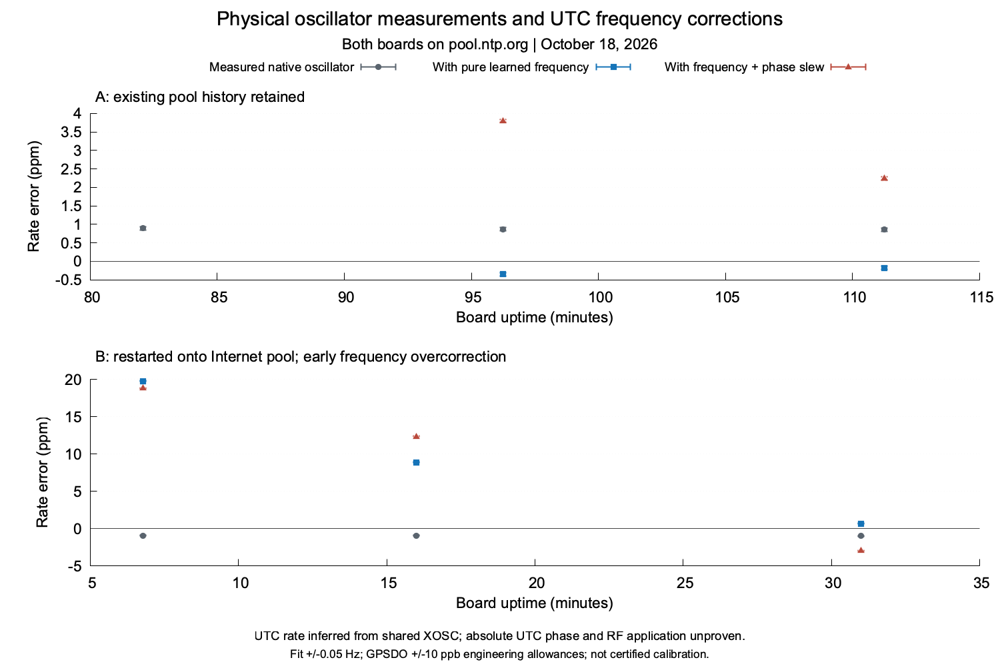

# Independent Internet NTP clock measurements

Independent physical RF measurements resolve oscillator frequency error on both
boards. Applying each measured oscillator error to the contemporaneous UTC
clock mapping distinguishes a useful learned frequency correction from a
statistical uncertainty estimate. Absolute UTC phase remains unresolved with
the current USB measurement path. No NTP-derived RF correction was applied.

At the final checkpoint, A's learned frequency component reduced the inferred
rate-error magnitude from about 0.86 to 0.17 ppm; B improved from about 0.97
to 0.65 ppm. B's earlier estimates substantially overcorrected before
narrowing. This establishes an instantaneous frequency benefit at the final
measurements, with the reference assumptions below; it does not establish a
uniform benefit throughout startup or smaller absolute UTC phase error.

## Physical measurement and clock binding

The RF measurements below used normal Pico 2 W firmware `0.0.0-devel`, source
`46c4a9e5a4a64912caed1c20ceb3399b4aa5b53d`, normal UF2 SHA-256
`416da27b8bba8a05516948d9441b65b4f597b55d16880289f048488769fec851`,
`pio-dma-gp2` at nominal 138 MHz. A is USB `0BF4B4AEC9FFB344`, device
`fd6127d11d6aca42a9905fa3fb1bf1d5`; B is USB `CDDBF8767C506C07`, device
`29f20b7342051ef947aa56cb9d4fab42`. The source image is unchanged from the
[earlier crossover](microchrony-live-comparison.md).

Both boards use `pool.ntp.org`. B changed from `time.local` with a saved-setting
readback and software restart at approximately 14:38:37 CDT on October 18,
2026. A retained its existing pool association and older history. Checkpoint
labels refer to elapsed time after B's restart; they are not A's boot age.
Other saved settings, manual `0.000` PPM, disabled schedules and all production
quality gates remained unchanged. Boards were unowned/inactive between the
finite two-second tone jobs.

The user-confirmed conducted path combines A, B and GPSDO, each with nominal
60 dB attenuation, into RSP1B `2404058C60` on wspr5. The LBE-1421 GPSDO
`0673ED0FA107` had satellite/PLL lock and antenna OK. Its temporary 40 kHz
Output 1 supplies simultaneous harmonics at 3.56 and 3.64 MHz, bracketing a
Pico tone requested at 3.5701 MHz. Two references identify both receiver
frequency offset and sample-rate scale in the same coherent IQ interval.
No single-line offset subtraction or unverified SDR TCXO specification is
used as a complete calibration.

Recordings use CF32 at 250 kS/s, center 3.55 MHz, 200 kHz bandwidth, gain 20,
channel 0, AGC and bias tee off. Complete sample hashes, exact settings,
receiver identity, zero overflow/clipping and verified receiver cleanup are
checked. Fits exclude 0.3 seconds at either tone edge. Every included line
retains contrast >=30 dB, phase residual RMS <0.15 rad and minimum/median
amplitude >=0.5. A half-window frequency difference above 0.1 Hz refuses the
measurement. The 3.48 MHz harmonic failed the phase criterion and is excluded.

Displayed intervals propagate explicit +/-0.05 Hz line-fit and +/-10 ppb
GPSDO engineering allowances with exact rational interval arithmetic. The
allowances, receiver-axis linearity and reference harmonic identification
have not been independently certified; these are conditional engineering
measurement intervals, not traceable absolute calibration certificates.
Only this frequency and conducted setup were measured.

The accepted NCO realization is 3,570,100.004319102 Hz at nominal clock rate.
The raw oscillator error uses this realized value rather than the requested
frequency. Firmware register checks bind RF SYS/PLL and the raw TIMER0
reference to the same XOSC. This establishes clock topology, not its absolute
frequency; the simultaneous GPSDO reference supplies that measurement.

For measured raw error r in ppm and UTC rate u in ppb:

```text
UTC frequency error (ppm) = r * (1 + u / 1,000,000,000) + u / 1,000
```

API-before / INFO / API-after snapshots bind board boot, source revision,
active SNTP arbiter, source disagreement, clock generation and estimator
generation. The 15/30-minute tones additionally contain running GET_CLOCK
snapshots, matched to the actual tone's raw interval. UTC/raw finite
differences must agree with the reported applied rate using a conservative
2 microsecond endpoint-difference allowance. The pure learned frequency
component is separated from intentional phase slew. An initial A measurement
spanned a model update and is excluded from correction-benefit verdicts.

A frozen-phase comparison removes only the learned frequency component from
the current mapping while keeping its current phase-slew rate. It measures
instantaneous incremental frequency effect. It is not a causal replay of a
phase-only controller's entire prior history or proof of smaller UTC epoch
error. Phase slew can deliberately increase instantaneous frequency error
while removing a phase offset.

## Absolute UTC phase and available wiring

wspr5 selects its GPS HAT PPS, stratum 1 with normal leap and fresh kernel
assertions. The host's Chrony root-distance estimate is combined with an
explicit 1 ms HAT/host allowance for USB UTC interval calculations. This
allowance is not an independently calibrated host-to-UTC guarantee.

The strict read-only USB meter brackets a Pico GET_CLOCK snapshot between
host send and the first byte of its one fully validated matching response.
CRC, exact framing, session identity and absence of preceding event bytes
are checked; no half-RTT or symmetric-path assumption is made. The best
brackets remain about 15 ms. Early B metrology used time.local and must not
be described as an Internet-source UTC accuracy result. PPS was not
identifiable through the existing conducted RF path in HF, LF or explicitly
enabled Output 1 reference-only recordings. Those failures remain private;
no detection gate was relaxed.

The manufacturer's [USB NMEA/DCD PPS capability](https://www.leobodnar.com/shop/index.php?main_page=product_info&products_id=399)
provides another reference at the host. It does not timestamp the Pico's
clock or remove the Pico USB transfer uncertainty.

An additional Pi-to-Pico connection can support the opposite signal direction:
a measurement-only, timestamped pulse from each Pico to a separate Pi input.
The [Linux GPIO event API](https://docs.kernel.org/userspace-api/gpio/gpio-v2-line-event-read.html)
timestamps input edges in the kernel, avoiding userspace read-arrival time.
The firmware brackets the physical GPIO edge with raw timer readings,
records the UTC mapping/model generation and sends the record over USB later.
Neither Pico consumes GPS time or uses these pulses to synchronize.
Pulse-generation bracketing, Pi interrupt/timestamp delay, reference error,
missing-event sequence detection and electrical identity must be included
before claiming an absolute UTC error. No nanosecond claim follows from a
nanosecond timestamp field.

The measurement connections use Pico GP22 (physical
29) to Pi GPIO22 (physical 15) for A and Pi GPIO23 (physical 16) for B, plus
Pico GND (physical 28) to Pi GND for each. Live inspection identified an Adafruit Ultimate GPS HAT, UART0 on GPIO14/15,
PPS on GPIO17 (physical 11), and GPSD using /dev/ttyAMA0 and /dev/pps-gps.
Chrony selected PPS. GPIO22/23 had no consumer and remained inputs; GP22
was absent from both Pico active role plans. Pin
numbers follow the [Pico 2 W datasheet](https://datasheets.raspberrypi.com/picow/pico-2-w-datasheet.pdf)
and [Pi header documentation](https://www.raspberrypi.com/documentation/computers/raspberry-pi.html#gpio-and-the-40-pin-header).
The [USB clock pulse instrumentation](clock-pulse-probe.md) is implemented
and loaded in the normal firmware on both boards. It does not assign a saved
GPIO role or emit pulses automatically. Both direct output paths passed three
synchronized pulse checks, with 5–6 microsecond physical edge brackets and no
crossed or duplicate edges. Earlier passive-check failures are retained;
the direct checker accounts for the RP2350 A2 input-leakage workaround.
The instrumented normal image, final boot/settings receipts and exact wiring
results are recorded in that engineering document. Physical routing and
clock-model binding are established. Host timestamp delay, independent UTC
error and a causal rate-benefit time series remain unqualified.

## Evidence and reproduction

Private captures, raw wire records, settings, guard/restoration receipts and
source backups remain under ignored `build/microchrony-independent-20261018/`
and `/home/pi/microchrony-independent-20261018` on wspr5. They are not in Git.
The original shared A/B recording contains a complete A tone and a truncated
B attempt. Only complete A is used; B was measured in a separate recording.
All later measurements use one board per receiver capture. Failed PPS
reference recordings and the early framing-validation failure are retained.

Offline `analyze_epochs.py` in that private evidence directory validates
original hashes and receipts, retains unchanged fit gates and writes
`epoch-results.json`. The maintained [arithmetic module](../../src/rf_analysis/clock_measurement.py)
contains no device access or firmware policy changes.
[Known-error tests](../../tests/clock_measurement_tests.py) cover asymmetric
USB delay, clock discontinuities, correlated reference errors, a known SDR
offset/scale plant, uncertainty and physical overcorrection.

## Frequency results

Raw error is physically measured; corrected UTC rate errors are inferred through the verified common clock topology. Positive is fast. All values below are ppm. Intervals use the stated engineering allowances.

| Board | Uptime (min) | Native oscillator error | Learned correction | Residual with pure frequency | Finding |
|---|---:|---:|---:|---:|---|
| A | 82.1 | [+0.852, +0.941] | -1.924 | excluded: model changed | excluded_model_transition |
| B | 6.8 | [-0.992, -0.903] | +20.748 | [+19.756, +19.844] | worsened |
| A | 96.3 | [+0.826, +0.915] | -1.219 | [-0.393, -0.304] | improved |
| B | 16.0 | [-1.008, -0.919] | +9.868 | [+8.860, +8.949] | worsened |
| A | 111.3 | [+0.817, +0.905] | -1.035 | [-0.218, -0.130] | improved |
| B | 31.0 | [-1.011, -0.923] | +1.615 | [+0.604, +0.692] | improved |



Only the gray series is directly measured RF oscillator error. Blue adds the reported pure frequency correction; red adds the full mapping, including phase slew. The graph does not show measured UTC epoch error or corrected RF output. A retained an older pool history; B restarted onto its new Internet source, so their uptimes and starting histories differ.

| Board | Checkpoint | Full UTC rate residual | Frozen-phase residual without learned frequency | Incremental frequency effect |
|---|---|---:|---:|---|
| A | 15min | [+3.755, +3.844] | [+4.974, +5.063] | improved |
| B | 15min | [+12.313, +12.402] | [+2.445, +2.534] | worsened |
| A | 30min | [+2.204, +2.292] | [+3.239, +3.327] | improved |
| B | 30min | [-2.983, -2.895] | [-4.598, -4.510] | improved |

The frozen-phase columns isolate the instantaneous rate contribution while retaining the actual phase-slew term. They do not predict the phase-only controller trajectory or establish reduced absolute UTC error.

## Final USB UTC bounds and restoration

| Board | Shortest USB bracket | Conditional UTC error interval | Fresh NTP age at final readback |
|---|---:|---:|---:|
| A | 16.194 ms | [-9.736, +8.507] ms | 43.803 s |
| B | 17.888 ms | [-4.938, +14.999] ms | 35.797 s |

These intervals include the 1.024 ms host-reference engineering allowance. They cannot resolve the microsecond-scale improvement expected from a small learned rate over one poll interval. No midpoint estimate is substituted for independent UTC truth.

Both boards finished on pool.ntp.org, inactive and unowned, with schedules disabled, unchanged firmware/boots and manual 0.000 PPM. B retains the explicitly requested Internet source. GPSDO frequency, drive, PPS flag and both disabled-output settings were restored after each capture. All four later worker/guard pairs completed without deadline intervention. No service, shared tool, other harness source or concurrent UI/installer file was changed.

The finite rate-check runner completed at 15:09:57 CDT with all guards exited. The final evidence audit records 219,499,405 bytes, below the 256 MiB cap. The run was not restarted or extended. Separate initial reference/metrology checks and their failures are retained in the same private evidence root. The [sanitized derived record](microchrony-independent-measurement.json) contains line fits, capture hashes, generation bindings and arithmetic results.

## Validation and limits

Nine deterministic known-error cases pass in independent_clock_measurement. The affected microchrony and microchrony_clock_loop checks also pass. Exact arithmetic bounds preserve the existing firmware quality gates; the production clock loop and RF policy were not changed.

Actual RF frequency error is measured at one conducted 80 m tone. Useful or harmful learned UTC frequency estimates can be identified against that physical oscillator reference. Absolute UTC phase, a complete causal phase-only holdout, certified reference uncertainty and application of NTP-derived RF correction remain unqualified. The current normal firmware's direct Pico-to-Pi pulse path passes physical routing and clock-model binding checks on both boards; absolute timestamp delay and rate-benefit qualification remain open.
