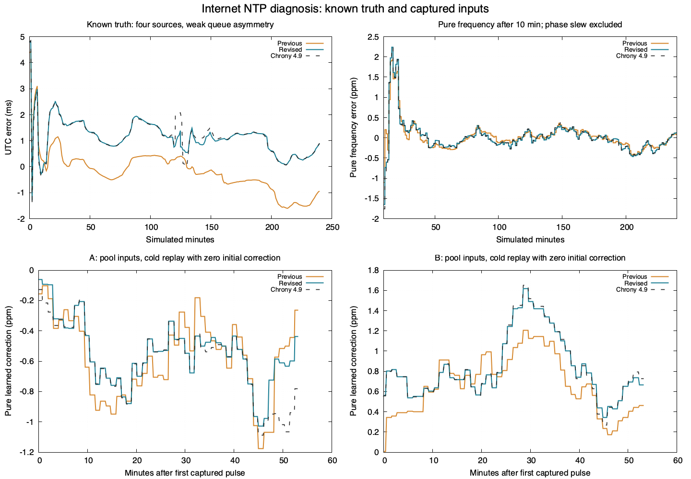

# Internet NTP: path weighting and selected-source freshness

This is the October 18 investigation record. The subsequent
[packet and clock-loop conformance results](microchrony-conformance-results.md)
correct the comparison boundary, resolve the fixed-coordinate source-history
discrepancies and record later firmware deployment and physical measurements.
The measurements and exclusions below remain historical results.

The offline investigation found two source-fit differences that affected
Internet-delay behavior: frequency weights included upstream server uncertainty,
and weak delay/phase correlations immediately changed the fitted clock. The
original MIT implementation now separates local packet-delay weights from root
uncertainty and requires sustained evidence before applying a delay-asymmetry
correction. No Chrony code is copied, translated or linked into firmware.

Known-error tests improve, and the retained A/B frequency replays track Chrony
4.9 more closely. **The captured-pulse UTC offsets get worse in both the revised
engine and Chrony.** Reference conformity therefore does not establish better
absolute UTC. A still has a material frequency difference from Chrony. B's
freshness gaps reproduce in both controllers on the same admitted stream.

The [machine-readable results](microchrony-internet-diagnosis.json) bind sources,
reference objects, executables, inputs and private receipts. The normal firmware
cross-build succeeds, but it has not been loaded. No board, USB endpoint, GPIO,
receiver, network service or RF job was accessed during this investigation.

## Changes in the clock loop

Sample weights now use peer delay and peer dispersion. The scale comes from
the median-to-minimum peer-distance spread, divided by 0.7 and bounded by
timestamp precision and minimum peer distance. Excess distance increases the
relative standard deviation; its square determines the inverse variance weight.
The weights remain fixed while selecting that update's active history. Remote
root delay and dispersion still participate in source selection, agreement,
clock-error bounds and every existing gate; they no longer conceal variation
on the client's own network path.

An independent partial regression removes the time trend before estimating
the delay/phase relationship. It uses the causal active/predecessor horizon,
requires identifiable time/delay excitation, and counts strong coefficients
of magnitude at least 0.45 within a same-sign run. Ten such observations enable
the correction, bounded to ±0.5. An unidentifiable fit or sign reversal clears
that evidence. The learned coefficient stays fixed while testing candidate
frequency histories. This replaces immediate adjustment for every small
correlation. Reset and reconfiguration clear the evidence counter.

The existing identifiable-delay condition and full joint covariance remain.
Withholding a weak correction does not prove it is zero: public skew and root
dispersion also cover displacement toward the identifiable alternative fit.
The existing correlated-delay coverage test remains intact and passes. Public
uncertainty is deliberately more conservative than Chrony's in some cases;
neither statistical combination nor a smaller point error grants RF authority.

The balanced-sign runs threshold, source agreement/combination limits, packet
delay/deviation/distance/jitter checks, maximum drift/update skew, 90-second
freshness, 500 ms launch uncertainty, RF qualification and manual-PPM handling
are unchanged. Compact-history and original-observation capacities are unchanged.
The engine remains within its 32 KiB static limit. The Arm compiler reports
a 1,104-byte static frame for `Engine::fit`; this is not a complete call-stack
or worst-case execution-time qualification.

## Convergence with independently known error

Three new four-hour traces supply four sources with identical physical raw
ticks, server timestamps, 20 ms base round-trip delay, up to 20 ms added queue
delay and ±5 ms deterministic path jitter. The injected oscillator error is
+0.8 ppm for weak/forward queues and −0.65 ppm for reverse queues. Neither
controller receives that error as a correction. Both start with zero learned
frequency. The reference executes unmodified SST/SRC/REF/LCL/SYS_Generic objects;
the firmware engine runs its production request/receive and virtual-clock path.

| Known-truth trace | Previous μChrony UTC RMS | Revised μChrony UTC RMS | Chrony 4.9 UTC RMS |
| --- | ---: | ---: | ---: |
| Weak queue asymmetry; 70% forward, 30% reverse | 1,184.85 µs | 768.40 µs | 765.85 µs |
| Entire queue forward | 518.70 µs | 442.85 µs | 447.14 µs |
| Entire queue reverse | 425.03 µs | 340.42 µs | 342.60 µs |

RMS describes the final simulated hour. Revised pure frequency stays within
1 ppm after 1,288, 1,096 and 1,224 seconds respectively, through the finite
trace. Final pure rate errors, including the injected oscillator and excluding
phase slew, are +0.121, +0.432 and +0.237 ppm. Last-hour maximum UTC errors are
1.323, 1.148 and 0.658 ms. The forward-queue trace does not remain within 1 ms
through its endpoint; low RMS is not an all-time accuracy guarantee.
The upper-right figure panel omits the first ten minutes to make the remaining
rate error visible; calculations retain the complete acquisition trajectory.

All original 25 complete-loop traces retain their checks. The original
four-source constant-RTT case remains 438.871 µs versus Chrony's 438.839 µs.
The new variable-delay cases exercise behavior that constant-RTT jitter cannot
distinguish. The original ten CI cases keep every existing acceptance limit;
three further CI cases protect these variable-delay results.

Exploratory lower-jitter forward/reverse queue traces were rejected by the
unchanged production delay-deviation gate in both engine versions at 711.04
seconds. They remain private excluded experiments. They cannot be used for
an admitted-stream SST comparison, and the gate was not
disabled to make that comparison pass. The reported synthetic cases are not an
exhaustive packet-admission comparison with the Chrony daemon.

## Retained A/B inputs

The pooled replay uses all 898 retained originals, preserving board, slot,
endpoint, epoch and record identity. It checks each input's archive-manifest
hash and the completed campaign's own capture baseline. All 196 new A and 190
new B originals through the final pulse frontiers are visible. The 51 A and
67 B missing pre-capture inputs remain explicitly missing. The seven A and six
B later accepts outside the history drain remain outside this replay's coverage.

Both engines receive identical raw send/receive and server timestamps, wire
quality fields, source slots and physical-pulse probe times. They start with
zero frequency correction and a common translated UTC coordinate origin. This
is a **cold replay of the retained subset**, not a recreation of either live
boot, persisted seed or earlier estimator state. Chrony's initial RTC and the
microcontroller's first epoch assignment still differ. The reference enters
after NTP packet admission; rejected packet contents are unavailable.

| Board | Previous final pure correction | Revised final pure correction | Chrony final pure correction | RMS frequency difference from Chrony, previous → revised |
| --- | ---: | ---: | ---: | ---: |
| A | −0.265 ppm | −0.437 ppm | −0.782 ppm | 0.1942 → 0.1266 ppm |
| B | +0.463 ppm | +0.665 ppm | +0.727 ppm | 0.2576 → 0.0233 ppm |

The RMS differences fall by about 35% and 91%. These measure agreement with
Chrony, not true frequency error. A's later physical RF checkpoint suggested
an ideal UTC correction near −0.84 ppm, but its seven uncaptured later inputs
and the incomplete earlier history preclude reconstructing that checkpoint's
controller state. Revised A is still about 0.345 ppm from the reference replay.
Remaining history, learned-asymmetry and conservative covariance differences
are explicit; full Chrony equivalence is not established.

The final selected-source update on A localizes the remaining difference:

| Source slot | Revised fit, ppm | Chrony raw-coordinate fit, ppm | Active samples, revised / Chrony |
| --- | ---: | ---: | ---: |
| 0 | −3.051 | −3.051 | 31 / 31 |
| 1 | +0.231 | +0.231 | 64 / 64 |
| 2, selected | −1.643 | −2.378 | 48 / 52 |
| 3 | +0.187 | +0.187 | 64 / 64 |

Slot 2 still withholds its path correction; the reference retains a previously
enabled coefficient whose current magnitude is 0.108. Learned-asymmetry/history
decisions therefore remain different on this input. Joint covariance also
changes frequency weights. Reconstructing the inverse-variance center gives
approximately −0.382 ppm for the revision and −0.731 ppm for the reference;
the controller blends these with its previous estimate to produce −0.437 and
−0.782 ppm. The separate same-estimate combiner and frequency-controller checks
pass. A small point estimate is therefore not evidence of a sign error or
failure to apply the reported rate. No correction is forced toward the RF
benchmark, and no existing identifiability or uncertainty condition is relaxed.

## Captured-pulse phase tradeoff

The same virtual clocks are also projected to the retained physical pulse
times and compared with the GPS/PPS host's GPIO timestamps. Common probes must
pass synchronization, the unchanged 90-second age and 500 ms clock-error limits
in all three replays: 320 on A and 308 on B.

| Board | Previous indicated UTC RMS | Revised indicated UTC RMS | Chrony indicated UTC RMS |
| --- | ---: | ---: | ---: |
| A | 0.600 ms | 2.258 ms | 2.294 ms |
| B | 1.367 ms | 5.881 ms | 5.781 ms |

This is an adverse result and is not discarded. Revised indicated offsets range
from −3.426 to −1.462 ms on A and −7.754 to −3.699 ms on B. These numbers include
uncalibrated host/GPIO delay, path asymmetry, epoch acquisition and the effects
of incomplete initial history. They are midpoint diagnostics, not certified
absolute UTC measurements or proof that new firmware application would produce
those exact offsets. The recorded campaign's live measurements remain in the
[original report](microchrony-pulse-rate-rerun.md); the replay does not replace
them. Neither better reference conformity nor narrower uncertainty proves that
interim corrections reduce actual UTC or RF error.

## B's freshness gaps

All three replays reproduce the same 12 stale pulse positions: 25–28, 45–48
and 193–196. Retained live INFO shows selected slot 3 advancing its query and
rejection counters without a new accepted observation at each gap. Two sampled
transitions preserve `delay_deviation` explicitly; the first rejection's reason
was overwritten before the sampled status. A combined slot-0 peer is accepted
during one gap without advancing the system update counter.

Chrony 4.9's selected-source rule also withholds a reference update when the
selected source has no new observation. A response from another combined peer
therefore cannot silently rejuvenate the model's evidence. With 64-second normal
polling, one rejected selected-source response can leave about 129 seconds
between admitted selected observations. The application correctly enters
holdover after 90 seconds. The external reference is evaluated against the same
90-second application limit; this is not a claim that the Unix daemon has that
Pico-specific limit.

No update-policy defect was demonstrated here, so polling, selection, packet
admission and freshness policy stay unchanged. The new integration regression
rejects a queued selected-peer packet, admits a combined-peer response, checks
that model generation/evidence age stay unchanged, verifies holdover immediately
after 90 seconds, and then verifies recovery on a new selected observation.
The missing rejected wire packets prevent deciding whether Chrony's separate
UDP admission path would have made the same rejection decisions.

## Validation and repository state

The existing and new deterministic engine/application tests pass. Reference
checks cover eight statistics streams, six 256-point adaptive histories,
274 same-estimate combinations, 80 frequency updates and 28 complete-loop
traces. Seven traces also run on a 0.25-second probe grid. Shared grid points
agree within the existing 1 µs/0.001 ppm limits, and causal-prefix and known-bias
checks pass. The new upstream-weight-invariance/weak-correlation regression
group fails against the preserved previous implementation and passes with the fix.

The wider host run passes 118 checks with the installed Xcode environment.
Two schema checks require `jsonschema`, which is absent from the local Python
environment; they are excluded from that run. No package is installed as part
of this investigation. The initial broad run's two compiler-subprocess failures
clear when the existing `scripts/xcode_env.sh` environment is inherited.

The normal `WsprryPico` cross-build passes with retained pinned dependencies,
including linked memory/journal, heap-hook and stack-guard checks. Cross-linking
is not device timing, wiring, RF or application qualification. Private evidence,
reference GPL executables, logs and firmware remain under ignored
`build/microchrony-diagnosis-20261018/`.

The working branch remains primary `devel` at
`0a7c05d1c41b7fd261db50a6fa267c4004e0c6e8`, with uncommitted changes. Concurrent
README, USB-installer and pulse-instrumentation work is preserved. Nothing is
staged, committed, pushed or published; hardware testing and the completed
campaign's heartbeat remain paused.

Reproduction commands and the external-reference boundary are in the
[reference guide](../../tests/reference/README.md). A further physical acceptance
test would need the normal firmware to be loaded under a separate finite test
instruction, retaining the measured phase tradeoff and all existing gates.
