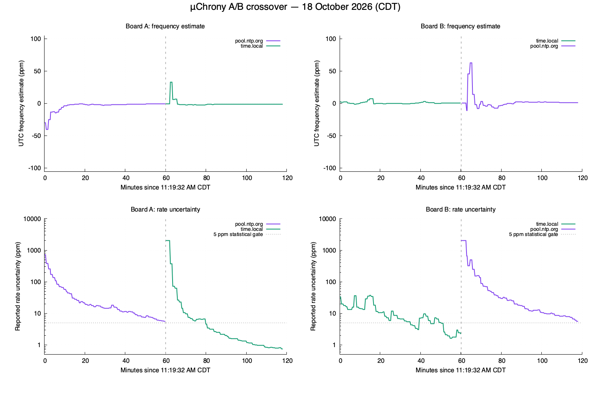

# μChrony live NTP comparison

Current disposition: [NTP work is closed](ntp-work-closeout.md). μChrony is
retained for UTC discipline and future GPS/PPS input; NTP-derived RF calibration
is rejected. The Pico-to-Pi GPIO pulse path is retired. Results below describe
their recorded images and evidence, not current operating instructions.

The finite A/B crossover completed on October 18, 2026, from **11:19:32 to
13:17:52 CDT**. The source swap completed at **12:19:38 CDT**. Both the observer
and its independent deadline guard exited normally, before the 13:19:32 hard
limit. The [derived record](microchrony-live-comparison.json) binds firmware,
private evidence, executable hashes, complete-input checks and the results.

`time.local` produced tighter rate estimates on both boards. Phase damping
reduced held-out NTP prediction error substantially. The incremental learned
rate did not demonstrate a clear overall benefit on these NTP-only proxies.
Unmodified Chrony 4.9 had somewhat better medians, with small RMS differences.
These results establish neither independent absolute UTC nor RF accuracy.

[Independent clock measurements](microchrony-independent-measurement.md) assess
physical oscillator error against a simultaneous GPSDO reference and separate
the learned frequency component from intentional phase slew.
The [Internet-source pulse/RF rerun](microchrony-pulse-rate-rerun.md) adds
independent GPIO timestamps and physical RF checkpoints on both boards.

## Hardware, firmware and restoration

| Board | USB serial | Stable device ID |
|---|---|---|
| A | `0BF4B4AEC9FFB344` | `fd6127d11d6aca42a9905fa3fb1bf1d5` |
| B | `CDDBF8767C506C07` | `29f20b7342051ef947aa56cb9d4fab42` |

Both boards received the same clean normal `WsprryPico.uf2`, firmware
`0.0.0-devel`, source `46c4a9e5a4a64912caed1c20ceb3399b4aa5b53d`, using
`pio-dma-gp2` at nominal 138 MHz. The UF2 SHA-256 is
`416da27b8bba8a05516948d9441b65b4f597b55d16880289f048488769fec851`.
Serial-specific programming/readback and all 72 KiB of reserved flash matched
before the first application reboot. Full original flash backups remain private.

The first phase used A/pool and B/local. Planned software restarts changed the
second phase to A/local and B/pool. At completion A was restored to
`pool.ntp.org` and B to `time.local`. The bounded post-run verification at
13:22:53 CDT confirmed fresh NTP, the exact firmware identity and unchanged
operator settings. Both boards were unowned, inactive and schedule-disabled;
manual PPM remained `0.000` in `manual` mode. No RF job or WTP ownership was used.

The learned journal remained healthy. The swap restored committed UTC priors
of −0.684 ppm on A and +0.819 ppm on B; restoration restarted with −1.024 ppm
and +1.313 ppm respectively. These are checkpoints, separate from the current
instantaneous estimate and manual PPM. They restore neither UTC freshness nor
RF authority. Planned software restarts do not qualify physical cold-boot
restoration of this image.

The run consumed 7,100.6 seconds of its 7,200-second budget. Whole-boot query
counts across the two observed phases were 331 for A and 299 for B, below 384
per board. The verified evidence contains 4,188 files and 81,054,973 bytes,
below the 128 MiB cap. Its archive SHA-256 is
`c5b14c9ab06c21d2f414ce9b8123a6a47fde90b6a8fbbd324ec3ce4a539a114c`.
The originals and backups are retained privately under the ignored
`build/microchrony-ab-20261018/` directory and the corresponding wspr5 run
folder. No capture, backup, credential or generated firmware is in Git.

## Convergence and unchanged gates

The following values are reported model estimates at the end of each phase.
Frequency correction and skew are in ppm; clock error is a reported bound in
milliseconds, rather than an independently measured residual.

| Board / phase | Source | UTC correction | Rate uncertainty | Clock-error bound | First observed statistical candidate |
|---|---|---:|---:|---:|---|
| A, before swap | `pool.ntp.org` | -0.684 | 5.643 | 87.015 | not reached |
| B, before swap | `time.local` | +0.728 | 2.211 | 3.317 | 11:54:41 CDT |
| A, after swap | `time.local` | -1.055 | 0.752 | 4.741 | 12:39:29 CDT |
| B, after swap | `pool.ntp.org` | +1.400 | 5.579 | 54.328 | not reached |

Local NTP crossed the unchanged 5 ppm statistical-candidate condition on both
boards. A/local also ended below the 1 ppm rate-settled threshold. Neither pool
condition crossed 5 ppm during its captured phase; each ended near 5.6 ppm.
First threshold crossings do not imply uninterrupted qualification. In
particular, B/local later entered holdover after rejecting one delay-deviation
outlier, then recovered on a new accepted sample. The 90-second freshness gate
correctly blocked two sampled launch-readiness points during that interval.

The vertical line marks the source swap and planned restarts. The upper curves
show UTC frequency estimates; the lower curves show reported uncertainty.
Neither is a measurement of actual residual oscillator error. The 5 ppm line
is one statistical condition; freshness and the other gates continue to apply.
Each source/board condition has approximately one hour of observations, rather
than two continuous hours on one source. The first phase also contains retained
pre-capture training history. Pool and local source quality therefore cannot
be reduced to an unqualified comparison of cold acquisition times.

Two B/pool peer replacements occurred early in the second phase. Their short
four-original cohorts remain in the evidence. Pool query loss and admitted
outliers remain represented; neither gates nor source history were adjusted
to make the results pass.

## Actual application of the clock corrections

Every one of the 560 newly accepted originals after the stable capture
baselines is present: 277 on A and 283 on B. The complete visible union contains
601 originals, including pre-capture training. A has 20 explicitly missing
pre-capture originals from older cohorts. These remain a whole-boot visibility
limit and are neither reconstructed nor excused as in-run loss.

Independent API/INFO/API validation confirmed active NTP authority, matching
physical device/boot/image, stable application and μChrony generations and the
actual application rate. The observer's stored verdict was not treated as
proof. The resulting 385 nonzero constant-rate segments agree with integer
UTC projection within 969 ns, under the existing 3 μs check.

| Board / source | Timing-ready INFO reads | Verified API brackets | Constant-rate pairs | Maximum mapping difference (ns) |
|---|---:|---:|---:|---:|
| A / `pool.ntp.org` | 159 / 159 | 157 | 101 | 969 |
| B / `time.local` | 157 / 159 | 155 | 99 | 834 |
| A / `time.local` | 153 / 154 | 150 | 92 | 935 |
| B / `pool.ntp.org` | 152 / 154 | 151 | 93 | 918 |

Readiness counts are sampled observations, not an uptime percentage. Besides
B/local's holdover, the exceptions were initial acquisition, including a
507.997 ms A/local bound and a 1,369.009 ms B/pool bound. Those points correctly
failed the unchanged 500 ms launch limit despite receiving time.

Five same-generation finite-slew transition pairs were identified separately.
INFO lacks the exact endpoint needed for an exact transition projection, so
these pairs are excluded from the constant-rate claim. Deterministic finite
slew/mapping tests remain the separate evidence for that behavior.

## Causal comparison with Chrony 4.9

The production μChrony engine and unmodified external Chrony 4.9 SST, SRC, REF,
LCL and SYS_Generic modules receive identical captured raw send/receive ticks,
server receive/send/reference timestamps and wire quality fields. An original
adapter supplies the reference through its NTP sample API; reference packet
admission, autonomous polling and DNS are outside this comparison. No Chrony
implementation is copied, translated or linked into the MIT firmware.

Each source is replayed cold, using zero frequency priors. A common translation
uses the first server midpoint to choose an arbitrary UTC origin. Chrony's
reference plant initially shares that origin; μChrony assigns an epoch from
its first usable fit. This does not compare RTC/boot acquisition or reproduce
the live persisted seed, previous rejected packets or combined pool state.
A's four pool source streams and B's pool cohorts are pooled only for scoring.

Every probe precedes admission of its own future NTP reply. Scores use the same
available probes, requiring synchronization, at most 500 ms reported error and
at most 90 seconds of age. The offset-only baseline holds the latest received
UTC offset and uses the supported 100 ppm drift envelope. The phase-only
counterfactual suppresses learned frequency updates without changing production
gates. All supplied originals were admitted by the μChrony replay.

Errors below are against the next admitted NTP observation, in milliseconds.
The [derived record](microchrony-live-comparison.json) also includes RMS, p95 and
15/30-minute windows for the same paired observations.

| Board / source | Paired probes | Offset median | Phase-only median | μChrony median | Chrony median | μChrony / Chrony RMS |
|---|---:|---:|---:|---:|---:|---:|
| A / `pool.ntp.org` | 218 | 10.128 | 7.314 | 7.456 | 7.058 | 17.995 / 17.721 |
| B / `time.local` | 54 | 6.431 | 3.597 | 3.702 | 3.094 | 14.512 / 14.515 |
| A / `time.local` | 51 | 9.184 | 2.601 | 2.732 | 2.676 | 11.538 / 11.542 |
| B / `pool.ntp.org` | 193 | 10.936 | 7.787 | 7.972 | 7.919 | 17.859 / 17.597 |

Phase damping reduces median error by approximately 28–72% versus offset-only
updates. Adding learned frequency slightly worsens the median in all four
conditions. Its RMS difference versus phase-only is at most about 1.3%, with
small improvements or regressions depending on the stream. These proxies do
not demonstrate a clear incremental interim-rate benefit.

Chrony's median advantage over full μChrony is approximately 5.3% on A/pool,
16.4% on B/local, 2.0% on A/local and 0.7% on B/pool. Its RMS advantage is about
1.5% for the pool cases; local RMS is effectively unchanged and slightly worse.
Startup differences, source weighting and noise remain possible contributors;
the result does not isolate a production-engine defect or establish that a
full Unix daemon would achieve these exact values.

A separate Chrony phase-only attempt produced no common probes passing the
unchanged timing limits because its retained frequency uncertainty remained
large. It is excluded from this qualified comparison and supports no claim
about Chrony's own incremental rate benefit.

## Interpretation and limits

At a normal 64-second poll, one ppm changes the projected clock by 64 μs.
Once the correction is near a few ppm, that incremental effect is much smaller
than the several-millisecond next-observation errors here. Phase damping already
removes much of the offset variation. A small rate benefit can be hidden by
path asymmetry and timestamp variation, while a noisy frequency estimate can
also add error. The captures do not separate those physical causes.

The source swap supports the observation that local NTP yields a tighter rate
estimate on both boards. It does not establish traceable UTC, physical clock
frequency or RF calibration. RP2350 software timestamps, network asymmetry,
USB observer load and oscillator/environmental changes were not independently
isolated. No absolute RF claim follows from a statistical candidate.

The adapters passed unchanged default-output checks, server-processing
midpoint checks and root-distance rejection tests. Both focused CTests pass,
including ten known-truth clock-loop scenarios. Negative analysis checks reject
false application authority and missing newly accepted inputs without altering
the originals. All remote evidence hashes match the private local copy. Manual
PPM, persistence formats, firmware quality gates and deployed firmware were
unchanged by the offline analysis.

Reproduction uses the commands in the [external-reference guide](../../tests/reference/README.md),
`summarize_microchrony_live.py` for the derived record and
`plot_microchrony_live.py` for the figure. Private captured originals and the
already built external reference are required; the scripts install nothing
and open no board endpoint.
