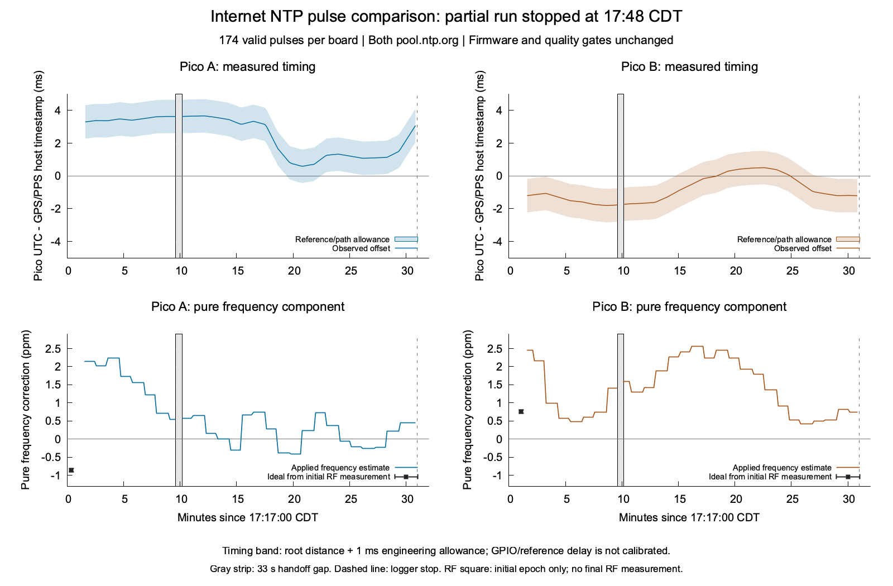

# Independent pulse and RF clock-rate comparison

The finite Internet-NTP comparison produced **174 valid pulse measurements per
board**, then the logger terminated at **17:48:00 CDT on October 18, 2026**.
The clock's freshness check became false and the logger treated that condition
as fatal. Passive measurement should retain an unqualified interval and record
recovery; transmission and RF admission gates can remain unchanged. The logger
also failed to retain the rejected INFO reply before checking it. Those are
logger defects. Neither requires weakening a firmware quality gate.

The retained measurements show mixed short-term effects from learned rate
correction. They do not establish a uniform reduction in absolute UTC error.
The run ended before the final RF checkpoints, and host GPIO/reference delay
has an explicit engineering allowance rather than independent calibration.
These partial results are usable with those caveats.

A separate [completed Internet-source rerun](microchrony-pulse-rate-rerun.md)
uses the repaired logger and retains clock loss/recovery without weakening
the firmware gates. The measurements below belong to this earlier partial run.

## Measured timing and frequency

The upper curves show Pico UTC minus the independently GPS/PPS-disciplined
host's GPIO event timestamp. Bands include Chrony root distance plus an
explicit **one-millisecond reference/GPIO-path allowance**. That allowance is
not a calibrated bound on absolute UTC error. The lower curves show the pure
frequency component applied to the UTC clock, excluding intentional phase slew.
The RF squares mark only the initial measurement epoch; no stable oscillator
error across the entire run is assumed.

| Board | Observed timestamp-offset range | First → last observed offset | First → last pure frequency correction |
| --- | --- | --- | --- |
| A | +0.589 to +3.660 ms | +3.294 → +3.072 ms | +2.148 → +0.443 ppm |
| B | −1.806 to +0.502 ms | −1.206 → −1.206 ms | +2.450 → +0.738 ppm |

These are timestamp differences against the host measurement path. Starting
and ending values include the effects of all intervening phase and frequency
updates; they cannot attribute a whole-run gain to frequency correction alone.
Both boards retained their existing NTP histories; this was not a cold-start
test. The last pulse pair preceded the synchronization failure.

## Does the rate component help?

A causal open-loop comparison starts each forecast at a captured pulse and
predicts the next physical pulse using only the then-known clock mapping.
It keeps the identical starting phase and scheduled finite phase slew, and
compares two frequency treatments. Any new NTP generation, clock model, source
cohort or boot ends the comparison. The held-out host edge supplies the
independent reference. Bounds retain edge quantization, reference allowance
and any admitted mapping-projection discrepancy.

| Board | Control compared with applied correction | Improved | Worsened | Unresolved | Eligible 10-second windows |
| --- | --- | ---: | ---: | ---: | ---: |
| A | Zero learned frequency, same phase slew | 0 | 61 | 86 | 147 |
| B | Zero learned frequency, same phase slew | 66 | 0 | 80 | 146 |
| A | Frequency frozen at original capture start | 110 | 0 | 37 | 147 |
| B | Frequency frozen at original capture start | 0 | 69 | 77 | 146 |

The frozen controls use A's original +2.148 ppm and B's +2.450 ppm throughout
both capture segments. They are starting estimates, not independently optimal
corrections. Of 172 possible adjacent windows per board, A excluded 25 and B
26 because an input/model binding changed. The same eligible windows are used
for both controls. Shared model histories, reference bias and adjacent endpoints
make these correlated comparisons, not independent trials or success rates.

Under the stated measurement allowance, A's positive frequency component often
increased its positive phase offset, while reducing that component from the
starting value helped. B's positive component often reduced its negative
phase offset; reducing it from the starting value could slow that phase
recovery. A useful short-term phase contribution and an accurate oscillator
frequency estimate are different measurements. These forecasts do not simulate
a complete alternative feedback-controller trajectory, and their conclusions
are conditional on the uncalibrated host/reference allowance.

Longer, overlapping 10–60 second forecasts are retained in the derived record.
They are not substituted for the adjacent-window counts above. Small effects
and predictions crossing the reference interval remain unresolved.

## Independent RF checkpoint

Each recording contains one two-second Pico tone at 3.5701 MHz and simultaneous
3.56/3.64 MHz GPSDO reference harmonics. The two references identify both SDR
frequency offset and sample-rate scale within the same coherent interval.
The [frequency methodology](microchrony-independent-measurement.md) retains
all original fit and receiver-cleanup gates and the explicit ±0.05 Hz fit and
±10 ppb GPSDO engineering allowances. Those allowances are not certified
absolute calibration.

| Board | Measured native oscillator error | Pure learned UTC correction | Inferred pure UTC rate residual | Finding |
| --- | --- | --- | --- | --- |
| A | +0.811 to +0.900 ppm | +1.351 before, +1.963 after | excluded | Model changed across the tone |
| B | −0.799 to −0.711 ppm | +2.069 ppm | +1.270 to +1.358 ppm | Pure frequency alone overcorrected |

B's simultaneous phase-slew component was −0.902 ppm. Its **full UTC mapping**
therefore had an inferred rate residual of **+0.368 to +0.456 ppm** at that
checkpoint. Against the same phase-slew mapping without learned frequency,
adding learned frequency improved absolute instantaneous rate error by
1.156–1.332 ppm. This is a clock-rate inference through the verified common
XOSC topology, not a direct measurement of UTC epoch error.

RF remained in manual `0.000` PPM mode. No NTP-derived RF correction was
applied. The missing final RF recordings prevent a start/end physical RF drift
comparison or an RF verdict for the later frequency estimates.

## Termination and restoration

The run began at **17:17:00 CDT** with a hard finish of 18:17:00 CDT. Each
initial RF checkpoint took about 43 seconds including reference restoration.
A user-approved logger handoff increased the final reserve from two to three
minutes without extending that deadline or repeating RF jobs. All 49 original
measurements per board were retained. A second segment added 125 per board.
The measured last-original to first-replacement edge gap was **33.329975030 s**;
no forecast crosses it and no interpolation conceals it.

The final captured pair was at about 17:47:50 CDT. A's accepted time sample
was **87.102 seconds old** then, close to the existing 90-second synchronized
lifetime in [the clock profile](../../src/standalone/wtp_profile.hpp). The next
check was roughly ten seconds later. Crossing that freshness boundary is
consistent with the failure. The rejected INFO reply was not retained, so its
exact state and immediate cause cannot be confirmed. The failed check was A's
next first-board check; neither board produced another pulse afterward.

After actual observer and guard exit, read-only terminal verification found:

- Both boards synchronized again from `pool.ntp.org`, using SNTP without source
  disagreement. Selected sample ages were A 46.180 s and B 1.446 s.
- Original boot identities, normal firmware identity, saved Wi-Fi/settings and
  manual `0.000` PPM in manual mode were preserved. Both boards were inactive,
  unowned and schedule-disabled.
- Pi GPIO22/23 returned to their original kernel-unowned `no pn` state. GPS HAT
  PPS GPIO17 and services were unchanged.
- GPSDO original settings matched, both outputs remained disabled, and its
  satellite/PLL/antenna and host PPS reference checks passed.
- No deadline guard intervention occurred. No final RF job was attempted. The
  run was not restarted or extended after this failure; the heartbeat is paused.

The logger should save each INFO reply before validation, retain clock-invalid
intervals, and resume qualified comparisons after recovery. Non-time failures
such as foreign ownership, changed settings, identity mismatch or hardware
resource faults should still stop the observer. RF jobs must continue to obey
all existing freshness, uncertainty, ownership and hardware gates. An offline
logger candidate now saves each per-pulse INFO reply before validation and
allows passive capture through synchronization loss while retaining strict RF
checks. Three hardware-free policy tests cover loss/recovery, raw-failure
retention and RF refusal. At this partial record's original cutoff, the candidate
had not been launched. The subsequent rerun validates the extended logger
policy; this run's original logger and failure evidence remain unmodified.

## Identity and evidence

Both boards used normal `WsprryPico` `0.0.0-devel`, revision
`0a7c05d1c41b-dirty`, UF2 SHA-256
`6a742656d26eb32e372bdced2d1130c7447e5b33c2e93523c65c8efe3fc273f0`,
`pio-dma-gp2`, nominal 138 MHz. Exact USB/boot identities and GP22-to-Pi
GPIO22/23 routes are in the [instrumentation record](clock-pulse-probe.md).
The conducted path used RSP1B `2404058C60` and LBE-1421 `0673ED0FA107`, with
the user-confirmed separate nominal 60 dB attenuation/combiner paths.
No firmware, NTP settings, manual PPM or production quality gate changed.

All 348 pulse records pass strict physical-edge, identity, clock-binding and
reference-health checks. Edge brackets range from 5 to 7 microseconds. Duplicate
requests returned identical cached records and emitted no additional edge.
All 1,156 archived files match independently computed remote SHA-256 values.
Private originals remain in ignored `build/microchrony-pulse-rate-20261018/`
and `/home/pi/microchrony-pulse-rate-20261018` on wspr5, including both capture
segments, raw failure logs, settings, source snapshots and cleanup receipts.
Evidence size at terminal verification was 61,369,244 bytes, below 256 MiB.

The NTP audit verified 778 original history pages and 408 distinct immutable
observations. It recovered every newly accepted original through the last
captured INFO frontiers, including across the handoff: A at 17:47:14.495 CDT,
B at 17:47:11.894 CDT. Pre-capture deficits remain explicit: four originals
on A and eight on B. Each of the 348 pulse records' selected-source pointers
matches a retained original. The final 36–39 seconds of pulses extend beyond
those INFO frontiers, and no final history drain occurred; complete packet
visibility through the abort is not claimed.

API-before / INFO / API-after binding verification found 29 stable checkpoints
out of 30 on A and 30/30 on B. A's other checkpoint crossed clock generation
52→53 and estimator generation 67→68 and is excluded from stable application
claims. Every individual pulse independently verifies its unchanged model
around the physical edge. Independent affine-calibration corner calculations
also confirm that all 32 RF uncertainty corners lie within each reported RF
interval.

The [sanitized derived record](microchrony-pulse-rate-comparison.json) retains
counts, intervals, figure data, source hashes and audit results. The
[exact arithmetic](../../src/rf_analysis/clock_measurement.py) and
[known-error tests](../../tests/clock_measurement_tests.py) additionally cover
admitted projection differences and interval-valued predictions containing
true UTC. These offline repairs retain the measured mapping and broaden
uncertainty where needed. Seventeen arithmetic cases and five physical-event
cases pass; affected CTest entries pass. The scientific figure was rendered
with gnuplot and visually inspected. Validation assessment: **Share with caveats** for the partial results.
The full planned UTC/RF comparison remains incomplete.
