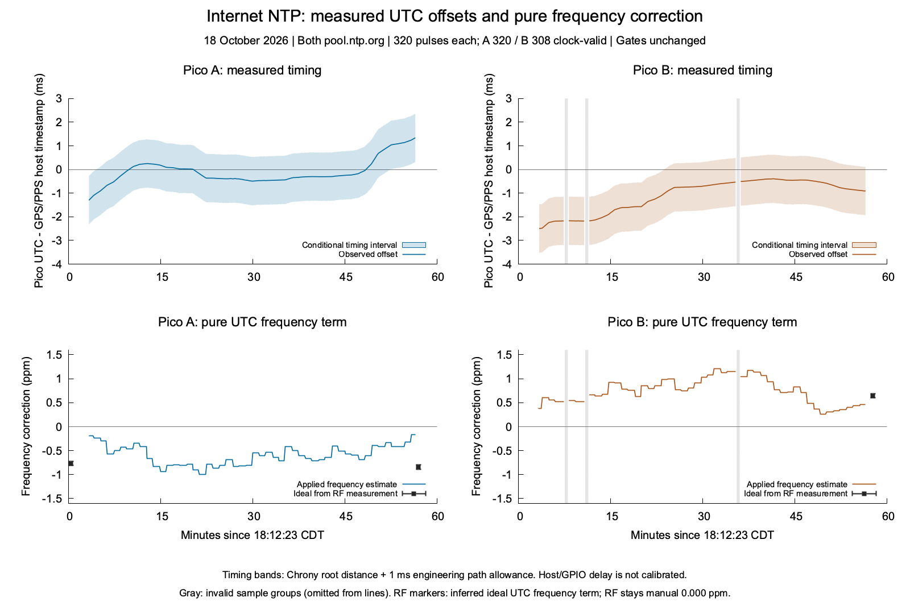

# Internet NTP: independent pulse and RF measurements

Current disposition: [NTP work is closed](ntp-work-closeout.md). μChrony is
retained for UTC discipline and future GPS/PPS input; NTP-derived RF calibration
is rejected. The Pico-to-Pi GPIO pulse path is retired. Results below describe
their recorded images and evidence, not current operating instructions.

The finite A/B comparison retained **320 physical pulses per board** and
finished at **19:10:30 CDT on October 18, 2026**, before its 19:12:23 deadline.
Both boards used `pool.ntp.org`. The corrected logger continued through B's
temporary loss of synchronized time and preserved all 12 clock-invalid records.
Firmware, saved settings, manual PPM and every production quality gate stayed
unchanged.

B shows a small, conditional benefit from the learned frequency component in
some matched forecasts. A's adjacent-window benefit is unresolved. These are
measurements against an independent GPS/PPS host, with an explicitly
**uncalibrated host/GPIO delay allowance**. They do not prove certified absolute
UTC accuracy or a uniformly improving frequency estimate. RF stayed in manual
`0.000` PPM mode, so UTC corrections did not correct the physical carrier.

## Measured UTC offsets

The upper panels show Pico UTC minus the GPS/PPS-disciplined host's GPIO event
timestamp. Bands include the host's 8.9–26.9 microsecond root distance and an
additional **one-millisecond engineering allowance** for the measurement path.
That allowance has not been independently calibrated. Gray strips identify
clock-invalid sampled intervals; lines omit those records. The lower panels
separate pure frequency correction from intentional phase slew. RF markers show
the ideal UTC frequency term inferred from the measured native oscillator error,
using the verified common oscillator topology.

| Board | Clock-valid pulses | Observed offset range | First → last observed offset | Midpoint RMS offset |
| --- | ---: | --- | --- | --- |
| A | 320/320 | −1.303 to +1.336 ms | −1.303 → +1.336 ms | 0.525 ms |
| B | 308/320 | −2.496 to −0.394 ms | −2.496 → −0.908 ms | 1.263 ms |

These offsets and RMS values describe the timestamp measurement path. They are
not independently calibrated absolute UTC errors. The first/last movement
contains all intervening phase and frequency updates and cannot isolate a
frequency-correction effect. Both boards retained their existing learning
history; this was not a cold-start test.

## Does interim frequency correction reduce error?

Each open-loop forecast starts at a measured pulse and holds out a later
independent GPIO timestamp. It uses only the starting clock mapping, preserves
the identical starting phase and scheduled finite phase slew, and stops before
any changed NTP generation, source cohort, model or boot. The two controls are
zero learned frequency and the frequency frozen at the original pulse-capture
start: **A −0.190 ppm, B +0.373 ppm**. The same eligible windows are used for
both controls.

| Board | Control | Improved | Worsened | Unresolved | Eligible adjacent windows |
| --- | --- | ---: | ---: | ---: | ---: |
| A | Zero learned frequency; identical phase slew | 0 | 0 | 270 | 270 |
| B | Zero learned frequency; identical phase slew | 75 | 0 | 186 | 261 |
| A | Frequency frozen at capture start | 0 | 0 | 270 | 270 |
| B | Frequency frozen at capture start | 7 | 0 | 254 | 261 |

Of 319 possible adjacent windows per board, A excludes 49 and B excludes 58
because the required clock/input bindings or qualification changed. An
unresolved result is not evidence of no effect. The intervals include edge
quantization and admitted mapping-projection discrepancy. These are correlated
ten-second comparisons, not independent trials or success rates. They do not
simulate a complete alternative feedback-controller trajectory.

The effect is small relative to the measured phase offset. On those same
eligible endpoints, midpoint RMS is 1,259.0 microseconds on B versus 1,265.0
with zero learned frequency and 1,261.8 with frozen-start frequency: nominal
differences of about **6.0 and 2.8 microseconds**. A's corresponding midpoint
values are 522.1, 520.5 and 520.9 microseconds; its interval verdict remains
unresolved. These midpoint calculations are diagnostics, not independently
verified reductions in absolute UTC RMS.

The conclusion depends on the measurement allowance. Repeating the offline
calculation with a five-millisecond path allowance makes **every adjacent
comparison unresolved on both boards**. No hardware or firmware gate changes
in that sensitivity calculation. The one-millisecond result supports a
conditional engineering finding on B; an unconditional absolute-UTC benefit
requires a calibrated delay bound or a stronger timing reference path.

Longer overlapping 10–60 second forecasts are retained separately. Against zero
learned frequency, A has 38 improved, three worsened and 831 unresolved windows;
B has 302 improved and 565 unresolved. Against frozen-start frequency, A has
17 improved and 855 unresolved; B has 174 improved and 693 unresolved. These
counts must not be combined with the adjacent-window table or treated as
independent evidence.

## Physical RF error and UTC rate inference

The conducted path combined the separately attenuated Pico and GPSDO signals
into RSP1B `2404058C60`. Every valid recording contains a two-second 3.5701 MHz
Pico tone and simultaneous 3.56/3.64 MHz GPSDO harmonics. Two reference lines
identify the receiver's frequency offset and scale in the same coherent window.
The [measurement methodology](microchrony-independent-measurement.md) retains
the original fit/receiver gates and the explicit ±0.05 Hz line-fit and ±10 ppb
GPSDO engineering allowances. Those are not certified calibration bounds.

| Board/checkpoint | Physical carrier error at 3.5701 MHz | Native oscillator error | Pure UTC frequency term | Inferred pure UTC rate residual |
| --- | --- | --- | --- | --- |
| A initial | +2.586 to +2.901 Hz | +0.723 to +0.811 ppm | −0.386 ppm | +0.337 to +0.425 ppm |
| A final | +2.852 to +3.167 Hz | +0.798 to +0.886 ppm | −0.005 ppm | +0.793 to +0.881 ppm |
| B initial | unavailable | unavailable | unavailable | `MISSED_START`; failed attempt retained |
| B final | −2.453 to −2.138 Hz | −0.688 to −0.600 ppm | +0.450 → +0.357 ppm | excluded: model changed across tone |

A's initial pure frequency term reduced its inferred oscillator rate error by
about 0.386 ppm; the final term contributed only about 0.005 ppm. The estimate
therefore did not narrow consistently toward the measured correction during
this run. At those checkpoints, A also had intentional phase-slew terms of
+8.213 and +4.134 ppm. Its full instantaneous UTC mapping consequently had
inferred rate residuals of +8.550–8.638 and +4.927–5.015 ppm. Phase recovery
and oscillator-frequency accuracy must be evaluated separately.

Both A checkpoints have independently verified API-before/INFO/API-after
bindings and consistent running-clock slopes. B's final triplets each bind,
but the clock generation changes 133→134 and estimator generation 149→150
between the job's before/after snapshots. Its physical RF result remains
usable; a single stable corrected UTC-rate inference is excluded.

These are snapshot-bound instantaneous rate inferences through the verified
clock topology, not complete source-input controller replays through the RF
checkpoints. The original-history coverage boundary is described below. No
NTP-derived RF correction was applied, and no absolute UTC phase or automatic
RF-calibration qualification follows from the carrier measurements.

## Clock loss, capture boundary and restoration

The campaign began at **18:12:23 CDT**. A's initial RF job completed. B's initial
job armed but reached `MISSED_START` about 4.807 ms after its target. Cleanup
released ownership and restored the GPSDO. All initial workers and guards
exited. Passive collection continued at 18:15:23 within the same original
deadline, query/evidence limits and RF-attempt budget; initial RF attempts
were not repeated. Both final RF jobs completed. All failure evidence remains.

B's clock-invalid pulses occur at ticks 25–28, 45–48 and 193–196. The retained
INFO replies show selected-sample ages crossing the existing 90-second
synchronized limit and reaching roughly 121–127 seconds before recovery.
The clock remained in holdover and the logger retained the physical pulses
without claiming qualified UTC. All 12 invalid pulse source pointers are
explicitly zero. This is not a logger failure or permission to transmit using
stale time. No holdover, RF, uncertainty or filtering gate was relaxed.

The final history drain verified all **386 newly accepted originals** after
the pulse-capture baseline: 196 on A and 190 on B. Pre-capture deficits remain
explicit: **51 on A, 67 on B**. They are not lost during this run or reconstructed
as visible inputs. Across the baseline and new packets, 1,352 original history
pages yielded 898 immutable source-cohort observations. All 628 clock-valid
pulse source pointers match a retained original. Every pulse has its raw INFO
reply saved before validation. GPIO global/per-line sequences, cached duplicate
behavior and every physical-edge bracket pass independent checks.

The final INFO frontiers follow the last pulses by about 5.7 seconds on A and
7.0 seconds on B. Seven additional accepted packets on A and six on B appear
before final RF cleanup without a subsequent full history drain. Complete
original-input coverage is claimed through the pulse-capture frontiers, **not
through final RF or the entire boot**. No further live collection was performed.
During pulse capture, all 55 A API triplets bind; 54/55 B triplets bind, with
the holdover checkpoint retained as unbound.

The observer finished at **19:10:30 CDT**, and all independent guards exited
without intervention. Final read-only checks at 19:14:48 confirmed both boards
synchronized from pool NTP without source disagreement, with sample ages
A 4.856 s and B 21.888 s. Both remained inactive, unowned and schedule-disabled.
Boot/image identities, saved settings and manual `0.000` PPM/manual mode
matched. Pi GPIO22/23 returned to their original `no pn` state; the HAT PPS
input and services were untouched. GPSDO original settings matched with both
outputs/PPS off and healthy satellite/PLL/antenna status.

## Identity, evidence and checks

Both boards used normal `WsprryPico` `0.0.0-devel`, revision
`0a7c05d1c41b-dirty`, UF2 SHA-256
`6a742656d26eb32e372bdced2d1130c7447e5b33c2e93523c65c8efe3fc273f0`,
`pio-dma-gp2`, nominal 138 MHz. Board/boot and GP22 wiring identities are in the
[instrumentation record](clock-pulse-probe.md) and the sanitized result JSON.
No reflash, reboot, source change, operator settings save or RF correction
occurred in this run. Normal automatic NTP-estimate retention remained active.

The closed evidence contains **2,632 hash-verified files / 125,019,153 bytes**,
within 256 MiB. Each board consumed two RF attempts of at most two seconds;
completed jobs were A two and B one. Query deltas at final observer read were
216 per board, within the 320 cap; the later read-only check found 232 each
as normal NTP polling continued. Evidence remains private in ignored
`build/microchrony-pulse-rate-rerun-20261018/` and the corresponding wspr5
directory. The retained archive SHA-256 is
`73c0778932b936f2d174c225d0a51e09db770572d040655bb26443cc0768745e`.

Independent exact arithmetic reproduces all 3,478 frequency-treatment
intervals. Separate 32-corner affine calculations are contained by each RF
measurement interval. Seventeen known-error arithmetic tests, five physical
event tests and ten logger-policy tests pass. The scientific figure is
rendered with gnuplot and visually inspected; all three affected CTest entries
also pass. A separate read-only adversarial review found no actionable issues,
reproduced the counts/RMS/sensitivity and independently extracted RF lines
within 0.0004 Hz of the reported fits. Validation assessment:
**Share with caveats** for the measured offsets and conditional rate benefits.

The [sanitized derived record](microchrony-pulse-rate-rerun.json) retains the
figure values, definitions, counts, intervals, bounds, identities and hashes.
The [earlier partial result](microchrony-pulse-rate-comparison.md) remains a
separate experiment. This completed rerun does not establish a uniformly
converged frequency estimate, a full alternative feedback trajectory, calibrated
absolute UTC accuracy or NTP-derived RF-calibration qualification.
