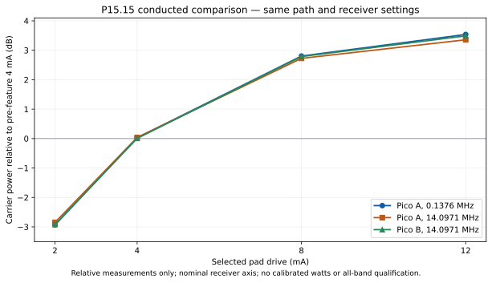

# P15.15 hardware acceptance and conducted comparison

Status: **ACCEPTED_SCOPED_WITH_RF_OBSERVATIONS**, 2026-10-17. P15.15 is
complete within the software and physical scope recorded here. Both Pico 2 W
boards passed all four actual pad-register observations, persistence, explicit
restart and physical USB re-enumeration. Target completion/cancel/abort/rearm
checks and the finite conducted comparison are complete. The original images,
settings and host service were restored and verified.

The operator explicitly directed that in-span energy must not invalidate these
tests unless it prevents detecting and validating the pad checks. It did not:
board/boot identity, register observation, USB persistence and target lifecycle
remain valid, and all captured carriers are clear and continuous. Numerical
spectral screens still fail and remain visible below as **nonblocking
observations**. They were not changed to passes. This acceptance does not claim
calibrated power, emissions compliance or all-band/mode RF qualification.
P15.16–P15.20 remain unexecuted; the default firmware target is unchanged.

The comprehensive [executed prompt](phase15-15-hardware-execution-prompt.md),
[sanitized evidence manifest](phase15-15-hardware-results.json) and original
[software execution record](phase15-15-results.md) define the evidence boundary.
This follow-up changes tools/tests and development records, not product firmware
or WsprryPi implementation. The review was adversarial self-review; no independent
reviewer or subagent was used.

## Source, images and exact setup

| Item | Identity |
| --- | --- |
| Tested Pico source | `d6de1f3cf14dc49266c4401c3bca91b8ce9da688`, clean delivered `devel` product; generated candidate revision `d6de1f3cf14d`. |
| Tested Pi source | `fe701cf4c2b05e46cb84927188984084503d1cea`, unchanged `devel`; existing Linux native USB client. |
| Immediate pre-feature Pico baseline | `46b256c636fb44c8ed059000d7b3f3b94cceea9e`, independent immutable source build. |
| Candidate StandaloneRF UF2 SHA-256 | `d8980c56c892fcab28491947f5aa77ef6562645df52006121158f6bcf3694c4a` |
| Baseline StandaloneRF UF2 SHA-256 | `c5bbed665fd3d44deba354a7cd76bd63c427cacea655c531db29eb0c1dacc5cf` |
| Target / engine / RF pin | Pico 2 W / RP2350; direct PIO/DMA `pio-dma-gp2`; GP2; normal 138000000 Hz clock. |
| SDK / compiler | SDK 2.3.1, pin `079c6f39023649b154152db30f1d781e884879bc`; Arm GNU 15.3.1. |
| Pico A | USB `0BF4B4AEC9FFB344`; WTP `fd6127d11d6aca42a9905fa3fb1bf1d5`. |
| Pico B | USB `CDDBF8767C506C07`; WTP `29f20b7342051ef947aa56cb9d4fab42`. |
| Test host | wspr5, Linux aarch64 6.18.34; existing Python/NumPy 2.2.4 and native helpers. |
| Receiver | SDRplay RSP1B `2404058C60`, channel 0, CF32, 250000 sample/s, 200000 Hz bandwidth, fixed 20 dB gain; AGC and bias tee off. |
| Receiver tuning | Requested RF minus 25000 Hz; unchanged settings and path within each comparison. |
| Conducted chain | Each GP2/GND through its own 20 dB attenuation, combiner, then 40 dB attenuation to RSP1B; no antenna or LPF. |
| Reference | GPSDO `0673ED0FA107`, satellite/PLL locked; outputs 1/2 off, both 10 MHz/LOW, PPS1 off; read-only throughout. |

The operator confirmed both USB boards and the established physical paths for
this task. Live serial/WTP/USB-parent checks refreshed that identity. Only one
Pico transmitted at a time; the other remained inactive/unowned. Existing
nonblocking per-board and receiver locks excluded competing test clients.
WsprryPi's initially active service was stopped for each finite attempt and
restored afterward. Boot enablement, Pi GPIO, networking and GPSDO controls were
not changed. No SDK or tools were installed.

The baseline firmware reports `unknown-unknown` from its Gitless source build;
it is identified by immutable source and exact loaded UF2 hash, not that label.
Its 4 mA value is nominal from reset/pinned SDK/source behavior. The old image
has no new drive API, so no old-image getter observation is invented.

Both normal inhibited and StandaloneRF targets were freshly linked before the
physical run. Existing heap-wrapper, flash/UF2 reservation, BOOTSEL, GP14 safety,
stack-guard and SRAM renderer checks passed. Renderer remains 660 bytes / 233
checked instructions, initialized SRAM data 13976 bytes, RF worker 166176 bytes;
no capacities or numeric admission limits were relaxed. The new tools/docs in
this acceptance commit are not firmware inputs; tested product source remains
`d6de1f3`.

## Actual pad, persistence and USB observations

Each matrix cell saved through the actual Pi native USB management client,
verified saved versus immutable boot selection, explicitly restarted and
rediscovered all three CDC roles. Initial fresh-boot `pad_readback:null` changed
to the selected value only after actual RF-adapter initialization. LOAD renders
a job but does not open the adapter. A 1 s job was therefore armed 15 s in the
future, its SDK getter read while armed/output-inactive, and canceled before
launch. Every cell refused a competing drive mutation with 409.

| Board | Selected / saved / boot / actual SDK getter (mA) | RF GPIO | Fresh-boot unknown → verified | Output inactive during getter | Busy write |
| --- | --- | --- | --- | --- | --- |
| A | 2 / 2 / 2 / 2 | 2 | Pass | Pass | 409 |
| A | 4 / 4 / 4 / 4 | 2 | Pass | Pass | 409 |
| A | 8 / 8 / 8 / 8 | 2 | Pass | Pass | 409 |
| A | 12 / 12 / 12 / 12 | 2 | Pass | Pass | 409 |
| B | 2 / 2 / 2 / 2 | 2 | Pass | Pass | 409 |
| B | 4 / 4 / 4 / 4 | 2 | Pass | Pass | 409 |
| B | 8 / 8 / 8 / 8 | 2 | Pass | Pass | 409 |
| B | 12 / 12 / 12 / 12 | 2 | Pass | Pass | 409 |

The observations are the real adapter's `gpio_get_drive_strength` verification
at initialization, bound to the current board, boot and job. They are not
ammeter measurements, continuous electrical sensing or physical voltage/current
characterization. Firmware/source inspection establishes that only the selected
RF GPIO is programmed; no external auxiliary-pad register measurement is claimed.
Explicit 4 mA, absent/default initialization and A/B/A sticky pending restart
were exercised. Saves did not hot-apply or change the boot value. Actual getter
readback remained the same after captured completion/rearm and lifecycle jobs.

Eleven retained explicit restart records contain physical disappearance,
same USB parent with a new device number, new boot ID, new UMP session, all six
USB interfaces and all three CDC role paths rediscovered. The old session token
was silently refused, consistent with the transport's stale-session behavior;
no explicit error reply is claimed. The full boot/session evidence is private;
sanitized boot IDs/device numbers are in the manifest.

| Board | Saved mA | Old → new USB device number |
| --- | --- | --- |
| A | 4 | 28 → 29 |
| A | 2 | 29 → 30 |
| A | 8 | 30 → 31 |
| A | 8, continuation setup | 37 → 38 |
| A | 12 | 38 → 39 |
| A | 4, final bracket | 39 → 40 |
| B | 4 | 62 → 63 |
| B | 2 | 63 → 64 |
| B | 8 | 64 → 65 |
| B | 12 | 65 → 66 |
| B | 4, final bracket | 66 → 67 |

An additional early accepted restart in attempt 1 is preserved privately but
not counted in these eleven retained matrix records. Firmware-load/restore
USB resets are also excluded from this explicit-restart count.

## Finite jobs and capture integrity

The frozen matrix completed 18 original 20 s captures: three baseline, twelve
candidate-strength and three final 4 mA brackets. The receiver retained exactly
5000000 CF32 samples in each, 720000000 bytes total / 360 s receiver time.
All actual settings matched; overflow, clipping and capture-validation failures
were zero, and helper cleanup succeeded. SHA-256 values for every capture,
metadata and control record are in the manifest. No failed or successful original
was replaced or selectively discarded.

There were 26 completed control records: those 18 Tone jobs, four future cancels
and four running aborts on A (one per strength at 14097100 Hz). Eight additional
inactive pad probes were canceled before launch. Independent CRC parsing of
all three attempts found **34 distinct ARM job IDs**, with no retransmission.
The conservative possible-RF reservation was **114 s**: 90 s captured Tone,
16 s cancel/abort reservations and 8 s pad-probe reservations. This is a budget,
not measured on-air time for uncaptured aborts. It remains below 36 ARM / 180 s
caps. No additional diagnostic RF windows were used.

Every captured Tone completed; every lifecycle cancel/abort reached aborted and
inactive. Rearm/reopen retained the immutable boot drive; ownership released;
no output resurrection was observed in status/quiet bracketing. Normal 138 MHz
was retained. DMA errors, invalid refill reserves and core-1 stack faults were
zero, with valid core-1 guards. These are target lifecycle observations plus
receiver continuity evidence, not calibrated launch-time measurements.

## Conducted results and retained spectral observations

Reduction uses identical 131072-point Hann FFTs (1.90735 Hz bins), three windows
from the selected on interval and three from concatenated quiet samples. The
on interval excludes 0.5 s at each end; the quiet selection excludes 0.2 s around
RF. The selected three quiet windows are before RF in these captures; the full
capture independently retains quiet after RF as well. Carrier power is summed
in ±25 Hz around the resolved peak, with linear quiet power subtracted before
conversion to dB. The full-capture Tone checker assesses continuity and duration.
No calibrated receiver clock, absolute frequency, power reference or watts are
implied. Duration is resolved to roughly 1 ms by this diagnostic.

All 18 Tone checks passed, with 70.37–84.78 dB carrier/quiet contrast and observed
5.000–5.001 s duration. In the table, Δ carrier is relative to that board/frequency's
pre-feature nominal 4 mA baseline. Close power integrates 8–100 Hz offset from
the resolved peak; it includes the diagnostic window's leakage and is not a
calibrated phase-noise result. Strongest bin is quiet-subtracted power outside
100 Hz of carrier/tuner DC, within ±90 kHz of receiver center, relative to the
carrier. It need not be a new feature or a transmitter-caused spur.

| Capture label | Δ carrier dB | Contrast dB | Duration s | Close power dBc | Strongest in-span bin dBc |
| --- | --- | --- | --- | --- | --- |
| baseline-A-137600 | +0.0000 | 73.12 | 5.000 | -47.91 | -65.45 |
| baseline-A-14097100 | +0.0000 | 81.91 | 5.000 | -48.88 | -47.39 |
| candidate-A-4-137600 | +0.0278 | 73.59 | 5.000 | -48.11 | -64.78 |
| candidate-A-4-14097100 | +0.0382 | 80.97 | 5.000 | -48.34 | -47.50 |
| candidate-A-2-137600 | -2.9336 | 70.37 | 5.000 | -47.89 | -62.20 |
| candidate-A-2-14097100 | -2.8464 | 78.86 | 5.000 | -47.56 | -47.29 |
| candidate-A-8-137600 | +2.8040 | 74.86 | 5.000 | -47.82 | -64.39 |
| candidate-A-8-14097100 | +2.7252 | 84.71 | 5.000 | -63.46 | -48.71 |
| candidate-A-12-137600 | +3.5372 | 76.14 | 5.000 | -47.91 | -66.07 |
| candidate-A-12-14097100 | +3.3569 | 83.88 | 5.000 | -54.05 | -47.94 |
| bracket-A-137600 | -0.0058 | 72.76 | 5.001 | -45.69 | -63.26 |
| bracket-A-14097100 | +0.0187 | 81.75 | 5.000 | -55.81 | -47.93 |
| baseline-B-14097100 | +0.0000 | 82.74 | 5.001 | -55.15 | -48.51 |
| candidate-B-4-14097100 | +0.0065 | 81.27 | 5.000 | -48.35 | -47.42 |
| candidate-B-2-14097100 | -2.9198 | 78.56 | 5.000 | -55.22 | -47.78 |
| candidate-B-8-14097100 | +2.7865 | 84.55 | 5.000 | -47.84 | -47.52 |
| candidate-B-12-14097100 | +3.4892 | 84.78 | 5.000 | -51.39 | -47.51 |
| bracket-B-14097100 | -0.0224 | 81.72 | 5.000 | -63.00 | -48.10 |


All six baseline-to-candidate/bracket **carrier** screens pass: maximum absolute
change 0.0383 dB; first/final 4 mA spreads 0.0336 dB (A LF), 0.0195 dB (A HF) and
0.0289 dB (B HF). Lower/higher strength produced a clear measurable carrier
change in this fixed load/path. The observed ratios are not a promised power
law or all-band result.

The unchanged numerical **spectral** screen flags candidate bins exceeding the
baseline envelope by 3 dB and local quiet by 10 dB, outside carrier/DC exclusions.
A ±3-bin baseline envelope accommodates small frequency drift; a 31-bin quiet
median prevents isolated noise-bin nulls from creating a false local floor.
Counts are flagged FFT bins, **not counts of independent physical spurs**.

| Comparison | Carrier Δ dB | Flagged spectral bins | Numerical spectral screen |
| --- | --- | --- | --- |
| A 137600 Hz, first 4 mA | +0.0278 | 4 | Fail, nonblocking |
| A 137600 Hz, final 4 mA | −0.0058 | 5657 | Fail, nonblocking |
| A 14097100 Hz, first 4 mA | +0.0382 | 13 | Fail, nonblocking |
| A 14097100 Hz, final 4 mA | +0.0187 | 16 | Fail, nonblocking |
| B 14097100 Hz, first 4 mA | +0.0065 | 3 | Fail, nonblocking |
| B 14097100 Hz, final 4 mA | −0.0224 | 10 | Fail, nonblocking |

Offline inspection of the A LF final bracket found elevated close-in energy
that decays during its burst: phase residual approximately 0.0107 → 0.0016 rad,
100–2000 Hz power approximately −38.5 → −49 dBc. Baseline/first LF candidate were
near 0.0011 rad / −54 dBc. This transient-like observation's cause is unresolved;
no receiver/transmitter causality is assigned. The other flagged bins include
weak components. Neither these findings nor the broad LF change obscured the
strong carrier, board identity, getter or lifecycle checks. Under the operator's
explicit instruction they do not reopen P15.15 or become a P15.16 prerequisite.
No threshold was relaxed after a failure and no extra RF was run to obtain a
preferred result. The reducer's `all_screens_passed:false` remains in evidence;
it does not evaluate pad acceptance.

## Execution iterations and adversarial assessment

| Pass | Finding and disposition | Verification |
| --- | --- | --- |
| Acquisition 1 | LOAD-only pad observation was null. Source showed adapter opening occurs during ARM, so stop and preserve the two valid baseline captures. Change probe to future ARM/read/cancel. | Regression proves getter is observed after ARM and before cancel; no RF launch during probe. Both originals restored exactly. |
| Acquisition 2 | Before the A 8 mA cancel cell, HELLO encountered an old partial CDC event (`WTP header`). No CLAIM/ARM was sent for that cell. Match the production idle DTR-low, discard, 100 ms quiet, discard, DTR-high sequence. | Order regression; no tolerant byte scanning or mutation replay. Restore both originals exactly. |
| Continuation 3 | Reuse every completed exact-image cell and capture by hash; carry all counters and prior pad/restart evidence forward. Execute only missing cells. | Acquisition complete; 34 unique ARM IDs, 18 original captures, 8 pad observations; no new run errors. Both originals restored exactly. |
| Failure-path review | Ambiguous ARM must consume its possible RF budget before delivery; a failed initial snapshot must return the unchanged board from ROM without relying on a nonexistent backup. | Lost-ARM, exhausted-budget and failed-backup regressions pass. |
| Reducer review | An isolated quiet-bin null and small baseline line drift can mislabel new energy. Use the documented local floor and baseline resolution envelope; retain a real-added-spur regression. | Five numerical regressions pass; frozen final screens retain actual failures. |
| Claims/evidence review | Distinguish saved selection, actual initialization getter, current boot, nominal old baseline, cached versus continuous sensing, bin counts, relative RF versus watts, and acquisition versus acceptance. | Offline auditor verifies original capture/metadata hashes, raw frame CRCs, exact board/boot/image/job linkage, all pad/restart cells and all three restorations. Numeric spectral failures remain visible under explicit operator disposition. |
| Final reassessment | Review corrected tools, prompt, complete evidence, disclosure and restored state again. No actionable in-scope defect remains. The cause of spectral observations remains unresolved and nonblocking. | Affected tests/contract checks pass; final offline audit and fresh restoration readback pass. No new RF. |

Attempts 1/2/3 had cumulative ARM reservations 2/15/34 and possible RF budgets
10/51/114 s, with 2/8/18 captures. Both failed attempts remain recorded, including
the exact errors and successful restoration. These were harness faults, not
repeated RF trials concealed by the final result.

## Restoration and evidence retention

Full 4 MiB flash was read twice and independently hash-verified before changing
either board. Restoration preserves the latest no-repeat cursor rather than
rolling it back. The cursor did not advance in this campaign, so **both original
full-flash images compare exactly**, on every attempt. Configuration, profile,
progress and cursor region hashes are in the manifest; their private payloads
and credentials are excluded from Git.

| Board | Original/restored revision | Exact original/restored full flash SHA-256 | Final watermark ns |
| --- | --- | --- | --- |
| A | `165303458e49` | `3f71b15d222c9236bfb18814168da1b60b4b22c99b6f56e45494c77c88efcbe5` | `1791199541540946076` |
| B | `7bff45c0f32f` | `02675b18ea96daca9ee52b95f41bd7f33dea0a5a739fee9fcc68e9e12cc73473` | `1791705481000000000` |

Fresh locks and INFO/STATUS after restoration verified both correct identities,
138 MHz, inactive/unowned, disabled schedules and suspended state. Original
station/profile/progress/settings are restored, not replaced by the candidate
4 mA setting. GPSDO outputs remain off; wsprrypi.service is active as on entry.
Receiver/capture/native-client/picotool processes are released. The physical RF
chain was not rearranged. Candidate firmware is not left installed.

Private evidence root on wspr5 is
`/home/pi/p15-drive-acceptance-20261017/`: immutable source snapshot, exact firmware,
executed harness copies, all three run directories/stdout, original/verify flash,
raw event frames, captures/metadata, final-state readback, reduction and audit.
Raw IQ is 720 MB. A local ignored `build/phase15-15-hardware-20261017/` retains
cross-build/audit/reduction metadata and plot inputs. The published manifest
contains identities and hashes only where original payloads could expose
credentials. Helper and executed-harness/reducer/auditor hashes bind the tools;
individual failed-attempt logs remain private, not discarded.

## Reproduction and checks

These commands describe this completed campaign; the acquisition command is
**not** an instruction to transmit again. Repeating acquisition needs a new
finite task/setup and evidence destination. Existing SDK/compiler/client/helper
paths are intentionally explicit in the runner and private entry plan.

```sh
# Pico cross-build, retained cached configuration and pinned dependencies:
cmake -S . -B build/phase15-15-pico
cmake --build build/phase15-15-pico --target WsprryPico WsprryPico-StandaloneRF -j 2

# wspr5 source/scripts; first run, then explicit continuation roots run-1/run-2:
sudo python3 scripts/phase15_15_hardware.py --run --output /home/pi/p15-drive-acceptance-20261017/run-1 --candidate /home/pi/p15-drive-acceptance-20261017/WsprryPico-StandaloneRF.uf2 --baseline /home/pi/p15-drive-acceptance-20261017/baseline.uf2
# Continuations used --output .../run-2 --resume-from .../run-1,
# then --output .../run-3 --resume-from .../run-2, with the same image arguments.

# Offline only, from the retained source tree on wspr5:
python3 scripts/phase15_15_analysis.py /home/pi/p15-drive-acceptance-20261017/run-3 /home/pi/p15-drive-acceptance-20261017/analysis
python3 scripts/phase15_15_audit.py /home/pi/p15-drive-acceptance-20261017

# Hardware-free regressions; analysis requires existing NumPy:
python3 tests/phase15_15_hardware_tests.py
python3 tests/phase15_15_analysis_tests.py
ctest --test-dir build/host-xcode -R '^(gpio_drive|gpio_drive_browser|gpio_drive_schema|softap_api_tests|config_updates|application_resources)$' --output-on-failure
python3 scripts/validate_wtp_contract.py
```

Five hardware-runner tests and five analysis tests passed on macOS and Linux.
Local analysis used the existing qualification-harness virtual environment's
Python/NumPy; no local Pi C++ build was attempted. Six affected CTest checks
passed. WTP validation passed 23 schema, 7 raw JSON, 1 framing and 8 transition
cases. Both firmware targets linked with all maintained checks. JSON parsing,
Python compilation, documentation links and diff checks passed. The original
188 host / 629 Pi production checks are historical software evidence in the
original record, not newly rerun full suites. No live browser/API implementation
changed in this follow-up.

## Documentation Impact and delivery

Updated the hardware prompt, GPIO development contract, software-record status,
this result/manifest/plot, Phase 15 plan/index and P15.20 handoff. Added finite
hardware tooling, offline reducer/auditor and meaningful failure-path tests.
WTP/1, existing schemas, firmware implementation, Pi implementation and the
separate WsprryPi-Docs operator site remain unchanged. P15.20 still owns the
operator instructions/screenshots and publication; this records that future
handoff, not an incomplete P15.15 implementation requirement.

Delivery is a scoped commit on Pico `devel`, followed by the requested push and
independent remote-head comparison. The commit contains this record and can be
identified through its Git history; it does not identify a new tested firmware
revision. Pi remains at `fe701cf4c2b05e46cb84927188984084503d1cea` with no follow-up
changes. No release, tag, PR, default-build switch or operator-site publication
is part of this delivery.
