# P15.19 UI and provisioning review

Date: 2026-10-17. Status: **Complete — second iteration independently accepted
within the installer-deferred software scope**. Original, first-repair and final
screenshots and scores are preserved below. Design progressed **28 → 32 → 35/40**;
technical quality progressed **12 → 13 → 14/16**. No physical acceptance is added.
The existing adapter-harness failure is disclosed below.
Installer coverage is explicitly deferred by the operator. P15.20 is not started.

## Scope and source identities

The operator invoked the [saved execution prompt](phase15-19-execution-prompt.md),
then resolved its obsolete installer prerequisite: **Proceed now; defer installer
coverage.** The [consolidated backlog](consolidated-backlog.md) supplies current
ordering. No installer, prerelease, documentation site or other phase is executed.

Entry Pico `devel`: `4edecf130314b8dfa2114de10f4e80e2716be6a2`, clean working
tree and index, independently matched to remote `devel`. Pi reference:
`fe701cf4c2b05e46cb84927188984084503d1cea`, read-only PRODUCT.md, DESIGN.md,
navigation and station/member save/recovery source. This is a source comparison;
no rendered Pi comparison or Pi implementation change is claimed.

P15.14 USB acceptance and P15.15 drive acceptance remain their recorded scopes.
The P15.15 physical pair is Pico `d6de1f3cf14dc49266c4401c3bca91b8ce9da688`
and the Pi reference above, with 2/4/8/12 mA and explicit 4 mA default. P15.16
selects normal RF-capable `WsprryPico` at 138 MHz and explicit simulated
`WsprryPico-Inhibited`. Historical images and qualification are not refreshed.
P15.17 testing publication and P15.18 installer remain unexecuted/deferred here.

The operator identified concurrent NTP work and required a pause for conflicts.
That work is excluded. Validation starts from an immutable entry-commit archive,
then copies only the attributable UI/test inventory. NTP time/standalone code,
tests and documents are neither edited nor silently incorporated into evidence.

## Product context and method

The installed Impeccable 4.1.1 context helper ran once for
`src/network/web/index.html`. It allowed narrow existing-interface refinement
without PRODUCT.md; incumbent source and DESIGN.md remain visual authority.
No product authority, framework, theme or private sidecar is introduced.
[Designing with Impeccable](https://impeccable.style/designing/) supplied the
existing-interface/check-before-release route. Critique, audit, Operate,
clarify, harden, craft-floor and design-document guidance were read.

| Startup fact | Resolved direction |
| --- | --- |
| Audience | Technically capable amateur-radio operators, including returning Pi users and first-time Pico provisioning. |
| Product | Local Pico 2 W/RP2350 transmitter application; browser configuration/observation, local scheduling and RF timing. |
| Tasks | Wi-Fi, optional station identity, supported hardware/transmission settings, admitted jobs, saved/active state and recovery. |
| Success | Familiar vocabulary, explicit consequences, preserved drafts and truthful desktop/mobile completion. |
| Voice | Precise, clean, technical, direct and pragmatic; necessary terms and units stay beside controls. |
| Character | Existing navy/slate instrument shell, neutral surfaces, compact native forms and system fonts. |
| Pico adaptation | Firmware-served local assets, current stack and embedded budgets; no Pi dependency/font/theme import. |
| State truth | Draft, persisted, pending restart, active, last confirmed, unknown and physical qualification remain distinct. |
| Platforms | Existing responsive light-only web interface, keyboard access and zoom; no new theme or browser-support claim. |
| Evidence | Synthetic browser/host evidence does not establish physical provisioning, timing, RF or installation. |

Method: independent read-only agents A `/root/design_review` and B
`/root/technical_review`. A finished before B findings entered synthesis.
A reviewed both source and rendered consumer/provisioning evidence; B performed
the detector/source audit and native consumer inspection. B's interrupted overlay
probe did not confirm injection. No reliable overlay exists; CSP was unchanged.
No Impeccable live server was started. Native viewport overrides were unreliable;
canonical Chromium captures provide measured 1280x900 and 390x844 evidence.

## Initial critique and audit

| Nielsen heuristic | Score | Principal finding |
| --- | ---: | --- |
| System status | 3/4 | Strong unknown/observed/pending distinctions; transition guidance weak. |
| Match with real world | 3/4 | Radio vocabulary fits; captive-window X instructions do not fit regular browsers. |
| Control and freedom | 3/4 | Draft retention, explicit apply and reset cancellation. |
| Consistency | 3/4 | Native system coherent; unavailable page and orphaned navigation diverge. |
| Error prevention | 3/4 | Identity and validation guards; comparison requires recall. |
| Recognition over recall | 2/4 | No browser draft in promised comparison; recovery assumes outside knowledge. |
| Efficiency | 3/4 | Independent saves, aliases and job files; long operation path. |
| Minimalist design | 3/4 | Restrained, but configuration precedes operation in a long area. |
| Error recovery | 2/4 | Honest uncertainty, incomplete next steps and heavy JSON review. |
| Contextual help | 3/4 | Useful units/consequences; recovery starting steps incomplete. |
| **Total** | **28/40** | **Good foundation; all ten criteria applicable.** |

Technical audit: accessibility 3/4, performance 3/4, responsive 3/4,
implementation integrity 3/4, theming n/a: **12/16**, Good. Intentional light-only
presentation is not a missing-theme defect. These initial scores are assessments,
not formal accessibility certification or post-repair scores.

Moderate cognitive load: single-focus, working-memory and progressive-disclosure
weaknesses. The legitimate 19 WSPR power values and GPIO choices are retained.
Jordan/Casey encounter ambiguous network transitions; Sam encounters lengthy JSON
review; Alex has a long path to Send a message. Optional operation shortcuts and
dependent QRSS frequency-shift treatment remain observations, not added features.
The emotional low point is contact loss after saving; recovery should reduce
recall there. Strengths are precise state distinctions, responsive native forms,
finite-message preview and deliberate save/apply/restart behavior.

The detector ran once initially over both source directories: seven advisories
in `web/style.css`: `design-system-color` x4 (`#dbe5ed`, `#d2e7f5`, `#fff8e8`,
`#d7bb78`), `design-system-font-size` x2 (`1.25rem`, `2rem`) and
`design-system-radius` x1 (`6px`). Font sizes are already documented in prose;
the other five are metadata gaps without demonstrated visual failure. No ignore
list existed. Optional HTML/CSS parser modules were absent, so regex fallback
undercounts selector/computed-style findings. Contrast was independently computed.

| Finding | Severity and surface/state | Implemented repair |
| --- | --- | --- |
| Missing browser draft in comparison | P1; consumer/engineering saved-state recovery | Field-labelled differences and matching count; raw JSON secondary; live local updates without requests; passwords excluded. |
| Incomplete next-network guidance | P1; Wi-Fi accepted/confirmed/lost contact | Explicit reconnection, validated matching-device hostname or current router IP, no reachability or saved-success inference. |
| Incorrect AP lifetime help | P1; Temporary setup Wi-Fi | Fixed cap from activation, no renewal by release/hold/traffic, recovery may close sooner and new deliberate request/USB guidance. |
| Low-contrast input boundaries | P1; both maintained stylesheets | Existing `#687e90` border replaces `#8b9ba8`; original 2.856:1 on white / 2.663:1 on canvas failed 3:1. |
| Circular unavailable recovery | P2; unavailable aliases | Matching shell and concrete Console `INFO` starting step; circular task links removed. |
| Orphaned provisioning navigation | P2; provisioning footer | Navigation inside the main inset, with labelled native links. |
| False saved-network introduction | P2; blank `/station` refusal | Hide the saved-network introduction on Wi-Fi-first refusal. |
| Small targets | P2; Identify and schedule-enable label | At least 44px target; native controls retained. |

Questions skipped: the supplied brief settles the design direction and authorizes
bounded repairs; no material product choice remains.

## First repaired pass reassessment

On the operator's follow-up request, independent assessor
`/root/final_assessment` rescored the final source and retained screenshots using
the same rubrics. The earlier final assessment accepted the repairs without
rescoring. This reassessment adds no browser round, detector run or UI changes.

| Nielsen criterion | Initial | Final |
| --- | ---: | ---: |
| System status | 3/4 | 3/4 |
| Match with real world | 3/4 | 3/4 |
| Control and freedom | 3/4 | 3/4 |
| Consistency | 3/4 | 4/4 |
| Error prevention | 3/4 | 3/4 |
| Recognition over recall | 2/4 | 3/4 |
| Efficiency | 3/4 | 3/4 |
| Minimalist design | 3/4 | 3/4 |
| Error recovery | 2/4 | 3/4 |
| Contextual help | 3/4 | 4/4 |
| **Design total** | **28/40** | **32/40 — Good** |

| Technical criterion | Initial | Final |
| --- | ---: | ---: |
| Accessibility | 3/4 | 3/4 |
| Performance | 3/4 | 3/4 |
| Responsive design | 3/4 | 3/4 |
| Implementation integrity | 3/4 | 4/4 |
| **Technical total** | **12/16** | **13/16 — Good** |

Theming remains n/a. Clearer recovery/comparison guidance, contextual help and
consistent presentation earn the increases. Remaining deductions reflect lengthy
technical forms and readback, demanding advanced inputs, limited undo after
committed changes, incomplete assistive-technology/physical mobile-keyboard
verification and no measured Pico interaction latency. Local assets, bounded
resource growth and tested layouts are strengths; passing tests do not
automatically earn a higher score. Confidence is moderate-high within the
inspected software scope, lower for broader browser and physical-device behavior.
These scores are review judgments, not accessibility certification or expanded
hardware acceptance.

## Second iteration: final accepted result

The second bounded pass received independent technical review, visual correction
confirmation and final assessment. No actionable product findings remain within
the inspected software scope. The earlier sections retain first-pass measurements
and judgments; this section records the current final result.

The comparison now groups only real differences into Station identity, Wi-Fi and
Schedules/pins. Omitted sparse progress inherits complete saved settings;
explicit clears remain distinct. Pin values use the normalized configuration,
and confirmed progress saves update an already-open comparison. Password values
never enter comparison markup. Three local keyboard shortcuts reach identity,
schedules/pins and message composition without changing receipts or sending a
request. Local message availability explains the existing admission gates.
Untouched empty messages show neutral preparation guidance; edited invalid
drafts retain errors and validation behavior.

Wi-Fi and hostname validation now identifies affected fields. Grouped Wi-Fi/pin
errors describe every member and clear stale invalid state when a member changes.
Help remains separate from accessible field names. Provisioning moves focus out
of a form when it becomes hidden, respects a newer focus destination, and reset
Cancel returns to the actual origin action. Shortcut targets keep the full amber
focus outline visible. The unavailable recovery document declares English.

Four classic operator script blocks are minified with existing pinned esbuild
0.28.2, retaining their scopes, order and CSP boundaries. Checked-in source,
output and recipe SHA-256 identities are verified by the Python generator.
Firmware builds still require no Node/esbuild installation. Source drift,
recipe drift and output tampering are rejected by regression tests.

| Design criterion | Original | First repair | Final |
| --- | ---: | ---: | ---: |
| System status | 3 | 3 | 4 |
| Match with real world | 3 | 3 | 3 |
| Control and freedom | 3 | 3 | 3 |
| Consistency | 3 | 4 | 4 |
| Error prevention | 3 | 3 | 3 |
| Recognition over recall | 2 | 3 | 4 |
| Efficiency | 3 | 3 | 4 |
| Minimalist design | 3 | 3 | 3 |
| Error recovery | 2 | 3 | 3 |
| Contextual help | 3 | 4 | 4 |
| **Total** | **28/40** | **32/40** | **35/40 — Good** |

| Technical criterion | Original | First repair | Final |
| --- | ---: | ---: | ---: |
| Accessibility | 3 | 3 | 3 |
| Performance | 3 | 3 | 3 |
| Responsive design | 3 | 3 | 4 |
| Implementation integrity | 3 | 4 | 4 |
| **Total** | **12/16** | **13/16** | **14/16 — Good** |

Theming remains n/a. Independent assessor `/root/final_assessment` attributes the
gains to meaningful comparison, local status guidance, keyboard efficiency and
responsive layouts. Deductions remain for technical terminology, demanding
advanced inputs, long forms, limited undo and some generic recovery guidance.
Accessibility lacks comprehensive assistive-technology verification; performance
has no measured Pico interaction latency. Confidence is moderate-high within the
inspected software scope. Scores are review judgments, not certification.

### Final verification and resource comparison

Mac Chrome 155.0.8059.82 passes organization/provisioning and saved-progress
workflows using the approved isolated wspr5 production HTTP/crypto fixture.
Tests include actual keyboard shortcut activation, concise Message accessibility
tree name with separate help, inline errors, hidden-form focus transfer, both
reset cancellation origins, preserved receipts/drafts, confirmed/lost saves,
concurrent edits and 200% no-horizontal-overflow checks. wspr5 Chromium
155.0.8059.39 passes the hostname/reconnect/uncertain-save workflow.

The isolated full CTest run has 209 checks: 203 pass initially, four need Git
history absent from the source archive and pass separately in the actual Mac
checkout, one format-sensitive asset assertion passes after correction, and one
pre-existing `phase12_rf_adapter_tests` extracted-code stub failure remains.
Thus **208 distinct checks pass**, with that one known existing failure.
The final affected CTest set passes **8/8**. Bootstrap package tests pass **17/17**,
asset freshness tests **4/4**, browser unit tests pass, WTP contract validation
passes, and changed C++ formatting and `git diff --check` pass. The independent
assessor reproduces all four minified blocks byte-for-byte with pinned esbuild.

A browser harness assertion initially expected rejected Wi-Fi input in durable
receipt history; it now checks the actual returned inline errors on both fields.
A repeat run exposed concurrent polling mixing TCP responses in the single-slot
synthetic fixture. Serializing complete proxy exchanges removes that fixture
race; the final complete progress workflow passes without changing production
admission or deadlines. Chrome Enter events include their text payload. The initial full-suite failure log is retained separately from final affected-check
acceptance. Transient browser-harness diagnoses are described here.

| Resource | First repair | Final second iteration | Change |
| --- | ---: | ---: | ---: |
| Consumer document | 260,568 B | 236,687 B | −23,881 B |
| Engineering document | 154,930 B | 131,048 B | −23,882 B |
| Wi-Fi setup document | 66,286 B | 67,566 B | +1,280 B |
| Optional station document | 124,153 B | 124,598 B | +445 B |
| Reset document | 55,535 B | 55,759 B | +224 B |
| Unavailable document | 713 B | 729 B | +16 B |
| Normal firmware text | 2,385,568 B | 2,366,472 B | −19,096 B |
| Inhibited firmware text | 2,366,596 B | 2,347,500 B | −19,096 B |

The first five documents retain one local asset request and no external assets;
unavailable recovery uses its local stylesheet as a second request. Final setup
and station scripts are 56,649/73,965 B; owner-key remains 40,787 B. Both accepted
firmware variants build. Normal/inhibited BSS remains 335,992/179,980 B, data zero;
UF2 sizes are 4,664,320/4,625,920 B. Renderer remains 660 B/233 instructions at
`0x200012d8`, initialized data 13,968 B and worker 166,176 B at `0x200167a8`.
Journal, primary stack, heap/core1, pool and engine guards pass unchanged.

Current source hashes, exact firmware hashes, served hashes, final browser logs,
81 new screenshot hashes and cleanup inventory are recorded under
`followup_iteration` in [the evidence manifest](phase15-19-evidence.json).
Original manifest hashes and first-pass evidence remain historical. Local final
evidence is `build/phase15-19/iteration2/`; the isolated wspr5 work area is retained.
Thirteen Mac and one wspr5 task-owned synthetic profiles were inventoried and removed
after process checks; temporary SSH wrapper removed. No task browser, proxy or
fixture remains. No shared dependency, NTP source, board or RF state changed.

The operator approved isolated test-only axe-core 4.14.0. Its npm archive SHA-512
and scanner SHA-256 are verified, with MPL-2.0 and third-party notices retained in
the ignored test area. It adds no project/firmware dependency. The scanner runs
in isolated DevTools worlds against actual maintained documents, leaving their
CSP and admission unchanged. **44 scans across 22 desktop/mobile states report
zero violations and zero incomplete results**, including engineering editors,
consumer controls, commissioning, validation, uncertain saves and recovery.
Forty-five distinct rule IDs pass across WCAG 2 A/AA, 2.1 A/AA, 2.2 AA and
best-practice tags. [Full scan results](phase15-19-accessibility.json) retain the
pin/integrity record and each state. Optional browser harness scans persist
results before failing on violations or unresolved manual-review results.

The independent assessor retains **35/40 design and 14/16 technical**, including
accessibility 3/4. Automated scanning strengthens confidence without establishing
comprehensive accessibility. Safari and physical phone behavior were not
exercised. Physical provisioning and installer coverage remain outside this
acceptance; no Pico latency, timing or RF qualification is added.

**VoiceOver testing is closed as not required by the operator.** No VoiceOver
run was performed and no follow-up remains. The operator accepted the completed
review and closed punchlist item 5 on 2026-10-17.

Optional scanner reproduction, after placing the approved pinned scanner at the
retained test-only path and recreating the recorded SSH wrapper:

```sh
UI_REVIEW_AXE_PATH="$PWD/build/phase15-19/iteration2/accessibility/axe.min.js" \
  HOSTNAME_BROWSER_NO_CAPTURE=1 node tests/organization_browser_integration.mjs \
  /private/tmp/p1519-remote-driver build/phase15-19/iteration2/axe-browser
UI_REVIEW_AXE_PATH="$PWD/build/phase15-19/iteration2/accessibility/axe.min.js" \
  PROGRESS_BROWSER_NO_CAPTURE=1 node tests/progress_browser_integration.mjs \
  /private/tmp/p1519-remote-driver build/phase15-19/iteration2/axe-progress
```

### Final visual examples

#### Compact saved-setting comparison

| Final — desktop | Final — mobile |
| --- | --- |
| 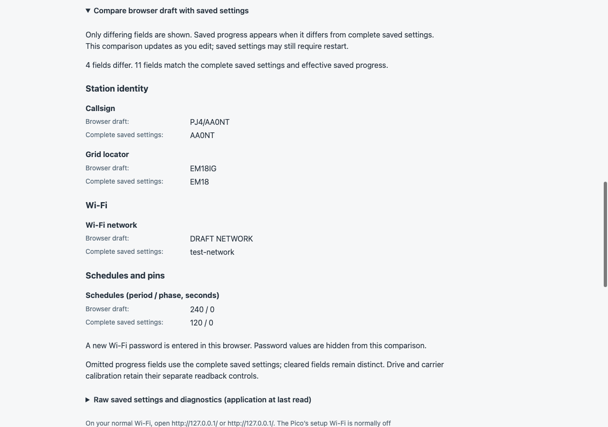 | 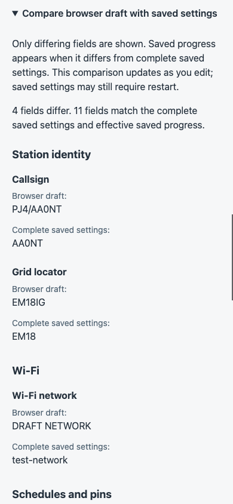 |

#### Direct path to message composition

| Final — desktop | Final — mobile |
| --- | --- |
| 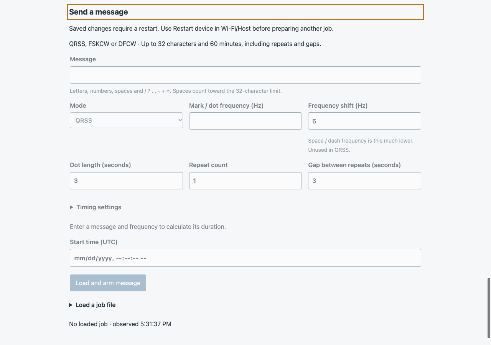 | 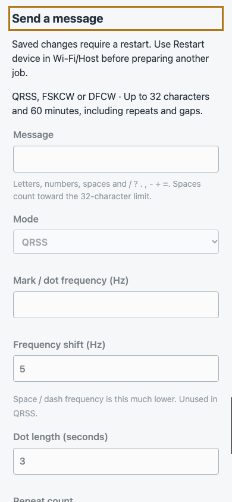 |

#### Inline provisioning error

| Final — desktop | Final — mobile |
| --- | --- |
| 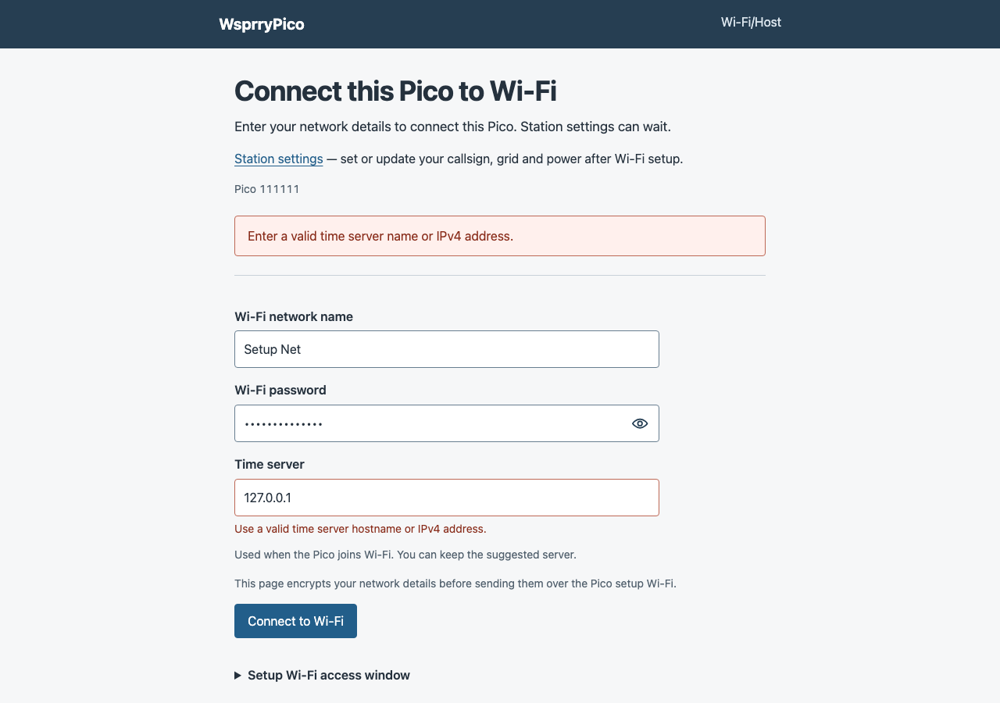 | 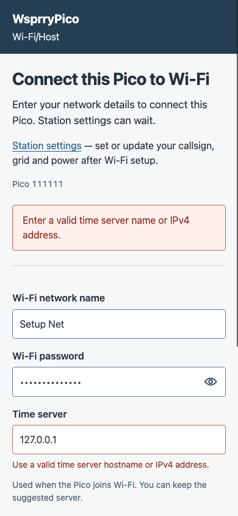 |

#### Wi-Fi-first setup

| Final — desktop | Final — mobile |
| --- | --- |
|  |  |

<details>
<summary>All 81 final second-iteration captures</summary>

- [ap-default-desktop-dark.png](phase15-19-assets/iteration2-final/ap-default-desktop-dark.png)
- [ap-default-desktop-light.png](phase15-19-assets/iteration2-final/ap-default-desktop-light.png)
- [ap-default-mobile-dark.png](phase15-19-assets/iteration2-final/ap-default-mobile-dark.png)
- [ap-default-mobile-light.png](phase15-19-assets/iteration2-final/ap-default-mobile-light.png)
- [blank-station-setup-desktop-dark.png](phase15-19-assets/iteration2-final/blank-station-setup-desktop-dark.png)
- [blank-station-setup-desktop-light.png](phase15-19-assets/iteration2-final/blank-station-setup-desktop-light.png)
- [blank-station-setup-mobile-dark.png](phase15-19-assets/iteration2-final/blank-station-setup-mobile-dark.png)
- [blank-station-setup-mobile-light.png](phase15-19-assets/iteration2-final/blank-station-setup-mobile-light.png)
- [blank-wifi-first-desktop-dark.png](phase15-19-assets/iteration2-final/blank-wifi-first-desktop-dark.png)
- [blank-wifi-first-desktop-light.png](phase15-19-assets/iteration2-final/blank-wifi-first-desktop-light.png)
- [blank-wifi-first-mobile-dark.png](phase15-19-assets/iteration2-final/blank-wifi-first-mobile-dark.png)
- [blank-wifi-first-mobile-light.png](phase15-19-assets/iteration2-final/blank-wifi-first-mobile-light.png)
- [draft-comparison-desktop-dark.png](phase15-19-assets/iteration2-final/draft-comparison-desktop-dark.png)
- [draft-comparison-desktop-light.png](phase15-19-assets/iteration2-final/draft-comparison-desktop-light.png)
- [draft-comparison-mobile-dark.png](phase15-19-assets/iteration2-final/draft-comparison-mobile-dark.png)
- [draft-comparison-mobile-light.png](phase15-19-assets/iteration2-final/draft-comparison-mobile-light.png)
- [full-erase-confirmation-desktop-dark.png](phase15-19-assets/iteration2-final/full-erase-confirmation-desktop-dark.png)
- [full-erase-confirmation-desktop-light.png](phase15-19-assets/iteration2-final/full-erase-confirmation-desktop-light.png)
- [full-erase-confirmation-mobile-dark.png](phase15-19-assets/iteration2-final/full-erase-confirmation-mobile-dark.png)
- [full-erase-confirmation-mobile-light.png](phase15-19-assets/iteration2-final/full-erase-confirmation-mobile-light.png)
- [lan-default-desktop-dark.png](phase15-19-assets/iteration2-final/lan-default-desktop-dark.png)
- [lan-default-desktop-light.png](phase15-19-assets/iteration2-final/lan-default-desktop-light.png)
- [lan-default-mobile-dark.png](phase15-19-assets/iteration2-final/lan-default-mobile-dark.png)
- [lan-default-mobile-light.png](phase15-19-assets/iteration2-final/lan-default-mobile-light.png)
- [message-shortcut-desktop-dark.png](phase15-19-assets/iteration2-final/message-shortcut-desktop-dark.png)
- [message-shortcut-desktop-light.png](phase15-19-assets/iteration2-final/message-shortcut-desktop-light.png)
- [message-shortcut-mobile-dark.png](phase15-19-assets/iteration2-final/message-shortcut-mobile-dark.png)
- [message-shortcut-mobile-light.png](phase15-19-assets/iteration2-final/message-shortcut-mobile-light.png)
- [missing-crypto-desktop-dark.png](phase15-19-assets/iteration2-final/missing-crypto-desktop-dark.png)
- [missing-crypto-desktop-light.png](phase15-19-assets/iteration2-final/missing-crypto-desktop-light.png)
- [missing-crypto-mobile-dark.png](phase15-19-assets/iteration2-final/missing-crypto-mobile-dark.png)
- [missing-crypto-mobile-light.png](phase15-19-assets/iteration2-final/missing-crypto-mobile-light.png)
- [network-station-setup-desktop-dark.png](phase15-19-assets/iteration2-final/network-station-setup-desktop-dark.png)
- [network-station-setup-desktop-light.png](phase15-19-assets/iteration2-final/network-station-setup-desktop-light.png)
- [network-station-setup-mobile-dark.png](phase15-19-assets/iteration2-final/network-station-setup-mobile-dark.png)
- [network-station-setup-mobile-light.png](phase15-19-assets/iteration2-final/network-station-setup-mobile-light.png)
- [network-wifi-first-desktop-dark.png](phase15-19-assets/iteration2-final/network-wifi-first-desktop-dark.png)
- [network-wifi-first-desktop-light.png](phase15-19-assets/iteration2-final/network-wifi-first-desktop-light.png)
- [network-wifi-first-mobile-dark.png](phase15-19-assets/iteration2-final/network-wifi-first-mobile-dark.png)
- [network-wifi-first-mobile-light.png](phase15-19-assets/iteration2-final/network-wifi-first-mobile-light.png)
- [optional-station-saved-desktop-dark.png](phase15-19-assets/iteration2-final/optional-station-saved-desktop-dark.png)
- [optional-station-saved-desktop-light.png](phase15-19-assets/iteration2-final/optional-station-saved-desktop-light.png)
- [optional-station-saved-mobile-dark.png](phase15-19-assets/iteration2-final/optional-station-saved-mobile-dark.png)
- [optional-station-saved-mobile-light.png](phase15-19-assets/iteration2-final/optional-station-saved-mobile-light.png)
- [organization-zoom.png](phase15-19-assets/iteration2-final/organization-zoom.png)
- [recovery-confirmation-desktop-dark.png](phase15-19-assets/iteration2-final/recovery-confirmation-desktop-dark.png)
- [recovery-confirmation-desktop-light.png](phase15-19-assets/iteration2-final/recovery-confirmation-desktop-light.png)
- [recovery-confirmation-mobile-dark.png](phase15-19-assets/iteration2-final/recovery-confirmation-mobile-dark.png)
- [recovery-confirmation-mobile-light.png](phase15-19-assets/iteration2-final/recovery-confirmation-mobile-light.png)
- [station-drafts-desktop-dark.png](phase15-19-assets/iteration2-final/station-drafts-desktop-dark.png)
- [station-drafts-desktop-light.png](phase15-19-assets/iteration2-final/station-drafts-desktop-light.png)
- [station-drafts-mobile-dark.png](phase15-19-assets/iteration2-final/station-drafts-mobile-dark.png)
- [station-drafts-mobile-light.png](phase15-19-assets/iteration2-final/station-drafts-mobile-light.png)
- [unavailable-recovery-desktop-dark.png](phase15-19-assets/iteration2-final/unavailable-recovery-desktop-dark.png)
- [unavailable-recovery-desktop-light.png](phase15-19-assets/iteration2-final/unavailable-recovery-desktop-light.png)
- [unavailable-recovery-mobile-dark.png](phase15-19-assets/iteration2-final/unavailable-recovery-mobile-dark.png)
- [unavailable-recovery-mobile-light.png](phase15-19-assets/iteration2-final/unavailable-recovery-mobile-light.png)
- [wifi-accepted-desktop-dark.png](phase15-19-assets/iteration2-final/wifi-accepted-desktop-dark.png)
- [wifi-accepted-desktop-light.png](phase15-19-assets/iteration2-final/wifi-accepted-desktop-light.png)
- [wifi-accepted-mobile-dark.png](phase15-19-assets/iteration2-final/wifi-accepted-mobile-dark.png)
- [wifi-accepted-mobile-light.png](phase15-19-assets/iteration2-final/wifi-accepted-mobile-light.png)
- [wifi-association-failed-desktop-dark.png](phase15-19-assets/iteration2-final/wifi-association-failed-desktop-dark.png)
- [wifi-association-failed-desktop-light.png](phase15-19-assets/iteration2-final/wifi-association-failed-desktop-light.png)
- [wifi-association-failed-mobile-dark.png](phase15-19-assets/iteration2-final/wifi-association-failed-mobile-dark.png)
- [wifi-association-failed-mobile-light.png](phase15-19-assets/iteration2-final/wifi-association-failed-mobile-light.png)
- [wifi-confirmed-next-connection-desktop-dark.png](phase15-19-assets/iteration2-final/wifi-confirmed-next-connection-desktop-dark.png)
- [wifi-confirmed-next-connection-desktop-light.png](phase15-19-assets/iteration2-final/wifi-confirmed-next-connection-desktop-light.png)
- [wifi-confirmed-next-connection-mobile-dark.png](phase15-19-assets/iteration2-final/wifi-confirmed-next-connection-mobile-dark.png)
- [wifi-confirmed-next-connection-mobile-light.png](phase15-19-assets/iteration2-final/wifi-confirmed-next-connection-mobile-light.png)
- [wifi-host-drafts-desktop-dark.png](phase15-19-assets/iteration2-final/wifi-host-drafts-desktop-dark.png)
- [wifi-host-drafts-desktop-light.png](phase15-19-assets/iteration2-final/wifi-host-drafts-desktop-light.png)
- [wifi-host-drafts-mobile-dark.png](phase15-19-assets/iteration2-final/wifi-host-drafts-mobile-dark.png)
- [wifi-host-drafts-mobile-light.png](phase15-19-assets/iteration2-final/wifi-host-drafts-mobile-light.png)
- [wifi-inline-errors-desktop-dark.png](phase15-19-assets/iteration2-final/wifi-inline-errors-desktop-dark.png)
- [wifi-inline-errors-desktop-light.png](phase15-19-assets/iteration2-final/wifi-inline-errors-desktop-light.png)
- [wifi-inline-errors-mobile-dark.png](phase15-19-assets/iteration2-final/wifi-inline-errors-mobile-dark.png)
- [wifi-inline-errors-mobile-light.png](phase15-19-assets/iteration2-final/wifi-inline-errors-mobile-light.png)
- [wifi-unconfirmed-desktop-dark.png](phase15-19-assets/iteration2-final/wifi-unconfirmed-desktop-dark.png)
- [wifi-unconfirmed-desktop-light.png](phase15-19-assets/iteration2-final/wifi-unconfirmed-desktop-light.png)
- [wifi-unconfirmed-mobile-dark.png](phase15-19-assets/iteration2-final/wifi-unconfirmed-mobile-dark.png)
- [wifi-unconfirmed-mobile-light.png](phase15-19-assets/iteration2-final/wifi-unconfirmed-mobile-light.png)

</details>

## Screenshot comparison and scores

The original screenshots, first repaired pass and second-iteration final captures are preserved byte-for-byte
under [phase15-19-assets](phase15-19-assets/), alongside this document. They no
longer depend on ignored build directories. The original 112 frames and 81 new final
frames retain their names and SHA-256 values in [the evidence manifest](phase15-19-evidence.json).

| Assessment | Original review | First repair | Final second iteration |
| --- | ---: | ---: | ---: |
| Design | **28/40** | **32/40** | **35/40** |
| Technical | **12/16** | **13/16** | **14/16** |

The operator requested another iteration after the first reassessment. Its final
screenshots and scores are recorded separately below; original frames and scores
remain unchanged. Original frames use wspr5 Chromium
155.0.8059.39; the first repaired frames use Mac Chrome 155.0.8059.82 and its
system font. All values shown are synthetic. Filename `dark` variants test the
OS preference; the product remains light only.

### Station control

| Original — desktop | First repaired pass — desktop |
| --- | --- |
| 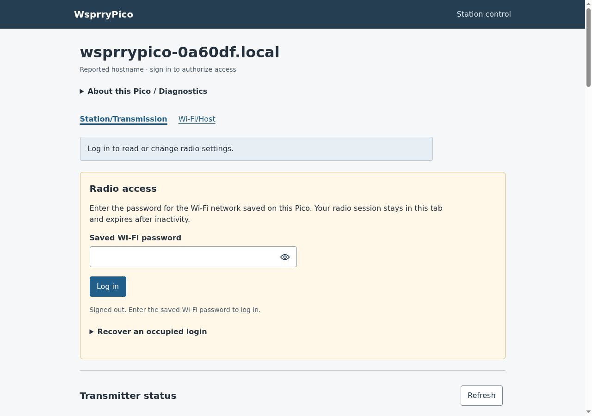 | 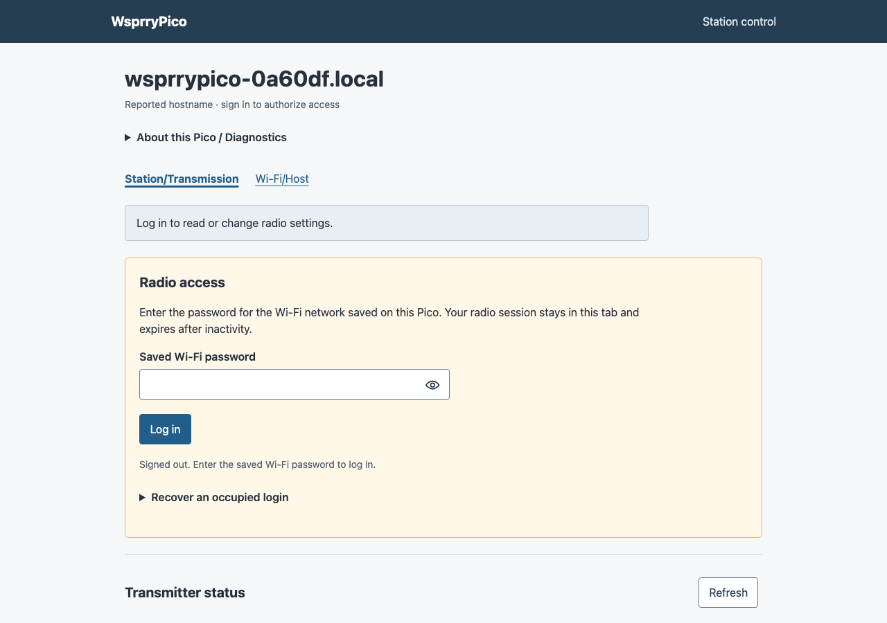 |

| Original — mobile | First repaired pass — mobile |
| --- | --- |
| 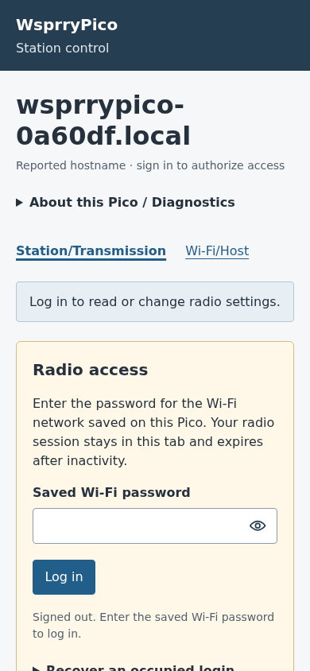 | 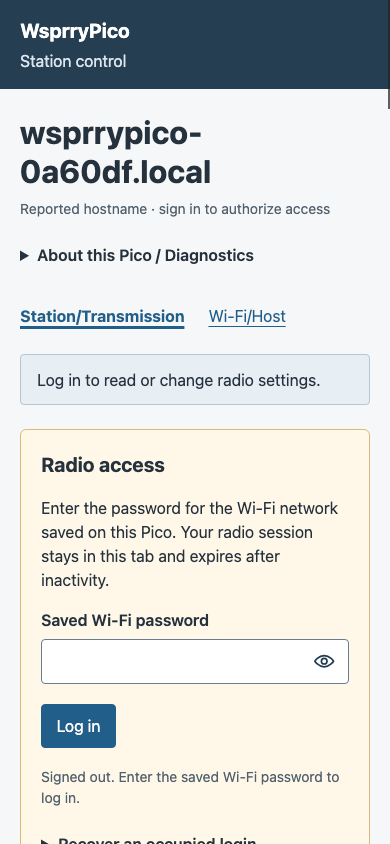 |

### Wi-Fi-first provisioning

| Original — desktop | First repaired pass — desktop |
| --- | --- |
| 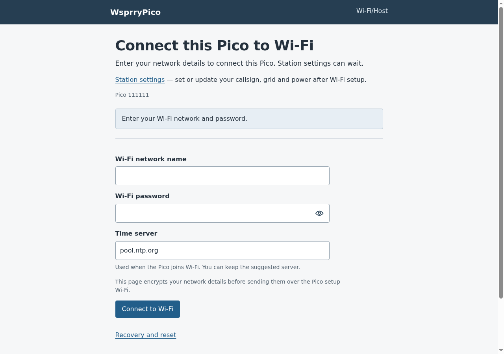 | 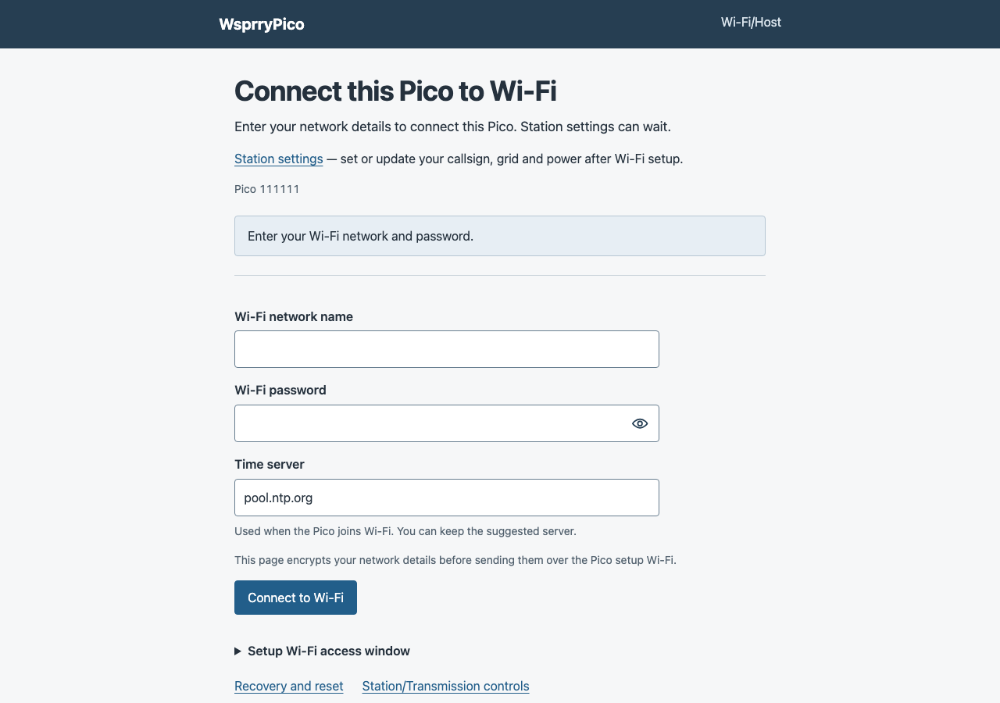 |

| Original — mobile | First repaired pass — mobile |
| --- | --- |
| 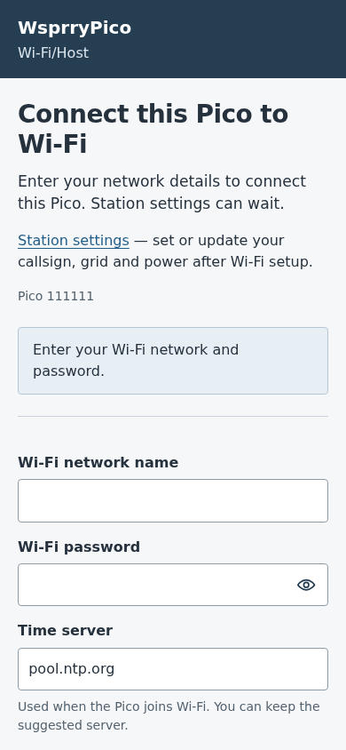 | 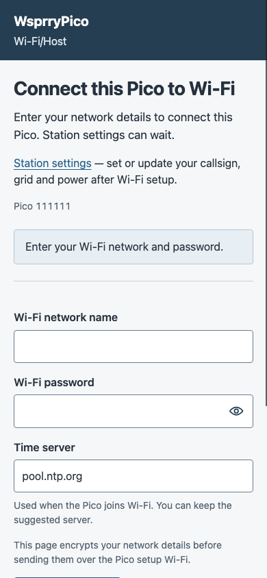 |

### Blank Pico station route

| Original — desktop | First repaired pass — desktop |
| --- | --- |
| 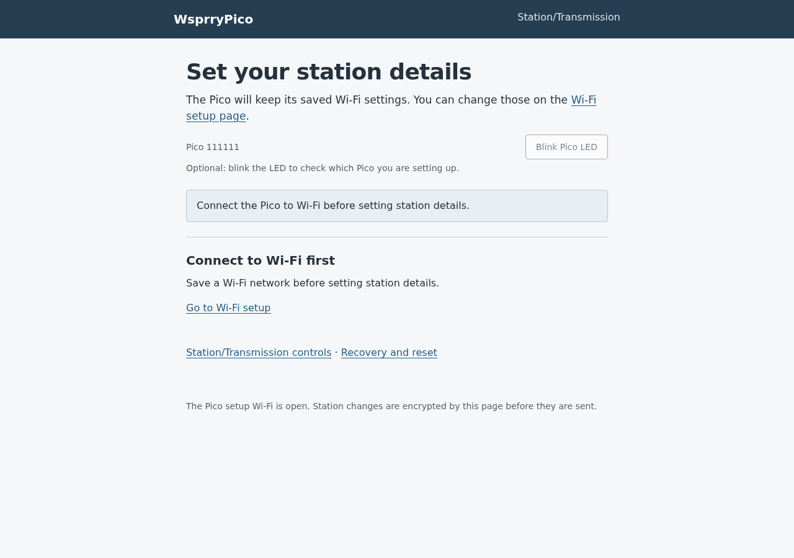 | 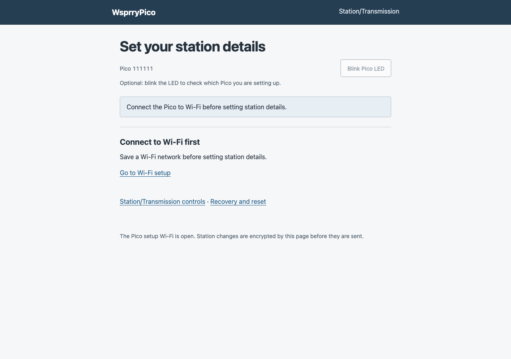 |

| Original — mobile | First repaired pass — mobile |
| --- | --- |
| 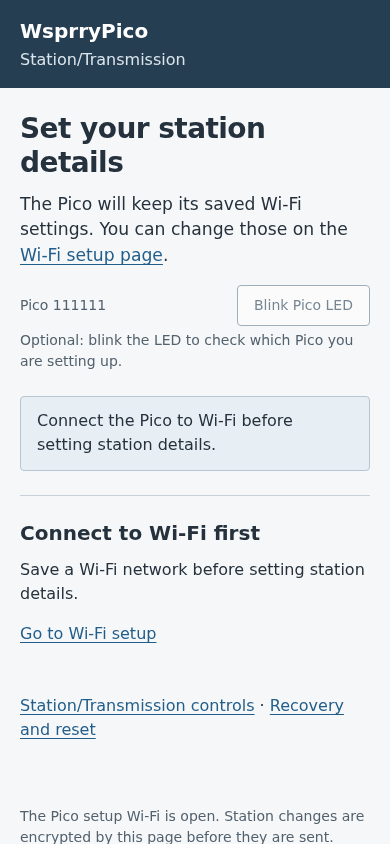 | 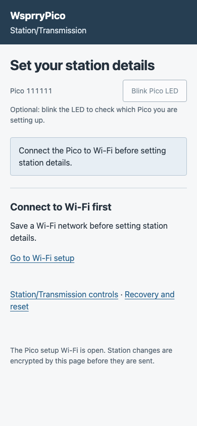 |

### Unavailable recovery

| Original — desktop | First repaired pass — desktop |
| --- | --- |
| 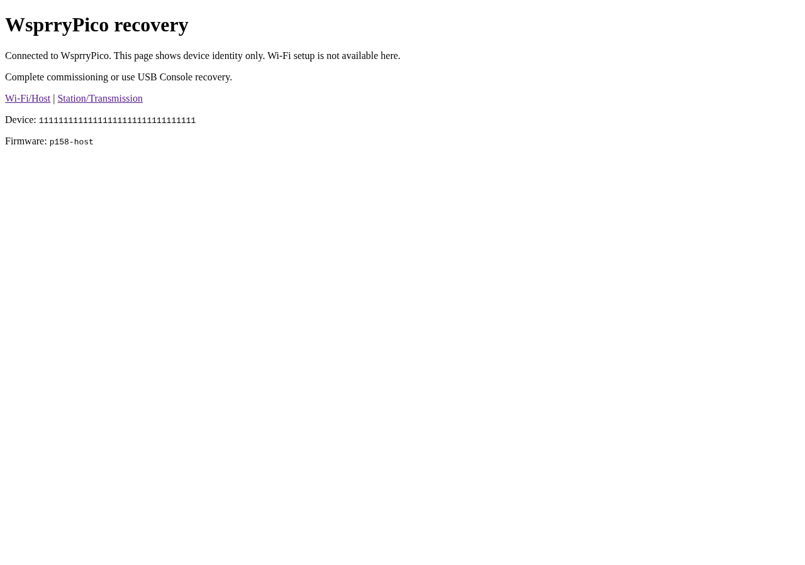 | 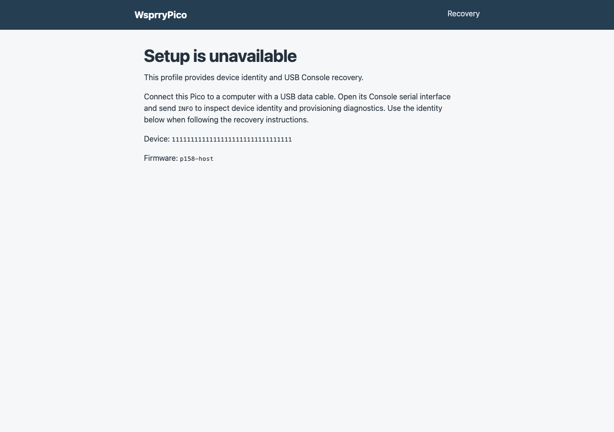 |

| Original — mobile | First repaired pass — mobile |
| --- | --- |
| 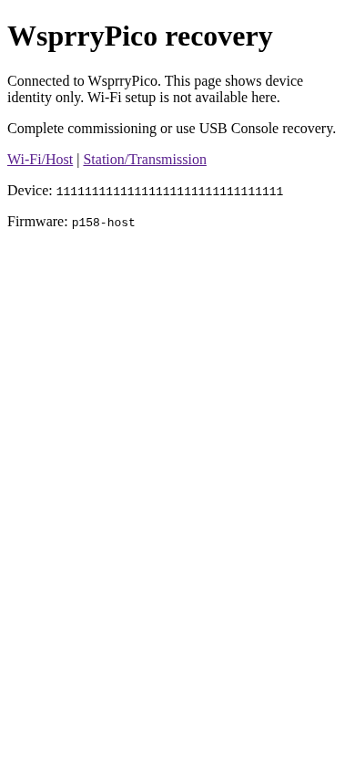 | 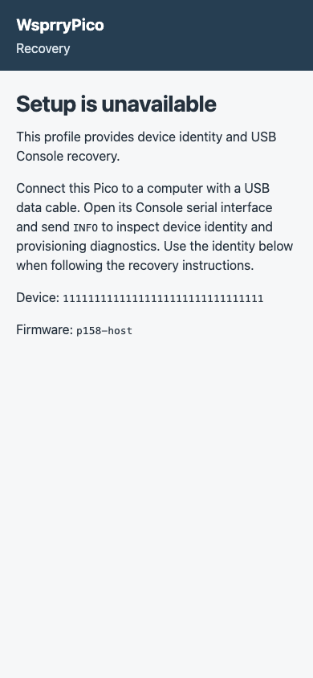 |

<details>
<summary>Complete original and first-pass screenshot inventory (112 frames)</summary>

Four initial frames named `blank-wifi-first-*` captured a faulty generation-one
fixture and are excluded from blank-device acceptance. Two corrected
`network-station-setup-*` frames show inherited busy state and are excluded from
ready-editor acceptance. They are retained as diagnostic evidence; the matched
comparisons above use the corrected blank fixture and the final ready editor is
in the first repaired pass.

#### Original review

- [ap-default-desktop-dark.png](phase15-19-assets/initial-organization/ap-default-desktop-dark.png)
- [ap-default-desktop-light.png](phase15-19-assets/initial-organization/ap-default-desktop-light.png)
- [ap-default-mobile-dark.png](phase15-19-assets/initial-organization/ap-default-mobile-dark.png)
- [ap-default-mobile-light.png](phase15-19-assets/initial-organization/ap-default-mobile-light.png)
- [blank-wifi-first-desktop-dark.png](phase15-19-assets/initial-organization/blank-wifi-first-desktop-dark.png) — fault fixture; excluded from blank acceptance
- [blank-wifi-first-desktop-light.png](phase15-19-assets/initial-organization/blank-wifi-first-desktop-light.png) — fault fixture; excluded from blank acceptance
- [blank-wifi-first-mobile-dark.png](phase15-19-assets/initial-organization/blank-wifi-first-mobile-dark.png) — fault fixture; excluded from blank acceptance
- [blank-wifi-first-mobile-light.png](phase15-19-assets/initial-organization/blank-wifi-first-mobile-light.png) — fault fixture; excluded from blank acceptance
- [lan-default-desktop-dark.png](phase15-19-assets/initial-organization/lan-default-desktop-dark.png)
- [lan-default-desktop-light.png](phase15-19-assets/initial-organization/lan-default-desktop-light.png)
- [lan-default-mobile-dark.png](phase15-19-assets/initial-organization/lan-default-mobile-dark.png)
- [lan-default-mobile-light.png](phase15-19-assets/initial-organization/lan-default-mobile-light.png)
- [missing-crypto-desktop-dark.png](phase15-19-assets/initial-organization/missing-crypto-desktop-dark.png)
- [missing-crypto-desktop-light.png](phase15-19-assets/initial-organization/missing-crypto-desktop-light.png)
- [missing-crypto-mobile-dark.png](phase15-19-assets/initial-organization/missing-crypto-mobile-dark.png)
- [missing-crypto-mobile-light.png](phase15-19-assets/initial-organization/missing-crypto-mobile-light.png)
- [network-wifi-first-desktop-dark.png](phase15-19-assets/initial-organization/network-wifi-first-desktop-dark.png)
- [network-wifi-first-desktop-light.png](phase15-19-assets/initial-organization/network-wifi-first-desktop-light.png)
- [network-wifi-first-mobile-dark.png](phase15-19-assets/initial-organization/network-wifi-first-mobile-dark.png)
- [network-wifi-first-mobile-light.png](phase15-19-assets/initial-organization/network-wifi-first-mobile-light.png)
- [organization-zoom.png](phase15-19-assets/initial-organization/organization-zoom.png)
- [station-drafts-desktop-dark.png](phase15-19-assets/initial-organization/station-drafts-desktop-dark.png)
- [station-drafts-desktop-light.png](phase15-19-assets/initial-organization/station-drafts-desktop-light.png)
- [station-drafts-mobile-dark.png](phase15-19-assets/initial-organization/station-drafts-mobile-dark.png)
- [station-drafts-mobile-light.png](phase15-19-assets/initial-organization/station-drafts-mobile-light.png)
- [unavailable-recovery-desktop-dark.png](phase15-19-assets/initial-organization/unavailable-recovery-desktop-dark.png)
- [unavailable-recovery-desktop-light.png](phase15-19-assets/initial-organization/unavailable-recovery-desktop-light.png)
- [unavailable-recovery-mobile-dark.png](phase15-19-assets/initial-organization/unavailable-recovery-mobile-dark.png)
- [unavailable-recovery-mobile-light.png](phase15-19-assets/initial-organization/unavailable-recovery-mobile-light.png)
- [wifi-host-drafts-desktop-dark.png](phase15-19-assets/initial-organization/wifi-host-drafts-desktop-dark.png)
- [wifi-host-drafts-desktop-light.png](phase15-19-assets/initial-organization/wifi-host-drafts-desktop-light.png)
- [wifi-host-drafts-mobile-dark.png](phase15-19-assets/initial-organization/wifi-host-drafts-mobile-dark.png)
- [wifi-host-drafts-mobile-light.png](phase15-19-assets/initial-organization/wifi-host-drafts-mobile-light.png)

#### Original review with corrected fixtures

- [blank-station-setup-desktop-light.png](phase15-19-assets/initial-corrected/blank-station-setup-desktop-light.png)
- [blank-station-setup-mobile-light.png](phase15-19-assets/initial-corrected/blank-station-setup-mobile-light.png)
- [blank-wifi-first-desktop-light.png](phase15-19-assets/initial-corrected/blank-wifi-first-desktop-light.png)
- [blank-wifi-first-mobile-light.png](phase15-19-assets/initial-corrected/blank-wifi-first-mobile-light.png)
- [network-station-setup-desktop-light.png](phase15-19-assets/initial-corrected/network-station-setup-desktop-light.png) — inherited busy state; excluded from ready-editor acceptance
- [network-station-setup-mobile-light.png](phase15-19-assets/initial-corrected/network-station-setup-mobile-light.png) — inherited busy state; excluded from ready-editor acceptance

#### First repaired pass

- [ap-default-desktop-dark.png](phase15-19-assets/final-mac-organization/ap-default-desktop-dark.png)
- [ap-default-desktop-light.png](phase15-19-assets/final-mac-organization/ap-default-desktop-light.png)
- [ap-default-mobile-dark.png](phase15-19-assets/final-mac-organization/ap-default-mobile-dark.png)
- [ap-default-mobile-light.png](phase15-19-assets/final-mac-organization/ap-default-mobile-light.png)
- [blank-station-setup-desktop-dark.png](phase15-19-assets/final-mac-organization/blank-station-setup-desktop-dark.png)
- [blank-station-setup-desktop-light.png](phase15-19-assets/final-mac-organization/blank-station-setup-desktop-light.png)
- [blank-station-setup-mobile-dark.png](phase15-19-assets/final-mac-organization/blank-station-setup-mobile-dark.png)
- [blank-station-setup-mobile-light.png](phase15-19-assets/final-mac-organization/blank-station-setup-mobile-light.png)
- [blank-wifi-first-desktop-dark.png](phase15-19-assets/final-mac-organization/blank-wifi-first-desktop-dark.png)
- [blank-wifi-first-desktop-light.png](phase15-19-assets/final-mac-organization/blank-wifi-first-desktop-light.png)
- [blank-wifi-first-mobile-dark.png](phase15-19-assets/final-mac-organization/blank-wifi-first-mobile-dark.png)
- [blank-wifi-first-mobile-light.png](phase15-19-assets/final-mac-organization/blank-wifi-first-mobile-light.png)
- [draft-comparison-desktop-dark.png](phase15-19-assets/final-mac-organization/draft-comparison-desktop-dark.png)
- [draft-comparison-desktop-light.png](phase15-19-assets/final-mac-organization/draft-comparison-desktop-light.png)
- [draft-comparison-mobile-dark.png](phase15-19-assets/final-mac-organization/draft-comparison-mobile-dark.png)
- [draft-comparison-mobile-light.png](phase15-19-assets/final-mac-organization/draft-comparison-mobile-light.png)
- [full-erase-confirmation-desktop-dark.png](phase15-19-assets/final-mac-organization/full-erase-confirmation-desktop-dark.png)
- [full-erase-confirmation-desktop-light.png](phase15-19-assets/final-mac-organization/full-erase-confirmation-desktop-light.png)
- [full-erase-confirmation-mobile-dark.png](phase15-19-assets/final-mac-organization/full-erase-confirmation-mobile-dark.png)
- [full-erase-confirmation-mobile-light.png](phase15-19-assets/final-mac-organization/full-erase-confirmation-mobile-light.png)
- [lan-default-desktop-dark.png](phase15-19-assets/final-mac-organization/lan-default-desktop-dark.png)
- [lan-default-desktop-light.png](phase15-19-assets/final-mac-organization/lan-default-desktop-light.png)
- [lan-default-mobile-dark.png](phase15-19-assets/final-mac-organization/lan-default-mobile-dark.png)
- [lan-default-mobile-light.png](phase15-19-assets/final-mac-organization/lan-default-mobile-light.png)
- [missing-crypto-desktop-dark.png](phase15-19-assets/final-mac-organization/missing-crypto-desktop-dark.png)
- [missing-crypto-desktop-light.png](phase15-19-assets/final-mac-organization/missing-crypto-desktop-light.png)
- [missing-crypto-mobile-dark.png](phase15-19-assets/final-mac-organization/missing-crypto-mobile-dark.png)
- [missing-crypto-mobile-light.png](phase15-19-assets/final-mac-organization/missing-crypto-mobile-light.png)
- [network-station-setup-desktop-dark.png](phase15-19-assets/final-mac-organization/network-station-setup-desktop-dark.png)
- [network-station-setup-desktop-light.png](phase15-19-assets/final-mac-organization/network-station-setup-desktop-light.png)
- [network-station-setup-mobile-dark.png](phase15-19-assets/final-mac-organization/network-station-setup-mobile-dark.png)
- [network-station-setup-mobile-light.png](phase15-19-assets/final-mac-organization/network-station-setup-mobile-light.png)
- [network-wifi-first-desktop-dark.png](phase15-19-assets/final-mac-organization/network-wifi-first-desktop-dark.png)
- [network-wifi-first-desktop-light.png](phase15-19-assets/final-mac-organization/network-wifi-first-desktop-light.png)
- [network-wifi-first-mobile-dark.png](phase15-19-assets/final-mac-organization/network-wifi-first-mobile-dark.png)
- [network-wifi-first-mobile-light.png](phase15-19-assets/final-mac-organization/network-wifi-first-mobile-light.png)
- [optional-station-saved-desktop-dark.png](phase15-19-assets/final-mac-organization/optional-station-saved-desktop-dark.png)
- [optional-station-saved-desktop-light.png](phase15-19-assets/final-mac-organization/optional-station-saved-desktop-light.png)
- [optional-station-saved-mobile-dark.png](phase15-19-assets/final-mac-organization/optional-station-saved-mobile-dark.png)
- [optional-station-saved-mobile-light.png](phase15-19-assets/final-mac-organization/optional-station-saved-mobile-light.png)
- [organization-zoom.png](phase15-19-assets/final-mac-organization/organization-zoom.png)
- [recovery-confirmation-desktop-dark.png](phase15-19-assets/final-mac-organization/recovery-confirmation-desktop-dark.png)
- [recovery-confirmation-desktop-light.png](phase15-19-assets/final-mac-organization/recovery-confirmation-desktop-light.png)
- [recovery-confirmation-mobile-dark.png](phase15-19-assets/final-mac-organization/recovery-confirmation-mobile-dark.png)
- [recovery-confirmation-mobile-light.png](phase15-19-assets/final-mac-organization/recovery-confirmation-mobile-light.png)
- [station-drafts-desktop-dark.png](phase15-19-assets/final-mac-organization/station-drafts-desktop-dark.png)
- [station-drafts-desktop-light.png](phase15-19-assets/final-mac-organization/station-drafts-desktop-light.png)
- [station-drafts-mobile-dark.png](phase15-19-assets/final-mac-organization/station-drafts-mobile-dark.png)
- [station-drafts-mobile-light.png](phase15-19-assets/final-mac-organization/station-drafts-mobile-light.png)
- [unavailable-recovery-desktop-dark.png](phase15-19-assets/final-mac-organization/unavailable-recovery-desktop-dark.png)
- [unavailable-recovery-desktop-light.png](phase15-19-assets/final-mac-organization/unavailable-recovery-desktop-light.png)
- [unavailable-recovery-mobile-dark.png](phase15-19-assets/final-mac-organization/unavailable-recovery-mobile-dark.png)
- [unavailable-recovery-mobile-light.png](phase15-19-assets/final-mac-organization/unavailable-recovery-mobile-light.png)
- [wifi-accepted-desktop-dark.png](phase15-19-assets/final-mac-organization/wifi-accepted-desktop-dark.png)
- [wifi-accepted-desktop-light.png](phase15-19-assets/final-mac-organization/wifi-accepted-desktop-light.png)
- [wifi-accepted-mobile-dark.png](phase15-19-assets/final-mac-organization/wifi-accepted-mobile-dark.png)
- [wifi-accepted-mobile-light.png](phase15-19-assets/final-mac-organization/wifi-accepted-mobile-light.png)
- [wifi-association-failed-desktop-dark.png](phase15-19-assets/final-mac-organization/wifi-association-failed-desktop-dark.png)
- [wifi-association-failed-desktop-light.png](phase15-19-assets/final-mac-organization/wifi-association-failed-desktop-light.png)
- [wifi-association-failed-mobile-dark.png](phase15-19-assets/final-mac-organization/wifi-association-failed-mobile-dark.png)
- [wifi-association-failed-mobile-light.png](phase15-19-assets/final-mac-organization/wifi-association-failed-mobile-light.png)
- [wifi-confirmed-next-connection-desktop-dark.png](phase15-19-assets/final-mac-organization/wifi-confirmed-next-connection-desktop-dark.png)
- [wifi-confirmed-next-connection-desktop-light.png](phase15-19-assets/final-mac-organization/wifi-confirmed-next-connection-desktop-light.png)
- [wifi-confirmed-next-connection-mobile-dark.png](phase15-19-assets/final-mac-organization/wifi-confirmed-next-connection-mobile-dark.png)
- [wifi-confirmed-next-connection-mobile-light.png](phase15-19-assets/final-mac-organization/wifi-confirmed-next-connection-mobile-light.png)
- [wifi-host-drafts-desktop-dark.png](phase15-19-assets/final-mac-organization/wifi-host-drafts-desktop-dark.png)
- [wifi-host-drafts-desktop-light.png](phase15-19-assets/final-mac-organization/wifi-host-drafts-desktop-light.png)
- [wifi-host-drafts-mobile-dark.png](phase15-19-assets/final-mac-organization/wifi-host-drafts-mobile-dark.png)
- [wifi-host-drafts-mobile-light.png](phase15-19-assets/final-mac-organization/wifi-host-drafts-mobile-light.png)
- [wifi-unconfirmed-desktop-dark.png](phase15-19-assets/final-mac-organization/wifi-unconfirmed-desktop-dark.png)
- [wifi-unconfirmed-desktop-light.png](phase15-19-assets/final-mac-organization/wifi-unconfirmed-desktop-light.png)
- [wifi-unconfirmed-mobile-dark.png](phase15-19-assets/final-mac-organization/wifi-unconfirmed-mobile-dark.png)
- [wifi-unconfirmed-mobile-light.png](phase15-19-assets/final-mac-organization/wifi-unconfirmed-mobile-light.png)

</details>

## Coverage and evidence

Raw logs, firmware and working evidence are ignored under `build/phase15-19/`
and isolated on wspr5 under
`/home/pi/p15-ui-review-20261017/`. Fixtures use synthetic identity, network and
password values, genuine maintained assets/crypto/handlers, RAM journals and
explicit board/TCP/time doubles. They never connect to hardware.

| Profile / route | Coverage and authority | Evidence disposition |
| --- | --- | --- |
| Blank AP `/`, `/index.html`, `/wifi-host` | Wi-Fi-first, generation zero; no job authority | Corrected initial desktop/mobile; real encrypted trial, failed association, lost reply, readback and confirmed save pass on Mac Chrome. |
| Blank `/station`, `/radio`, `/owner.html` | Wi-Fi-first refusal, no station editor | Corrected desktop/mobile refusal. |
| Network-only AP root / station aliases | Saved-network prefill, optional station, no job authority | Fresh ready desktop/mobile editor, valid-field save and explicit profile application pass. |
| Consumer station IP / hostname aliases | Station default, shared authenticated session and scoped saves | Native inspection and canonical production browser workflow passed initially. |
| Consumer AP `/`, `/index.html`, `/wifi-host` | Wi-Fi/Host default; raw setup remains AP-only | Actual dispatcher alias/admission tests and browser navigation. |
| Consumer `/station`, `/radio`, `/owner.html` | Same Station/Transmission document and authority | Production routes, drafts, explicit apply and receipt reconciliation. |
| Engineering pages | Shared maintained composition; TLS admission separate | Native desktop, host TLS/SoftApApi and actual engineering progress/invalid-input, delayed/future acknowledgement, keyboard and draft-preservation browser paths pass; TLS boundary is doubled in this browser fixture. |
| Unavailable aliases | Identity and USB recovery; no settings forms | Initial and repaired desktop/mobile; matching shell, INFO guidance, no circular links/forms. |
| `/recovery.html` where admitted | Separate reset authority, confirmations and no replay | Real encrypted reset submission; exact phrase, two confirmations, cancel/focus return and no replay after reload pass. Reset itself is a boundary double. |
| GPIO drive | Existing separate saved/boot/verified/pending states | Source/readback review, gpio_drive / schema / browser / USB tests and firmware resource guards pass. |
| Installer | Operator-deferred | No Pico or Pi installer presentation acceptance claimed. |

Consumer operation covers unauthenticated/login, draft navigation, independent station
save without message submission, pending restart, readback and lost receipt. Host
checks cover session expiry/capacity/retirement, conflicts, target/boot changes,
unsupported fields, busy/owned/RF pause and both drive API versions. Bootstrap
package tests cover wrong-device/foreign result, failed status, prefill, privacy
toggles and saved-but-disconnected states. Actual browser evidence includes the
primary success/uncertainty/failure paths; it does not claim every state on every
browser or a physical mobile keyboard.

The first fixture incorrectly selected an Unprovisioned tombstone at generation
one. Production correctly refused it. The fixture now uses an erased generation
zero and asserts the real status source/generation. Initial files named
`blank-wifi-first-*` are retained as fault evidence; corrected images are under
`initial-corrected/`. Fresh profiles avoid inherited pending setup when capturing
optional station readiness. This fixes evidence, not production admission.

The native localhost preview cannot qualify AP commissioning or login retirement:
those paths bind canonical origin/authority. The review helper now supports a
loopback HTTP proxy and advertises canonical URLs. The maintained real-browser
workflow uses canonical addresses with unchanged guards/CSP. TLS authentication
is separately tested; an authenticated engineering adapter fixture does not
establish a physical TLS handshake.

## Validation and resources

The maintained commands are used with current pinned dependencies:

```sh
npm --prefix src/network/bootstrap_web test
npm --prefix src/network/bootstrap_web run build
node tests/network_browser_tests.js
python3 scripts/validate_wtp_contract.py
```

All 17 package tests, browser logic regressions and regenerated bundle checks pass.
WTP validation passes 23 schema, seven raw JSON, one framing and eight transition
cases. The final detector confirms the same seven initial advisories; there is
no ignore-list change or score-chasing rescan.

The approved wspr5 archive uses the host preset and retained, byte-verified Mbed
TLS. Full build passes. Full CTest initially passes **202/208**. Four historical
Git-audit checks require history omitted from the archive; all four pass read-only
from the actual Mac checkout: `phase11_5_package{6,7,8}_tests.py` and
`phase11_7_closure_tests.py`. `consumer_recovery` exposed an existing driver null
access when its RNG command omitted `zero`; the fixture now preserves that option
unless supplied. Session recovery and the affected UI/route checks then pass
**4/4**. Thus 207 distinct checks pass across the valid environments.

The remaining `phase12_rf_adapter_tests` failure is an existing extracted-code
harness limitation: unchanged dispatcher code references `location`, `wtp::json`,
`boot_id_`, `progress_api_` and `owner_claimable` absent from unchanged test stubs.
The test and its direct extraction inputs match entry HEAD; the independent
assessor confirmed that provenance. No firmware guard/test expectation was
weakened to obtain a green full-suite claim; this is **not 208/208**.

Host configure/build/full-suite command paths:

```sh
cmake --preset host-debug -S /home/pi/p15-ui-review-20261017/source \
  -B /home/pi/p15-ui-review-20261017/host \
  -DWSPRRY_PICO_TEST_MBEDTLS_PATH=/home/pi/p15-gpio-drive-20261017/mbedtls
cmake --build /home/pi/p15-ui-review-20261017/host -j2
ctest --test-dir /home/pi/p15-ui-review-20261017/host --output-on-failure -j2
```

The supported canonical browser harness uses genuine maintained documents and
crypto/handlers. Node 20.19.2 with `--experimental-websocket`, Chromium
155.0.8059.39 on wspr5 passes the hostname/keyboard/reconnect/lost-reply suite.
Its organization runs intermittently stall in `Page.navigate`; a 15-second CDP
deadline makes this finite. No repeatable source defect or incomplete document
was established. Mac Chrome **155.0.8059.82**, Node **26.12.0**, a fresh synthetic
profile and an SSH executable wrapper to the same isolated driver complete the
organization workflow, including failed 45-second synthetic association, lost
Wi-Fi reply without replay, confirmation, optional station apply, reset/no-replay,
missing-crypto fallback and unavailable recovery. This is browser/software
acceptance, not a physical network or device measurement.

Final Mac browser commands use the recorded wrapper, which executes only
`ssh wspr5 /home/pi/p15-ui-review-20261017/host/consumer_bootstrap_driver` and
forwards the synthetic device argument. Its retained reproduction source is
`build/phase15-19/remote-driver.sh`; the temporary executable was removed.

```sh
node tests/organization_browser_integration.mjs /private/tmp/p1519-remote-driver \
  build/phase15-19/final-mac-organization
PROGRESS_BROWSER_NO_CAPTURE=1 node tests/progress_browser_integration.mjs \
  /private/tmp/p1519-remote-driver build/phase15-19/progress-mac-functional
```

The final organization run records 116 complete fixture requests, 13 document
requests and exactly two Wi-Fi submits: one failed attempt and one explicitly
requested retry whose reply is dropped. Readback confirms the second save
without another submit. These are workflow totals, not page-load budgets.

The progress harness was refreshed for already-delivered progress `/3`, actual
versioned update routes and discovery/reload readiness. The reload wait now
requires a new `performance.timeOrigin`, preventing edits to the outgoing page.
The complete Mac progress workflow passes, including partial/invalid inputs,
zero power, blank QRSS draft, saved-versus-applied state, reconstructed reboot,
future/delayed acknowledgements, explicit read/review without replay, public
commissioning loss/readback, native numeric input and keyboard focus.

The independent reviewer found a stale comparison after Reload saved settings.
Reload now invalidates the old comparison before filling fields and replaces its
readback-required status with successful reload wording. Regression tests verify
both the hidden stale comparison and the coherent ready status.

Cross-build recipe (existing SDK/toolchain, both accepted variants):

```sh
source scripts/xcode_env.sh
export PICO_SDK_PATH="$PWD/build/local-sdk-079c6f3"
cmake --preset pico2-w -S build/phase15-19/source -B build/phase15-19/pico \
  -DCMAKE_EXPORT_COMPILE_COMMANDS=ON \
  -DPICOTOOL_FETCH_FROM_GIT_PATH="$PWD/build/phase15-19/picotool-deps" \
  -DPICOTOOL_GIT_REPOSITORY_URL="$PWD/build/pico2-w/_deps/picotool-src"
cmake --build build/phase15-19/pico --target WsprryPico WsprryPico-Inhibited -j2
```

SDK 2.3.1 pin `079c6f39023649b154152db30f1d781e884879bc`, Arm GNU
15.3.rel2/GCC 15.3.1 and retained picotool 2.3.0 are unchanged. No dependency
upgrade/download was performed. The Mac's initially full disk interrupted
preliminary host/baseline linking; failed logs are retained. Only this run's
preliminary generated host trees were removed (`local-build-cleanup.json`).
Subsequent external space recovery allowed baseline and final linking to pass.

| Linked image | Baseline text / BSS | Final text / BSS | Text delta |
| --- | ---: | ---: | ---: |
| Normal RF | 2,377,368 / 335,992 B | 2,385,568 / 335,992 B | +8,200 B |
| Inhibited | 2,358,404 / 179,980 B | 2,366,596 / 179,980 B | +8,192 B |

Data remains zero in `size`. Normal/inhibited UF2 sizes are 4,702,208/4,664,320 B,
each +16,384 B. Renderer identity is unchanged: 660 bytes, 233 checked
instructions at `0x200012d8`, 13,968 initialized-data bytes and a 166,176-byte RF
worker at `0x200167a8`. Both engine selection checks, reserved journal boundary
at `0x103f0000`, 32 KiB primary stack, heap/core1 separation, heap wrappers,
Bluetooth pools and guard checks pass without relaxation. These are linked-image
checks; they do not refresh target timing/RF qualification.

| Served composition | Baseline | Final | Delta |
| --- | ---: | ---: | ---: |
| Consumer document | 257,226 B | 260,568 B | +3,342 B |
| Engineering document | 151,588 B | 154,930 B | +3,342 B |
| Wi-Fi setup document | 64,569 B | 66,286 B | +1,717 B |
| Optional station document | 123,287 B | 124,153 B | +866 B |
| Reset document | 55,216 B | 55,535 B | +319 B |
| Unavailable document | 511 B | 713 B | +202 B plus local CSS |

The first five documents inline local CSS/scripts and need one asset request,
with zero external asset requests. The repaired unavailable page needs two local
asset requests (713 B HTML + 3,683 B stylesheet), also zero external assets.
Initial native request logs and final complete production HTTP bodies verify the
consumer/setup/station/reset byte counts and hashes. Engineering size is the
exact generated composition, independently exercised through its API fixture.
Minified setup bundle is 55,629 → 55,905 B; station bundle 73,197 → 73,742 B;
owner-key bundle remains 40,787 B. Raw file sizes/hashes and full screenshot/log
inventories are retained in the evidence manifest. Assets remain well within
unchanged literal/response/linked-image checks. Polling and mutation protocols
are unchanged; draft comparison performs no requests. There is no latency budget
or Pico first-usable performance claim. Ready controls and completed tasks are
observed in named fixtures; loopback/SSH/host times are fixture conditions only.

Source transfer was initially rejected by automatic approval review; the
operator explicitly approved the exact snapshot/destination, then it succeeded.
Retained Mbed TLS matches clean pinned local source byte-for-byte. Only the
isolated archive's Git preflight is substituted with recorded byte identity;
all runtime checks/guards remain. No shared tool, service or dependency changed.

## Cleanup, limitations and P15.20 handoff

The old fixture server (wspr5 PID 582369) and verified SSH tunnel (Mac PID
13699, session 37125, ports 18719–18724) were stopped. Remote port/process checks
confirm no listeners; local tunnel shutdown is recorded. A closed its five
native tabs and reset viewport. B closed Chrome tab 387084258 and successfully
reset viewport. The parent closed its blank IAB documentation tab. Each maintained
headless workflow closes its own browser, proxy and driver. Final process checks
show no task browser/driver remaining. Six Mac and 13 wspr5 synthetic profiles
were inventoried and removed; the SSH wrapper was removed after retaining its
reproduction source. Unrelated profiles and build/evidence areas are retained. No overlay or Impeccable live server was started.

The critique snapshot was written outside the repository at
`/private/tmp/p1519-critique-vazgwnw8/.impeccable/critique/2026-10-17T22-01-41Z__src-network-web-index-html.md`;
the temporary body was removed and one-row trend read succeeded. Slug:
`src-network-web-index-html`; ignore list absent; independent A/B assessments
preserved; detector source fallback and blocked overlay are disclosed above.
The source, raw/minified asset, linked-image, screenshot and local log inventories
and SHA-256 values are in [the evidence manifest](phase15-19-evidence.json).
Local evidence root: `build/phase15-19/`; wspr5 root:
`/home/pi/p15-ui-review-20261017/`. Baseline/failed runs remain distinguishable
from the final Mac acceptance. There is no new cosmetic iteration after the
batched confirmation; functional retries repaired harness/source correctness.

| Before/after pair | Before image | After image |
| --- | --- | --- |
| Unavailable recovery, 1280×900 | `initial-organization/unavailable-recovery-desktop-light.png` | `final-mac-organization/unavailable-recovery-desktop-light.png` |
| Blank station refusal, 390×844 | `initial-corrected/blank-station-setup-mobile-light.png` | `final-mac-organization/blank-station-setup-mobile-light.png` |
| Wi-Fi first, 390×844 | `initial-corrected/blank-wifi-first-mobile-light.png` | `final-mac-organization/blank-wifi-first-mobile-light.png` |

Paths above are relative to the local evidence root. Baseline frames use wspr5
Chromium; final frames use Mac Chrome and its system font. These show actual
maintained compositions with synthetic values. The final confirmation inspected
mobile/desktop refusal, Wi-Fi first, confirmed reconnect, ready/confirmed optional
station, draft comparison, reset focus and unavailable recovery. CSS/keyboard,
visible focus, labels, error associations, status text, 44px targets, long-content
wrapping and 200% no-horizontal-overflow checks accompany the real-browser flows.
Actual iOS/Android keyboards, Safari, Firefox and physical captive windows were
not exercised. No dark theme or formal accessibility certification is claimed.

Pico A was identified by USB serial `0BF4B4AEC9FFB344` on wspr5. NTP deployment
was active on B, which was not operated by this task. This review has not opened
A's serial ports, flashed firmware, changed settings, reset a board, armed a job
or transmitted RF. Physical browser/captive-portal/USB/device behavior and target
latency remain outside the software evidence. No device restoration is claimed.

P15.20 should use the final route/profile distinctions, Wi-Fi-first/optional
station ordering, ten-minute setup-window and USB recovery guidance, explicit
draft/save/apply/restart vocabulary and final screenshot inventory. Installer
material remains deferred. No documentation site is built or published here.

Independent final assessor `/root/final_assessment` accepted this scope after
checking changed source, regenerated bundles, attribution, 112 screenshot hashes,
32 log hashes, linked artifacts/guards, 13 representative desktop/mobile/recovery/
zoom frames and actual browser flow evidence. Its stale-comparison and reload
status findings were fixed and affected regressions passed before reassessment.
No actionable findings remain within this software scope. Initial critique/audit
scores are retained; the separately requested post-repair reassessment above
adds new scores without expanding physical acceptance.

At software-review acceptance, no Git staging, commit, push, tag or publication
had been performed. The evidence manifest lists attributable source and excluded
concurrent files. The pre-commit working state remained on `devel` at the entry
HEAD; no NTP conflict was detected. At first acceptance, the attributable inventory contained 25 modified and three
new files. The requested documentation follow-up adds 112 unchanged PNG files;
eight modified and one new external NTP path remain preserved separately. The index
is empty. The second iteration is independently accepted as recorded above; P15.20
remains Not started.

Pre-commit repository inventory: 33 attributable modified files and 205
attributable new files (including 193 screenshots); eight modified and one new
external NTP paths are preserved. The index was empty and HEAD unchanged at that
validation checkpoint.

## Operator closeout

The operator accepted P15.19, closed VoiceOver testing as not required, and
requested commit and push on 2026-10-17. Punchlist item 5 is closed. Only the
attributable UI, test and documentation paths are included in the closeout;
concurrent NTP changes remain outside the commit. Repository inventories in this
record and its manifest describe the pre-commit validation checkpoint. Git
history records the resulting delivery commit.
