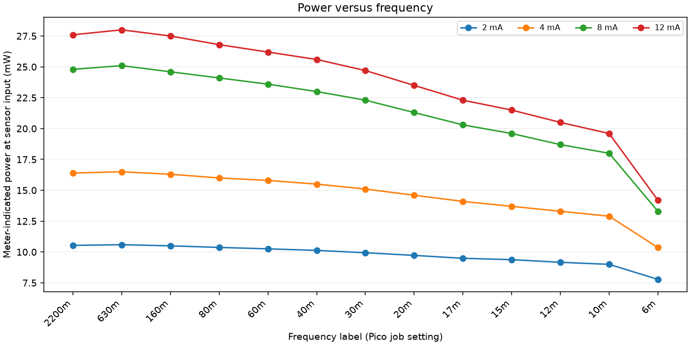
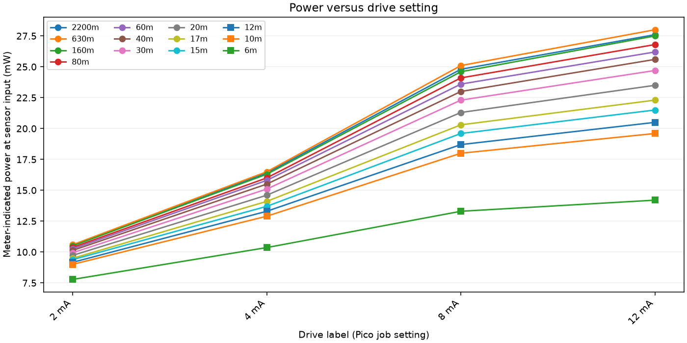
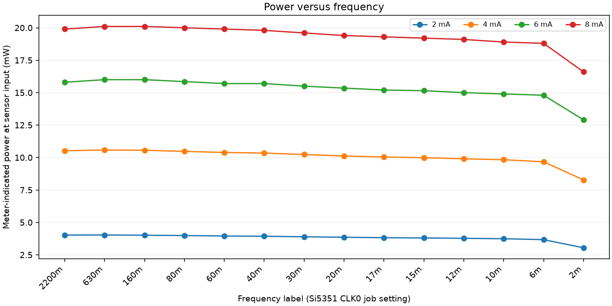
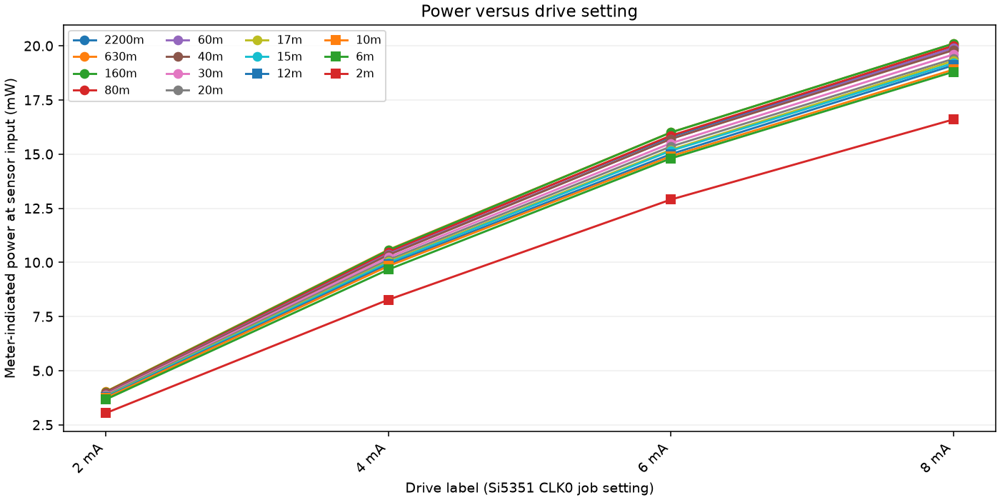

# Output and band limits

One normal firmware image supports **Direct GPIO** and the qualified external **Si5351** setup. Select the RF engine in Radio pins.

(gpio-drive-strength)=
## Direct GPIO output

The direct engine generates **RF**, a radio-frequency signal, on the configured **GPIO output pin**. The factory selection is **GP2, physical pin 4**; see [hardware preparation](../start.md#hardware-connections) for wiring and other pin choices. The Pico uses a **138 MHz** system clock for this output.

The generator's numeric range is **100 kHz through 68,999,999 Hz**. **1 kHz is 1,000 Hz; 1 MHz is 1,000,000 Hz.** That range does not mean every frequency inside it is enabled or suitable for transmission. The firmware also checks permissions for the selected band and frequency.

### Band coverage

The sampled frequencies below are the bare-GPIO power-measurement points
described below, not mode-decoding or emissions qualifications. They are RF
frequencies, not WSPR USB dial settings. A dash means no point was measured
in that sweep.

| Band | Sampled RF frequency (Hz) | Current operating boundary |
| --- | ---: | --- |
| 2200 m | 137500 | Enabled by the normal frequency policy |
| 630 m | 475700 | Enabled by the normal frequency policy |
| 160 m | 1838100 | Enabled by the normal frequency policy |
| 80 m | 3570100 | Enabled by the normal frequency policy |
| 60 m | 5366200 | Enabled by the normal frequency policy |
| 40 m | 7040100 | Enabled by the normal frequency policy |
| 30 m | 10140200 | Enabled by the normal frequency policy |
| 20 m | 14097100 | Enabled by the normal frequency policy |
| 17 m | 18106100 | Enabled by the normal frequency policy |
| 15 m | 21096100 | Enabled by the normal frequency policy |
| 12 m | 24926100 | Enabled by the normal frequency policy |
| 10 m | 28126100 | Enabled by the normal frequency policy |
| 8 m | — | Disabled by default; requires explicit advanced experimental-frequency permission |
| 6 m | 50294500 | Enabled by the normal frequency policy |
| 5 m | — | Disabled by default; requires explicit advanced experimental-frequency permission |
| 4 m | — | Unavailable with direct GPIO in the normal 138 MHz firmware |
| 2 m | — | Unavailable with direct GPIO output |

For standalone WSPR, enter the whole-Hz USB dial in **WSPR dial frequency (Hz)**. The four RF tones surround dial +1,500 Hz, and every tone must fit the generator range and frequency permissions. On numeric engine limits alone, the normal 138 MHz engine allows dial values from 98503 through 68998496 Hz; frequency permissions also apply. The dial is a reference, not an emitted RF frequency.

### Drive strength

GPIO drive selects the output pin's electrical drive strength. New installations
use **12 mA**; settings-preserving upgrades retain the saved selection.

| Drive setting | Recorded test coverage |
| --- | --- |
| 2 mA | Bare-GPIO power sweep at all 13 sampled frequencies |
| 4 mA | Bare-GPIO power sweep at all 13 sampled frequencies |
| 8 mA | Bare-GPIO power sweep at all 13 sampled frequencies |
| 12 mA | Bare-GPIO power sweep at all 13 sampled frequencies |

Drive is not a calibrated RF-power control. See [Pins and drive](../configure.md#pins-and-drive)
for configuration and restart requirements.

### Measured bare-GPIO power

The following graphs show a bare **Pico 2 W GP2** sweep recorded on
**24 November 2026 (UTC)** by Lee Bussy [AA0NT]. GP2 was connected through a
coax adapter directly to an **HP 8482A power sensor** and **HP 437B power meter**,
without an output filter, amplifier, or attenuator chain. The sweep covered
13 frequency settings from **137,500 Hz to 50,294,500 Hz** at each of the
**2, 4, 8, and 12 mA** GPIO drive settings, with two readings averaged per point.

These are **meter-indicated power readings at the sensor input**, with the
recorded sensor calibration factors applied. The unfiltered output includes
harmonics, so the readings do not isolate power at the wanted frequency.
No additional fixture-loss correction, uncertainty estimate, or baseline
subtraction is included. The plots describe this measured setup; they do not
establish guaranteed output power, filtered antenna power, or emissions compliance.

*Power versus frequency setting.* Band labels identify the requested test
frequencies and are equally spaced; the horizontal axis is not a linear
frequency scale. At 12 mA, the mean indication was **28.0 mW** at 475,700 Hz,
**23.5 mW** at 14,097,100 Hz, and **14.2 mW** at 50,294,500 Hz.

*Power versus GPIO drive setting.* Drive labels are equally spaced categories,
not a linear current scale. Increasing drive raised the indication at every
sampled frequency, with a smaller increase from 8 to 12 mA than from 4 to 8 mA.
GPIO drive remains an electrical setting, not a calibrated RF-power control.

## Si5351 output

Ordinary firmware supports the [qualified QRP Labs Rev. 6 / 25 MHz TCXO setup](../configure.md#si5351-output-settings). RF comes from the module's CLK0 connector, rather than a Pico RF GPIO. The numeric synthesis range is **8 kHz–160 MHz**, subject to complete-plan validation; this is not qualification of every frequency or configuration in that range. Other module/reference/drive arrangements require an engineering build.

### Band coverage

Conducted tone, WSPR, QRSS, FSKCW, and DFCW tests passed at each sampled RF frequency below. These are emitted RF frequencies, not WSPR USB dial settings.

| Band | Sampled RF frequency (Hz) | Current operating boundary |
| --- | ---: | --- |
| 2200 m | 137500 | Enabled by the normal frequency policy |
| 630 m | 475700 | Enabled by the normal frequency policy |
| 160 m | 1838100 | Enabled by the normal frequency policy |
| 80 m | 3570100 | Enabled by the normal frequency policy |
| 60 m | 5288700 | Enabled by the normal frequency policy |
| 40 m | 7050000 | Enabled by the normal frequency policy |
| 30 m | 10140200 | Enabled by the normal frequency policy |
| 20 m | 14097100 | Enabled by the normal frequency policy |
| 17 m | 18106100 | Enabled by the normal frequency policy |
| 15 m | 21096100 | Enabled by the normal frequency policy |
| 12 m | 24926100 | Enabled by the normal frequency policy |
| 10 m | 28126100 | Enabled by the normal frequency policy |
| 8 m | 40001000 | Disabled by default; requires explicit advanced experimental-frequency permission |
| 6 m | 50294500 | Enabled by the normal frequency policy |
| 5 m | 60001000 | Disabled by default; requires explicit advanced experimental-frequency permission |
| 4 m | 70400000 | Disabled by default; requires explicit advanced experimental-frequency permission |
| 2 m | 144490500 | Native Test Tone admits this exact carrier on the ordinary Si5351 profile by default. Other 2 m carriers and transmission modes require explicit advanced experimental-frequency permission. |

Every transmission remains subject to the chosen frequency, RF setup, and operating privileges. These results apply to the recorded Pico C engineering image and QRP Labs Rev. 6 / 25 MHz TCXO setup, using CLK0 at **8 mA**. They qualify the sampled points under those test conditions, rather than complete band ranges or other module/reference/drive configurations. All three consecutive WSPR frames decoded the expected message at each point; CW acceptance uses human-readable marks and frequency states. These results do not establish calibrated frequency, power, emissions, or absolute UTC timing.

### Drive strength

Si5351 drive selects the transmit clock output's electrical drive strength.
The settings offer **2, 4, 6, or 8 mA**; the recorded mode tests above used
**8 mA** with the qualified module and reference setup.

| Drive setting | Recorded test coverage |
| --- | --- |
| 2 mA | Bare-Si5351 power sweep at all 14 power-sweep frequencies |
| 4 mA | Bare-Si5351 power sweep at all 14 power-sweep frequencies |
| 6 mA | Bare-Si5351 power sweep at all 14 power-sweep frequencies |
| 8 mA | Bare-Si5351 power sweep at all 14 power-sweep frequencies; conducted tone, WSPR, QRSS, FSKCW, and DFCW tests at all 17 mode-test frequencies |

Drive is not a calibrated RF-power control. See [Si5351 output settings](../configure.md#si5351-output-settings)
for supported module, reference, drive, and restart requirements. The bare-GPIO
power graphs do not measure Si5351 output power.

### Measured bare-Si5351 power

The following graphs show a bare **QRP Labs Si5351A Synthesizer and 25 MHz
TCXO module** sweep recorded on **24 November 2026 (UTC)** by Lee Bussy [AA0NT],
using a **Pico 2 W** to control the module. **CLK0** was connected through a
coax adapter directly to an **HP 8482A power sensor** and **HP 437B power meter**,
without an output filter, amplifier, or attenuator chain. The sweep covered
14 frequency settings from **137,500 Hz to 144,490,500 Hz** at each of the
**2, 4, 6, and 8 mA** Si5351 drive settings, with two readings averaged per point.

The power sweep used the same frequencies as the GPIO sweep from 2200 m
through 6 m, plus **144,490,500 Hz** on 2 m. Its **60 m (5,366,200 Hz)** and
**40 m (7,040,100 Hz)** points differ from the earlier Si5351 mode-test points
in the band table above; 8 m, 5 m, and 4 m were not included in this power sweep.

These are **meter-indicated power readings at the sensor input**, with the
recorded sensor calibration factors applied. The unfiltered output includes
harmonics, so the readings do not isolate power at the wanted frequency.
No additional fixture-loss correction, uncertainty estimate, or baseline
subtraction is included. The plots describe this measured setup; they do not
establish guaranteed output power, filtered antenna power, or emissions compliance.
The power sweep does not extend the mode-test qualification to other drive settings.

*Power versus frequency setting.* Band labels identify the requested test
frequencies and are equally spaced; the horizontal axis is not a linear
frequency scale. At 8 mA, the mean indication was **20.1 mW** at 475,700 Hz,
**19.4 mW** at 14,097,100 Hz, and **16.6 mW** at 144,490,500 Hz.

*Power versus Si5351 drive setting.* Increasing drive raised the indication at
every sampled frequency. The 2 m indication was lower than the other sampled
bands at every drive setting. Si5351 drive remains an electrical setting,
not a calibrated RF-power control.

## RF connections and permissions

The band names in metres describe approximate radio wavelengths. They are not frequency entries for the browser's Hz fields. Use a frequency appropriate for your chosen mode and operating privileges.

The RF output is **unfiltered**. It contains the wanted signal and unwanted frequencies, including **harmonics**, which are multiples of the intended frequency. Use a suitable output filter before connecting to an antenna. A **load** is the circuit or device receiving the output; use a suitable test load or measurement connection while checking the setup. **Attenuation** reduces signal level to suit the next device. Filtering, attenuation, the load, and any amplifier must suit the frequency and signal level.

**Reported WSPR power** is the power value sent in the beacon message. **GPIO drive** selects the output pin's electrical drive setting: **2, 4, 8, or 12 mA**, with **12 mA** for a new installation. Settings-preserving upgrades retain the saved drive strength. Neither control measures RF power. Measure the actual output with suitable equipment; a received signal level alone is not a transmitter-power measurement. Recheck the RF setup when changing drive, frequency, filtering, or amplification. The [radio defaults table](defaults.md#radio-pins-and-filtering) also lists the initial pin, amplifier, and filtering selections.

The optional **amplifier-enable** output is a separate logic control signal. It stays active for an entire job, including message gaps, and becomes inactive when the job stops. It does not supply amplifier power. Before connecting amplifier control circuitry, check its [pin and polarity settings](../configure.md#pins-and-drive).

The optional [LPF / band selector](../configure.md#lpf-and-band-selector) chooses one external filter for each complete job. Its output settles before amplifier enable and remains selected until after amplifier disable. Required selection checks every nominal and programmed RF frequency against declared ranges. Fixed/manual filtering leaves selector outputs inactive. These controls do not measure or certify the external filter.

Experimental frequency permissions are advanced configuration settings; the ordinary browser form does not edit them. They do not expand the generator's limits or bypass time, control ownership, pin, or output checks. Permission in firmware is not a statement of RF performance or local operating authority.
