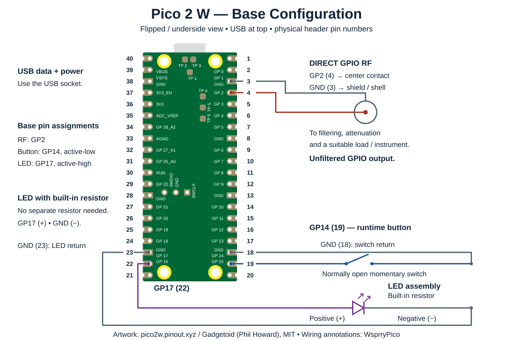
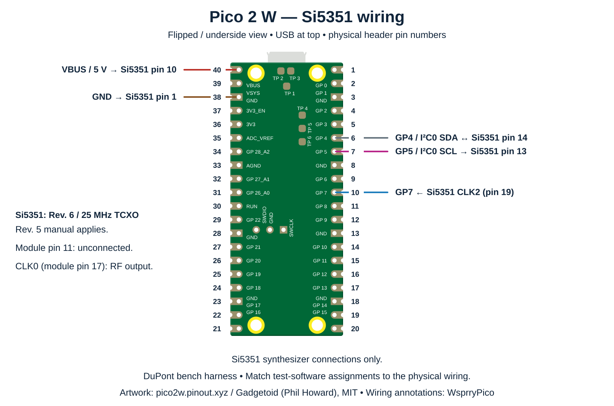
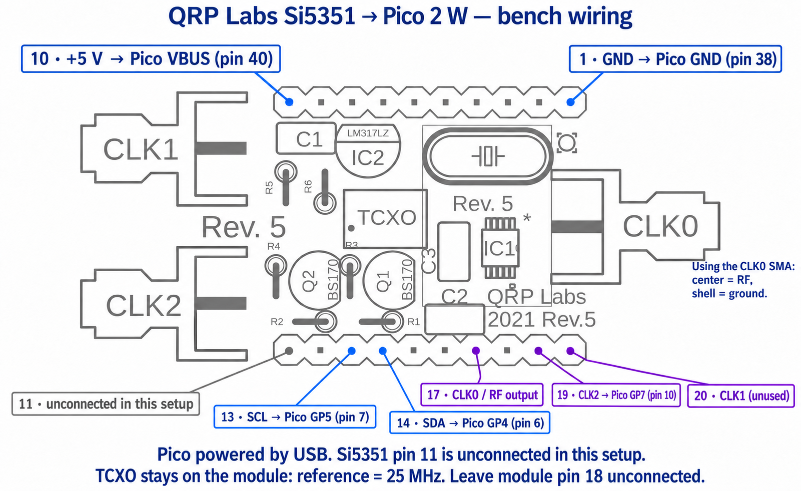
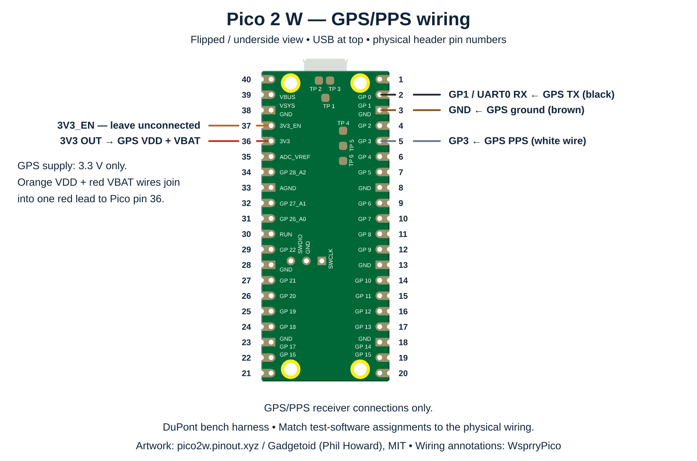
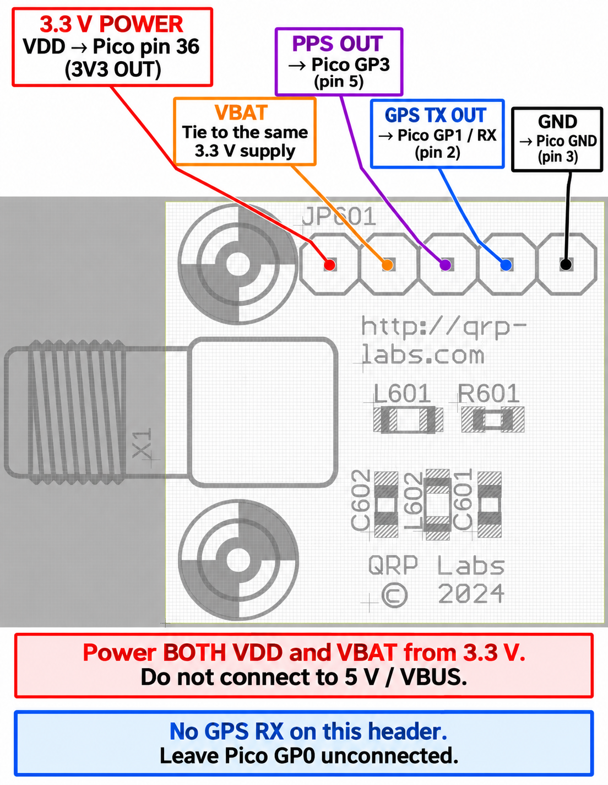

# Pico Validation Platform

The validation platform starts with a **Raspberry Pi Pico 2 W**, a runtime control button, an external transmit LED and a direct GPIO RF connection. A **QRP Labs Rev. 6 Si5351A synthesizer with a 25 MHz TCXO** and a **QRP Labs QLG3 GPS receiver** provide synthesizer output, GPS serial data and PPS connections for bench measurements.

WsprryPico supports many pin combinations for the configurable RF, button and external LED roles. The combination shown here was selected for easy, clearly identifiable **DuPont jumper connections** on the bench. It is not a preferred electrical arrangement or a recommendation for a printed circuit board layout. A PCB design needs its own pin selection, routing, grounding and RF layout review. Alternative assignments must respect the available GPIOs, exclusive pin roles and any peripheral mapping requirements; the module connections below record this harness's specific assignments.

Disconnect USB and any other power before changing wiring. GPIO names such as **GP2** and physical header numbers such as **pin 4** are different numbering systems. Each GPIO must have one exclusive role. Match the pin assignments in the loaded test software to the physical wiring before applying power.

## Parts

The QRP Labs components are available from **Hans Summers' [QRP Labs store](https://shop.qrp-labs.com/)**.

| Part | Platform configuration | Store |
| --- | --- | --- |
| Raspberry Pi Pico 2 W | RP2350 board, powered through a USB data cable | [Raspberry Pi product information](https://www.raspberrypi.com/products/raspberry-pi-pico-2/) |
| QRP Labs QLG3 | GPS receiver with its active patch antenna and SMA connection | [QLG3 receiver kit](https://shop.qrp-labs.com/qlg3) |
| QRP Labs Si5351A synthesizer | Rev. 6 board with onboard regulator and I²C level converters | [Si5351A synthesizer kit](https://shop.qrp-labs.com/synth) |
| QRP Labs 25 MHz TCXO | Fitted to the Si5351 board instead of the standard crystal | [25 MHz TCXO module](http://shop.qrp-labs.com/tcxo?search=TCXO) |
| Normally open momentary push button | Runtime switch between GP14 (physical pin 19) and GND (physical pin 18) | [Buttons used in this platform](https://www.amazon.com/dp/B01J9KO7DC) |
| External LED with built-in resistor | Active-high indicator on GP17; no separate series resistor required | [LEDs used in this platform](https://www.amazon.com/dp/B087TNB45V) |
| DuPont-to-BNC lead | BNC center contact to GP2, shield to GND; measurement path includes a suitable load, attenuation and filtering | [Leads used in this platform](https://www.amazon.com/dp/B09VBC7611) |
| Connecting leads | DuPont jumpers, including a joined supply lead for GPS VDD and VBAT | Suitable leads for the fitted headers |

The fitted synthesizer is a **Rev. 6 board**. The **Rev. 5 documentation remains applicable** to its connections and supply arrangement, and the wiring illustrations retain that reference artwork. Check the supplied PCB revision before applying this wiring to another module. The 25 MHz TCXO differs from the kit's standard 27 MHz crystal, so the synthesizer configuration must use the actual reference frequency. See the [QRP Labs synthesizer information](https://qrp-labs.com/synth.html) and [Rev. 5 assembly manual](https://qrp-labs.com/images/synth/synth_assembly5.pdf).

## Base Configuration

The base setup uses **GP2 for direct RF**, **GP14 for the runtime button**, and **GP17 for the external transmit LED**. The diagram uses the **flipped underside view**, with **USB at the top**, **physical pin 40 at upper left**, and **physical pin 1 at upper right**, matching the module wiring view below. Header assignments follow the [Pico 2 W pinout](https://pico2w.pinout.xyz/).

The Pico Pinout website provides a **Flip** control to select this view. Commercially pre-pinned Picos have their header pins projecting from the **bottom of the board**, so the flipped image shows the side from which those pins are accessed. Looking at the component side reverses the left and right headers relative to these drawings. **Verify your own board's orientation and every connection before applying power**: identify the USB end, confirm which side faces you, and check the physical pin numbers and signal labels. Do not rely on wire colors or apparent left/right position alone.

| Connection | Pico GPIO or supply | Physical Pico pin | Wiring |
| --- | --- | --- | --- |
| Direct RF | GP2 | 4 | RF connector center contact |
| RF ground | GND | 3 | RF connector shield or shell |
| Runtime control button | GP14 | 19 | One side of a normally open momentary switch |
| Button ground | GND | 18 | Other side of the switch |
| External transmit LED | GP17 | 22 | LED assembly positive (+) lead; resistor is built in |
| LED ground | GND | 23 | LED assembly negative (−) lead |
| Power and host connection | USB | USB socket | USB data cable to the host |

### Button

The validation platform's runtime switch connects **GP14 (physical pin 19)** to **GND (physical pin 18)**. Pressing it pulls GP14 low. Configure GP14 as an input with its internal pull-up enabled; this harness has no external pull-up resistor. The switch is separate from the onboard BOOTSEL button. See [button operation](../connect.md#request-setup-wi-fi-with-the-external-button) for application controls.

### External LED

The [LEDs used in this platform](https://www.amazon.com/dp/B087TNB45V) have a **built-in series resistor**, so **no separate resistor is required**. Connect **GP17 (pin 22) → LED assembly positive (+) lead**, then connect **LED assembly negative (−) lead → GND (physical pin 23)**.

This circuit is **active-high**: driving GP17 high lights the LED. Match the test software's output assignment and polarity to the wiring. See [LED and button settings](../configure.md#led-and-button-settings) for application configuration.

### RF connection

Connect **GP2 (pin 4)** to the RF connector's center contact and **GND (pin 3)** to its shield or shell. Keep the RF and return leads short. Confirm that **RF output** is assigned to **GP2** before use.

**The GPIO RF output is unfiltered.** Connect it through filtering and attenuation appropriate to the frequency and receiving instrument, with a suitable load. Read [RF output and band limits](output.md) before connecting an antenna or measurement equipment. Measure output power in the connected RF path.

This is the direct GPIO RF path. The Si5351 configuration below has its own **CLK0** RF output; keep the two outputs separate rather than wiring them together.

## Optional module wiring

The Si5351 synthesizer and GPS receiver are **independent, optional additions** to the base platform. Fit either module on its own or both together. The synthesizer provides a separate RF source; the GPS receiver provides serial time data and PPS. Choosing one does not require choosing the other. Each section below shows only its module’s connections; wire only the modules selected for the setup.

Both module drawings use the **flipped underside view**, with **USB at the top**, **physical pin 40 at upper left**, and **physical pin 1 at upper right**. GPIO names such as GP5 and physical header numbers such as pin 7 are different numbering systems. The assignments agree with the [Pico 2 W pinout](https://pico2w.pinout.xyz/).

Disconnect USB and other power before changing connections. On the left header, counting from the USB end, the first five pins are **40 VBUS**, **39 VSYS**, **38 GND**, **37 3V3_EN**, and **36 3V3 OUT**. The GPS supply belongs on **pin 36**, the fifth position. **Pin 37 is regulator enable, not a power output**; loading it can reset or shut down the Pico.

The **Si5351 connection group** uses VBUS, GND, GP4, GP5 and GP7. The **GPS connection group** uses 3V3 OUT, GND, GP1 and GP3. Reserve only the GPIOs required by the fitted modules and avoid assigning another role to those pins. Base button, direct RF and LED wiring is shown separately under [Base Configuration](#base-configuration).

## Si5351 Configuration

This optional connection group can be fitted with or without the GPS receiver.

Module pin numbers in this table refer to the **QRP Labs board header**, not the Si5351 chip pins.

| Si5351 module pin | Function | Connection | Physical Pico pin |
| --- | --- | --- | --- |
| 1 | Ground | Pico GND | 38 |
| 10 | +5 V board supply | Pico VBUS | 40 |
| 11 | I²C pull-up supply | Unconnected in this platform | — |
| 13 | SCL | Pico GP5, I²C0 SCL | 7 |
| 14 | SDA | Pico GP4, I²C0 SDA | 6 |
| 17 | CLK0 | RF output path | No Pico GPIO connection |
| 18 | Onboard regulated supply | Unconnected | — |
| 19 | CLK2 | Pico GP7 feedback input | 10 |
| 20 | CLK1 | Unused | — |

*QRP Labs board artwork used with permission from Hans Summers, QRP Labs. Wiring annotations added by WsprryPico.*

The module's onboard regulator converts the 5 V supply on pin 10 to approximately 3.3 V for the synthesizer and fitted TCXO. **Pin 11 is the supply for the I²C level-converter pull-up resistors**, rather than the synthesizer's main power input. These functions are described separately in the [Rev. 5 manual, pages 1–2](https://qrp-labs.com/images/synth/synth_assembly5.pdf).

The synthesizer uses I²C address `0x60`. Module pin 11 is unconnected in this harness, so it does not supply the module's I²C pull-up resistors. The bench arrangement relies on Pico internal pull-ups on GP4 and GP5, with a 100 kHz bus. Check bus voltage levels and rise times when changing cable length, bus speed or module assembly.

CLK0 is the RF connection; SDA and SCL carry control data. At the CLK0 SMA connector, the center contact carries RF and the shell is ground. Use an appropriate load, attenuation and filtering for the measurement path. CLK2 feeds GP7 as a separate measurement input; it is not connected to the GPS PPS input.

Conducted Si5351 validation connects CLK0 and the GPSDO reference to a combiner, followed by a path providing 60 dB attenuation to the SDR. No antenna is connected. This arrangement uses the Si5351 RF output, with CLK2 still connected to GP7 for loopback; GP2 is the separate direct GPIO RF connection and carries neither GPS nor Si5351 control signals. Combined-reference tests use 160 m through 4 m.

## GPS/PPS Configuration

This optional connection group can be fitted with or without the Si5351 synthesizer.

| QLG3 connection | Harness wire | Pico connection | Physical Pico pin |
| --- | --- | --- | --- |
| VDD | Orange, joined to the red supply lead | 3V3 OUT | 36 |
| VBAT | Red, joined to the same supply lead | 3V3 OUT | 36 |
| PPS output | White | GP3 input | 5 |
| GPS TX serial output | Black | GP1, UART0 RX | 2 |
| Ground | Brown | GND | 3 |

The orange and red wires join into **one red lead at the Pico end**, supplying both VDD and VBAT from 3V3 OUT. Insulate the joint. Both GPS power pins require **3.3 V**, not VBUS or 5 V. This connection supplies the GPS only; it does not connect to the Si5351 module.

The QLG3 five-pin header has no GPS RX input, so no connection to Pico GP0 is needed. PPS supplies a second boundary; the serial data supplies the associated UTC information.

*QRP Labs board artwork used with permission from Hans Summers, QRP Labs. Wiring annotations added by WsprryPico.*

The [QLG3 module information](https://qrp-labs.com/qlg3) specifies a regulated 3.3 V supply. The [QMX+ assembly manual, pages 62–63](https://www.qrp-labs.com/images/qmxp/manuals/assembly_2_00.pdf) explains the powered VBAT requirement. This platform ties VBAT to VDD rather than using a separate backup battery.

## Drawing credits

The base, GPS and Si5351 Pico diagrams incorporate the underside artwork from [Gadgetoid's Pico 2 W pinout](https://pico2w.pinout.xyz/), copyright 2024 Gadgetoid (Phil Howard), under the MIT license. Its [retained license notice](../_static/images/wiring/pico2w-pinout-LICENSE.txt) accompanies the adapted SVG. Pin labels and wiring annotations are project additions.

The QLG3 and Si5351 illustrations annotate QRP Labs board artwork used with permission from Hans Summers, QRP Labs. Original artwork and product names retain their respective ownership; these annotations do not relicense them as original MIT project code.
